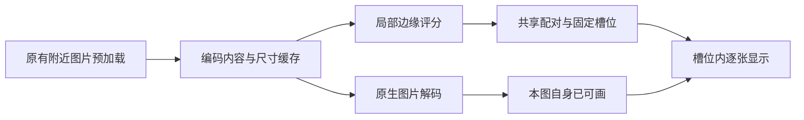

# 双页阅读：局部匹配、结构索引与固定槽位渐进呈现

本文件承接[共享双页设计](2026-10-01-shared-dual-page-rules-and-repair-design.md)。用户要求漫画显示后不能因后台加载而移动，并于2026-10-03明确否定“牺牲加载速度换取正确匹配”。本版取代提交 `dfe08325c8` 中保留全局强边竞争、等待整个依赖段后一次显示双图的方案。**这是尚未实施的重新设计，不是新版已经解决问题的报告。**

本版取消整段/整卷匹配作为显示前置，改为有界局部判定、持续维护结构索引、按已确定槽位逐张出图。保留真实跨页、宽图、手动边界、B1末页和B2开篇语义；同时明确：新的冲突算法不保证与旧全局贪心逐例相同，完全冷跳且没有结构信息的情况不能靠算法凭空判定。本版不能以隐藏这两项边界获得通过。

## 1 重新固定目标与性能边界

### 1.1 必须做到（PROJECT_POLICY）

- 同一内容版本、设置和视口下，已出现的漫画页不因下载、采样、匹配或解码回调换边、移动、改变裁边或重新fit。触摸拖动中已经露出的内容也算已显示。
- 当前图片能在确定位置画出时立即显示；不因为另一张图尚未解码、远处匹配未完成或预加载队列未清空而扣住它。
- 当前组的自动匹配只依赖常数数量的邻页，不随章节从20页增长到300页而扩大读取范围。
- 匹配利用原有附近预加载所得内容，不以“需要判定”为由让前台等待整段额外下载。
- 背景工作只能准备未显示内容。它不能把“先放中间，随后挪到右边”换成动画或延迟后重排。
- 真实宽图仍完整居中；RTL双页前页在右、后页在左。明确的开篇例外保留，不能为了快速出图把所有页都放右侧。
- 共享KMP决定匹配、导航与固定位置；平台只提供事实和原生呈现。

### 1.2 撤销上一版加上的两条限制

1. **不再保留旧全局强度优先求解作为唯一正确答案。** 它是启发式冲突选择，不是漫画作者提供的配对真值；持续等待远处候选也不能使它成为100%准确的识别器。
2. **不再要求两张漫画同时首次出现。** 固定槽位内可以分别从加载状态变为图片。用户反对的是已有内容移动及无法理解的空黑区域，并未要求把已就绪的一张也隐藏。

因此必须区分三种耗时：当前图片本身的下载/解码、当前槽位必要的结构信息、可选的自动匹配优化。第三类不得阻塞已经确定槽位的当前图；第二类若确实缺失，不能伪装成第三类已经解决，见第5节。

## 2 当前链路中需要修正的具体位置（SOURCE）

产品源码仍是正式70的 `84d98c7`，设计读取时HEAD为 `dfe08325c8`；后续文档提交没有改变产品。

| 已有入口 | 当前事实 | 本版方向 |
|---|---|---|
| [SharedSpreadMatching](../domain/src/commonMain/kotlin/mihon/domain/reader/SharedSpreadMatching.kt) | 全部候选按分数排序后依次占用页面 | 改为有界局部竞争，不做删除落选边后的递归补选 |
| [ReaderSpreadSamplesOwner](../domain/src/commonMain/kotlin/mihon/domain/reader/ReaderSpreadSamplesOwner.kt) | 同时保存正评分和不匹配结果，样本上限16页；默认按源序找未评分边 | 优先当前及附近缺失边；UNKNOWN、REJECTED、ACCEPTED、FAILED分开 |
| [SharedDualPageSession](../domain/src/commonMain/kotlin/mihon/domain/reader/SharedDualPageSession.kt) | 事实到达即重算units/layoutRevision | 候选更新与可见槽位发布分离，维护已确认前缀摘要 |
| [SharedDualPageRules](../domain/src/commonMain/kotlin/mihon/domain/reader/SharedDualPageRules.kt) | 当前伙伴唯一的certain不包含未来采样的影响；未决可输出FULL | 用局部决策状态判定安全位置；FULL不再是可见临时位置 |
| [ReaderScreenModel](../app-desktop/src/main/kotlin/mihon/desktop/ui/reader/ReaderScreenModel.kt) | units直接进入UI，部分邻页header依赖firstPresentedGeneration | 允许首帧前处理已预取内容；不让后台候选重建已显示槽位 |
| [Android adapter](../app/src/main/java/eu/kanade/tachiyomi/ui/reader/viewer/pager/DualPageViewerAdapter.kt) / [holder](../app/src/main/java/eu/kanade/tachiyomi/ui/reader/viewer/pager/DualPagerPageHolder.kt) | 更新事实后重建显示列表，图片加载期间更新呈现 | 可见slot保持原View和最终变换，准备与真实显示信号分离 |
| [ReaderRequestScheduler](../domain/src/commonMain/kotlin/mihon/domain/reader/scheduler/ReaderRequestScheduler.kt) | P0–P4、current+4、去重/取消已经存在 | 沿原队列准备附近图及紧邻评分，不新增整段请求 |

## 3 匹配从全局竞争改为有界局部决策

### 3.1 局部互选规则

沿用原50点边缘采样、方向归一、白/暗/低方差排除和色差门槛，先得到相邻边的评分。对于候选 `i / i+1`，只比较：

- 左竞争边 `i-1 / i`；
- 自身 `i / i+1`；
- 右竞争边 `i+1 / i+2`。

自身通过原有效性门槛，并且按“距离较小优先、同分较早页优先”的固定总序优于两侧所有有效竞争边时，成为自动跨页锚点。宽图、章界、开篇策略和已提交手动边界屏蔽相应边。一个候选最多需要四张邻图的相关事实与样本。

**不因竞争边本身落选而重新激活一个落选候选，也不反复剥离并补选。** 这样才能切断远处结果向前传递的链。相邻两个候选不可能同时获胜，因此无需再执行全局消冲突。

UNKNOWN/FAILED不等于明确不匹配；相关局部比较未完成时，锚点仍待定。局部已完成的结果对更远页完全独立，不依赖网络到达顺序。

### 3.2 从结构边界向前推进普通配对

自动锚点之外仍按源顺序做普通双页，不把没有自动匹配证据的漫画全部变成单页。共享前缀摘要至少保存：

- 下一张未归组的源页身份；
- 是否仍在开篇独占区；
- 前一单元是否宽图/双页及必要配对相位；
- 已确认局部锚点、用户边界及内容/规则版本。

从已确认起点A决定下一组时，只需要A附近的局部锚点和尺寸；例如是否应给B/C锚点让出A，需要查看B/C两侧竞争，最多涉及A前一张及A至A+3。已确认的前页事实复用，右侧落在现有current+4窗口内。具体共享实现复用原规则中的分类、边界和槽位职责，不能在两端各复制一套配对器。

顺读每步处理固定数量邻页，前缀摘要增量前进，不反复扫描已读前缀，更不等待后面的整卷。没有已确认起点时不能直接套用该结论；冷跳页单独处理。

### 3.3 正确性承诺不能偷换

新规则保留没有冲突的有效跨页，以及局部竞争中唯一胜出的跨页。但旧全局贪心可能在强边占用邻页后，继续接纳更远的次强边；新规则不会做这种递归补选。**候选集合和最终分组存在差异风险，不能宣称无损替换。**

例如连续竞争A/B、B/C、C/D，后到C/D只会影响邻近局部判定，不会沿整条链重新选择前面的已确定边。旧测试中“等强候选全局每隔一条补选”的期望必须作为明确语义变化审阅，不能仅更新黄金就宣布正确。

实施前须用真实图像和既有合法跨页夹具对照，单独统计：真实跨页保留、误拼、漏识别及普通双页分组。已确认合法案例退化时，本算法候选不通过。阈值识别的冲突结果不等于作者真值，不能承诺任何模糊图片都自动识别正确。

## 4 固定槽位后渐进显示，移除整组同步等待

### 4.1 锁定的是每张已经可画出的图片位置

一组可能仍在准备未显示的伙伴，但如果当前图在所有剩余合法局部结果中的位置和几何都相同，就可以先画出当前图。

例如已离开开篇区的RTL顺读起点A：
- 结果是[A,B]时，A在右侧；
- 结果是右侧孤页[A]时，A仍在相同右槽。

只有这两种结果确实覆盖当前全部合法可能，而且裁边/缩放等实际矩形相同时，才能提前显示A。随后B可以在固定左槽出现，也可以确认A为右侧孤页；A不移动、不重挂载、不重新fit。

不能泛化为“A永远先放右侧”。如果可能是左侧开篇孤页、居中孤页、宽图或前一双页的后页，就尚无安全槽位；不得以猜位置掩盖信息不足。B2第2页左侧与第20页允许居中/右侧继续是必验约束。

### 4.2 加载反馈与像素几何

- 两张图的槽位已确定时，各自在自己的槽内显示加载/错误反馈，哪张可画就显示哪张。
- 未加载槽显示明确的加载状态，不能只留无法解释的纯黑半屏；这不改变另一张图的尺寸。
- 显示前完成该图自身的有效方向、必要裁边及初始变换。高分辨率tiles之后可以细化，不能再次改变其内容矩形。
- 当前图使用独立于“伙伴是否加入”的稳定slot身份。添加左图不能改变右图key、重置缩放或释放右图lease。
- 保持当前可见frame的身份，语义上的伙伴确认通过共享事件附加；不能把后台units列表替换直接交给pager。
- 准备过程的真实首帧不再与“这个组的全部图片已完成”混为一谈。进度只计实际显示且符合原完成政策的页面，加载槽不记已读。

### 4.3 匹配工作与图片加载并行

匹配阶段不新增网络队列，不以首张已显示为启动条件。已存在的encoded内容可以在首帧前贡献尺寸和样本；采样与解码复用现有所有权及预算，优先级低于当前可画内容所需的工作。

正常顺读提前准备附近两组的布局；内存允许时预解码最近一组。当前图不能为了提前解码后两组而被挤出缓存。current+4之外不再为全局匹配启动额外整段下载，原16页/32MiB/15秒补齐额度也不作为前台“必须等完”的门槛。

## 5 结构索引解决已知位置的跳页；无索引冷跳仍有信息下界

### 5.1 轻量、可丢弃的结构索引

随着正常预加载到达，保存尺寸/有效方向、局部锚点和已确认配对前缀的摘要；不是整章Bitmap，也不是手动强制配对。优先复用现有源页表提供的可靠尺寸、现有encoded metadata及缓存身份。

允许在既有派生缓存中保存小型索引，避免关闭再打开后从头恢复；绑定有序页身份、实际内容版本、方向、手动记录revision及规则版本。旧字节被替换、记录版本改变或缓存身份无法核验时，相应摘要失效，不能只凭章节ID和页数沿用。此为缓存元数据扩展，不修改用户进度或配对数据库格式。

索引在后台增量生成，不要求先扫描300页再开放阅读。源本身提供完整可靠布局元数据时可直接建立索引；源没有这些数据时，不能假称一定能免费取得。

当前公共[Page模型](../source-api/src/commonMain/kotlin/eu/kanade/tachiyomi/source/model/Page.kt)只有index、url、imageUrl及加载状态等字段，没有通用width/height输入。因此“扩展页表已经带全卷尺寸”不能作为本仓库现有能力，来源支持必须逐项核实；缓存索引也不能在第一次全冷访问之前凭空存在。

### 5.2 明确反例：局部匹配并未消除全部冷跳依赖

同样的目标第6页，以及完全相同的第5～8页图片，可能有两种结构：

| 第2页的未知事实 | 从头顺读的正确分组 | 第6页的位置 |
|---|---|---|
| 第2页纵向，其余也纵向 | [1] [2,3] [4,5] [6,7] [8] | 右侧 |
| 第2页宽图，其余纵向 | [1] [2] [3,4] [5,6] [7,8] | 左侧 |

只读取第5～8页，任何匹配算法都不能区分两种情况；自动匹配关闭也一样。若同时要求“首次冷跳立即出图、与从头顺读严格一致、后续不能移动”，必须在跳转前已经有能区分这两种情况的结构信息。

本版不使用“缺索引时从目标页重新配对”“临时居中永久锁住”“拿页码奇偶猜”填补缺口：它们会改变双页布局。也不重新把长时间等待写成默认合格结果。**对于完全没有结构信息的冷跳，这三个绝对要求尚不能同时满足；这是必须在实施前明确的产品前提，不是已解决的性能优化。**

实际适用范围应通过B1/B2及长卷来源取证：源页表是否给出尺寸、原有预取能否及时生成目标附近检查点、打开历史缓存时能否复用。若均没有，不能对该来源承诺任意冷跳零额外等待。需要的是真实输入契约，不能靠加一个缓存类就声称已获得数据。

## 6 300页与实际用户路径

| 场景 | 本版行为/可保证范围 |
|---|---|
| 从第1页打开300页卷 | 第1页独占，自己的内容可画即显示；不等第300页，也不等完整候选集合 |
| 从头连续阅读 | 依原附近预加载增量处理，匹配依赖常数邻页；已确定槽位逐张显示 |
| current已显示，远处评分晚到 | 不能触发当前画面的任何位移；远处不会通过全局竞争回传到当前 |
| 当前双页一张先完成 | 先在最终槽位显示，另一槽给出明确加载反馈；无需整组同步等待 |
| 回翻/已有有效索引的跳页 | 直接复用确定分组，只加载实际要看的图 |
| 读者快于预加载、开篇槽位尚有多种可能 | 不能承诺槽位未确定也正确出图；必须测量这类等待，不能归入“正常所以通过” |
| 首次跳入完全无结构信息的中段 | 第5.2节的前提仍未满足；不能宣称无等待且严格等价顺读 |
| 网络错误或图像解码失败 | 在对应固定槽内沿原重试；错误不代表图片单独成页，不触发全卷补齐 |

默认不新增“等匹配完成”按钮或额外用户操作。用户原有手动配对调整继续存在，但不能把大卷日常正确性转嫁给用户逐页手调。

## 7 与旧方案不同的验收

以下既是实现门槛，也决定新规则能否被采用；当前没有运行产品测试。

| ID | 验收项 |
|---|---|
| V01 | 300页输入仅提供开头原预取窗口，故意阻塞其余页；前台不得因全局候选未齐被阻塞 |
| V02 | 对某候选四页范围外任意改变评分，局部候选选择不变；相邻候选不能同时胜出 |
| V03 | 完整图片下对照真实已确认跨页和B1/B2，不能仅以新算法自洽替代原正确案例 |
| V04 | 第一张图完成、第二张延后：第一张在最终位置按原加载速度显示，另一槽明确反馈 |
| V05 | 每帧记录实际View/Compose内容矩形、slot身份、裁边与变换；后台完成顺序打乱后零被动位移 |
| V06 | 从首帧前即执行原有预取事实与采样；故意不发送firstPresented/settled仍能前进，排除死锁 |
| V07 | 相同内容和设置、不同网络到达顺序，已完整确定的布局一致；不允许靠截止时碰巧已有的候选固定不同结果 |
| V08 | 原生产HTTP、缓存、下载、局部下载、本地源仍使用同一队列，匹配不添加前台必等的远处请求 |
| V09 | 已有索引冷重启、内容替换、页表重排和手动revision变化；旧索引不会污染新内容 |
| V10 | 对第5.2节无索引反例分别执行两种输入，不能猜同一个槽位并把其中一个错误记为性能通过 |
| V11 | 拖动露页、连续按键、返回、设置/视口变化及生命周期：旧准备不能移动/覆盖当前图或伪记进度 |

性能必须与同一正式输入、相同缓存状态和相同网络响应次序的原读取链对照，分别记录第一张漫画首帧、第二槽填充、可操作时间、HTTP数量/字节和解码资源。计时到spinner出现没有意义。不能只给平均值掩盖冷跳/快速翻页卡住，也不能先显示位置错误的漫画来改善首帧数字。

## 8 设计推演结果与下一步边界

2026-10-03仅执行一次独立数学推演，不是产品测试：对6条相邻边的4096种完整评分赋值验证了局部互选不重叠、范围外分数不影响当前边；另对299条边确认尾边改变不影响前方非相邻边。该推演不证明真实漫画识别精度，也不证明平台首帧无位移。

同时保留第5.2节的结构反例，避免将“匹配已经局部化”误写为“任意跳页也不需要前方信息”。

当前可作为实施候选的是：局部匹配规则、已知结构上的增量前缀、固定槽位渐进显示、现有预取中的事实提前发布。**旧全局算法差异的真实跨页对照、完全冷跳的可靠结构信息来源和实际性能仍是未关闭前提。** 不把这个文档提交当成所有用户约束均已解决，不恢复旧版整卷等待方案，也不在前提未明确时直接展开大规模实现和全量测试。
