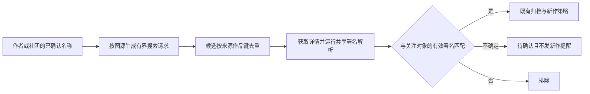

# 图源署名识别与作者追踪设计

日期：2026-10-12。代码基线：`9699618bdc9f9fcc0c07eb8c8c58c9715bac2f81`，开始调研时工作区干净。状态：调研与方案，尚未实施，也未改变当前作者归属或关注。

本方案解决图源把上传者放进作者字段、真正署名位于标题，以及个人名与社团名混用造成的漏收录和误追踪。建议在现有作者体系中加入共享的署名解析与证据判断，让作品详情、书架索引、作者归档和新作检查使用同一个结果。已适配来源自动识别，歧义允许用户纠正，原始图源字段始终保留。

作者页继续承担追踪入口。个人与创作社团都可关注；同一人的不同名字可以作为别名，社团与成员的关联不能自动变成同一身份。搜索命中只提供候选，作品的有效署名才决定是否收录和提醒。

## 调研结论与证据边界

### 用户样本与名字关系

这里只记录与署名有关的文本，不复制作品封面或正文。

| 样本 | 观察 | 目标处理 |
|---|---|---|
| 图一 | 标题含 `[ホロナミンZ (ホロナミン)]`，详情署名显示“飞鸟”，来源显示绅士漫画 | 按已核验来源规则提取两个署名；`ホロナミンZ` 保留为社团署名，`ホロナミン` 为个人署名候选。“飞鸟”作为该来源的上传者信息，不参与作者归属。两种署名均可进入相应作者档案并关注 |
| 图二 | 标题含 `[micro page (Kuromotokun)]`，字段显示 `kuromotokun`，原来源未安装 | 标题可离线识别出社团与个人候选；不把这个样本的字段也判成上传者。大小写不同不自动合并；确认别名后统一追踪 |

图一的角色划分来自标题结构和本方案约定，未独立证明该社团的完整成员关系。图二的旧 sourceId 不能证明它属于哪一种现存扩展；用户提供的 nHentai 系列、禁漫天堂、绅士漫画、E-Hentai 是需要覆盖的类似来源。

关于用户要求核实的名字：

- [AniList 的 Kuromotokun 条目](https://anilist.co/staff/201126/Kuromotokun)确实把 `micro page`、`みくろぺえじ` 列为其他名称，原文名为 `黒本君`。页面抓取返回 403 后，经代理读取其官方 GraphQL API 的 `Staff(id: 201126).name` 得到这些字段；没有读取作品内容。
- [`@kuromotokun` 的公开个人简介](https://en.twitcasting.tv/kuromotokun)自述是“サークルみくろぺえじの代表です”，即みくろぺえじ社团的代表；[Bangumi 的人物条目](https://bgm.tv/person/94626)也将みくろぺえじ单列为社团。
- 因此，“这些名字有关联”有证据，“所有名字在任何场景下都指同一个自然人”没有被上述证据证明。资料库为检索而登记的其他名称，可能混合个人名和社团品牌。

本例建议分别管理 `Kuromotokun / kuromotokun / 黒本君` 的个人名称，以及 `micro page / みくろぺえじ` 的社团名称；跨文字和大小写关联须经用户确认，不能把这份调研变成全局自动别名字典。个人页可以提示本作品的相关社团并进入其档案；用户要追踪品牌发行时直接关注社团。原有主动“添加别名”仍保留，但社团不能成为系统自动推荐的“同一人”合并项。

### 来源字段不是作者身份保证

[Mihon 上游 SManga](https://github.com/mihonapp/mihon/blob/9c3cc1ca5f0011c4b3638d8f5272080d219bfb2e/source-api/src/main/kotlin/eu/kanade/tachiyomi/source/model/SManga.kt#L16)把 author、artist 定义为可空字符串；[CatalogueSource](https://github.com/mihonapp/mihon/blob/9c3cc1ca5f0011c4b3638d8f5272080d219bfb2e/source-api/src/main/kotlin/eu/kanade/tachiyomi/source/CatalogueSource.kt#L28)提供关键词与过滤器搜索，没有通用的“列出作者全部作品”保证。

[Wnacg 扩展的固定版本源码](https://github.com/keiyoushi/extensions-source/blob/bce2d76db6a026a6468fcddbb079e57570fb8a77/src/zh/wnacg/src/eu/kanade/tachiyomi/extension/zh/wnacg/WNACG.kt#L221)把同一个 `div.uwuinfo p` 文本同时赋给 artist 和 author；非空搜索词走普通 `q` 参数。[该扩展仓库 issue 11436](https://github.com/keiyoushi/extensions-source/issues/11436)明确报告这两个字段实际显示上传者。

这两项证据分别证明“代码映射到同一字段”和“已有相同问题报告”；本轮没有运行用户安装的扩展或访问站点详情，不把公开源码当作用户版本的现场抓包。实施时仍须核对实际 package、sourceId、版本及可复现响应。

其他项目也将角色分开处理：[gallery-dl 的 Danbooru extractor](https://github.com/mikf/gallery-dl/blob/33e7b19da50ae387734c5e79990bf5bf1bf97681/gallery_dl/extractor/danbooru.py#L61)把 uploader 与 artist tags 分开；[MangaDex extractor](https://github.com/mikf/gallery-dl/blob/f77c330d83018b25924d219f96aaf4f064bd3eaf/gallery_dl/extractor/mangadex.py#L73)里的 group 是汉化组。不能全局把名为 group 的字段解释成创作社团。

[ComicInfo 规范](https://anansi-project.github.io/docs/comicinfo/documentation)、[Komga](https://komga.org/docs/guides/scan-analysis-refresh/#book-metadata)与[Kavita](https://wiki.kavitareader.com/guides/metadata/comics/)分别表达编剧、绘者、译者等角色。它们支持本方案的角色区分，但不提供可直接套用的跨站标题身份识别规则。

### 用户指定图源的适配矩阵

以下均为公开源码事实与拟采用策略，尚未进行在线业务验收。固定提交对应所引用文件的核验版本；同一品牌的不同扩展不共享未经验证的能力声明。

| 图源 | 公开代码中确认的事实 | 拟采用策略与未决边界 |
|---|---|---|
| nHentai.net | [SY 的 NHentai 包装器](https://github.com/jobobby04/TachiyomiSY/blob/96384efda159ad6f91a7b4b5058125d8e0327546/app/src/main/java/eu/kanade/tachiyomi/source/online/all/NHentai.kt#L36)保留 tags 的 type/name，另存 scanlator；网络搜索委派给底层扩展 | 能取得实际 artist/group 命名空间时优先使用；本轮没有核实用户所装独立扩展，不预设其映射、筛选或 memo 输出 |
| nHentai.com(unoriginal) | [NHentaiCom](https://github.com/keiyoushi/extensions-source/blob/05827c1c57094355b6e87bce80a42559a034d1f7/src/all/nhentaicom/src/eu/kanade/tachiyomi/extension/all/nhentaicom/NHentaiCom.kt#L7)继承 HentaiHand；[DTO](https://github.com/keiyoushi/extensions-source/blob/4eec7934feedee6f02c887b33b9d6939ee69ed0f/lib-multisrc/hentaihand/src/eu/kanade/tachiyomi/multisrc/hentaihand/Dto.kt#L113)分别读取 artists/authors/groups，author 缺失时回退 artist；groups 放在 description。[搜索](https://github.com/keiyoushi/extensions-source/blob/4eec7934feedee6f02c887b33b9d6939ee69ed0f/lib-multisrc/hentaihand/src/eu/kanade/tachiyomi/multisrc/hentaihand/HentaiHand.kt#L84)支持 Artists/Groups 名称查 ID | 优先复用明确类型的过滤器。LookupFilter 无精确匹配可能采用首项；普通 query 优先匹配 tags，再 artists、characters。任何返回都须详情复核；不能将首条 ID 写成永久人物映射 |
| NHentai.xxx | [NHentaiXXX](https://github.com/keiyoushi/extensions-source/blob/51e7081c7b588c634b7678195accf52225d3b6b5/src/all/nhentaixxx/src/eu/kanade/tachiyomi/extension/all/nhentaixxx/NHentaiXXX.kt#L12)继承 GalleryAdults；[详情实现](https://github.com/keiyoushi/extensions-source/blob/9de6a8eb88cfece4c3d0715f62451176c8e48c96/lib-multisrc/galleryadults/src/eu/kanade/tachiyomi/multisrc/galleryadults/GalleryAdults.kt#L489)把 Artists 写入 author，空时回退 Groups。普通搜索为 key；共享高级查询开关默认关闭，子类未开启 | author 是混合角色字段，不能恒定当个人。能取得 Artists/Groups 原始语义才直接判断，否则借标题判定或进入候选；不宣称已有可用高级画师搜索 |
| 禁漫天堂 | [Jinmantiantang](https://github.com/keiyoushi/extensions-source/blob/e5dc53aa035740356a33ba08f16ea3c7a268ff2a/src/zh/jinmantiantang/src/eu/kanade/tachiyomi/extension/zh/jinmantiantang/Jinmantiantang.kt#L325)按第 4 个 tag-block 取 author；[TypeFilter](https://github.com/keiyoushi/extensions-source/blob/54e6f71baa0cd13f4eec098c470377e74a19fd4d/src/zh/jinmantiantang/src/eu/kanade/tachiyomi/extension/zh/jinmantiantang/Filters.kt#L111)提供作者 main_tag=2 | 复用作者筛选并核对响应。页面固定位置会漂移；现有查询中加号、空格和连字符有特殊语义，带连字符姓名须验证不会进入排除搜索路径 |
| 绅士漫画 | 上述 Wnacg 代码将同一用户字段放入 author/artist；非空 q 为普通关键词 | 适配后排除上传者字段作为创作者证据，以已核验标题语法识别；不用“两个字段一致”增强可信度 |
| E-Hentai | [SY 的 EHentai 实现](https://github.com/jobobby04/TachiyomiSY/blob/cad7d0a7077d518fe35cdb53693ae88e51822d97/app/src/main/java/eu/kanade/tachiyomi/source/online/all/EHentai.kt#L736)单独读取 uploader，保留标签 namespace；搜索构造 namespace、引号及 `$` 边界 | 优先使用实际扩展支持的 artist/group 查询及详情标签。SY 是可参考实现，不是用户独立扩展已兼容的证据；标签仍可能错误，详情仍需复核 |

这些差异意味着不能只修 Wnacg，也不能为全部 nHentai 品牌套用同一规则。首批适配验收应覆盖“上传者字段”“画师缺失回退社团”“结构化人物/社团”“只有标题”四类；未取得独立扩展证据的来源保持候选模式，直到完成该适配项的生产链路验证。

## 当前产品链路与缺口

以下是 SOURCE 事实，来源于本次代码阅读，不表示运行验收通过。

| 环节 | 当前实现 | 本次需要补足 |
|---|---|---|
| 署名提取 | [ExtractCreatorsFromManga](../domain/src/commonMain/kotlin/tachiyomi/domain/creator/interactor/ExtractCreatorsFromManga.kt)仅读取 author、artist | 标题、结构化标签、图源字段真实含义与人工裁决 |
| 库索引 | [CreatorRepositoryImpl](../data/src/commonMain/kotlin/tachiyomi/data/creator/CreatorRepositoryImpl.kt)的 `reconcileLibraryMangaBatch` 将字段名直接归根并写入 AUTOMATIC、VERIFIED | 只有可接受的创作者署名进入有效关系；上传者排除 |
| 姓名身份 | 全局精确文本唯一，跨源同名归根；不同名由用户添加别名 | 保持此政策；来源与角色约束证据，不改成按图源分裂人物 |
| 搜索适配 | [CatalogueCreatorDiscoverySourceAdapter](../domain/src/commonMain/kotlin/tachiyomi/domain/creator/service/CatalogueCreatorDiscoverySourceAdapter.kt)复用 AuthorSearchSource 或普通搜索，并取详情 | 按来源区分 artist、group 与标题查询；结构化详情证据不再丢失 |
| 发现复核 | [CreatorIdentityEvidenceEvaluator](../domain/src/commonMain/kotlin/tachiyomi/domain/creator/service/CreatorDiscoveryPlanning.kt)只比较详情 author、artist 与已登记名称 | 同一共享解析器解释详情；不能以标题任意位置含名字替代复核 |
| 查询预算 | 默认最多四个归一化查询名、每名三页、每源八页；验证使用完整别名集合 | 查询名与身份名分离；新增社团检索词不能挤掉个人名，也不能增大总预算 |
| 用户纠错 | 已有根身份合并、作品同一性校正、展示分组排除 | 新增“这部作品不属于此署名”的持久裁决；不能用分开显示冒充归属纠正 |
| 备份与同步 | 作者备份含身份、关系及关注；关注同步基于 portable key | 新署名证据与纠错需备份；不能宣称现有关注同步会传输这些新事实 |

两个接线细节必须纳入实施：Android [MangaScreen](../app/src/main/java/eu/kanade/tachiyomi/ui/manga/MangaScreen.kt)当前只用 author、artist 作为 mentions 的 `remember` key；增加标题识别后，标题和规则变化必须触发重算。[MangaMetadataWriter](../data/src/commonMain/kotlin/tachiyomi/data/manga/MangaMetadataWriter.kt)已把 title 纳入索引触发，但尚未包括 memo 变化。

## 设计决策

本节及后续方案均为 PROJECT_POLICY，尚未实施。本轮不制作 HTML 原型，也没有 HTML_ADAPTER 验收结果。

### 一份原始信息和一套有效署名

保留 `Manga` 和 source work 的原 title、author、artist、URL。新增有效署名投影，供详情、入库、发现和作者页共同使用；不覆盖原字段，也不修改自然键。空 URL 的 fallback key 目前由原标题和署名生成，覆盖原字段会影响去重与恢复。

共享解析服务放在现有 domain creator 链路，来源能力适配在既有 source port 和平台 source resolver 边界。它接收本地作品或详情快照、来源语义策略以及人工裁决，输出有效署名、待确认候选和原始来源说明。Android/Desktop 使用同一实现及共享契约。

证据至少需要表达：

| 内容 | 用途 |
|---|---|
| source work 自然键、来源 package/sourceId/version、观察时间 | 区分哪一个版本提供的哪条事实 |
| 原字段、原文、标题中的字符区间 | 能向用户展示“依据哪段文字”，不靠无法解释的分数 |
| 署名文本、creditKind、既有 CreatorRole | 区分个人/创作社团/上传者/汉化组/未知，以及真正可证实的作者/画师职能 |
| parserVersion、sourcePolicyVersion、输入指纹 | 重算和规则升级幂等，知道旧结论是否需要复核 |
| 证据来源及决策 | 区分结构化详情、标题规则、普通字段、用户确认或排除 |
| creator root/portable key 与裁决版本 | 复用现有身份、关注和事务；防止陈旧窗口覆盖新决定 |

优先扩展现有 `CreatorMentionEvidence` 与作者归档的附属证据存储，不另建作者身份库。`creditKind` 是新增的明确语义，允许一条作品关系有多份不同角色证据。首版不直接给 `CreatorRole` 加 `CIRCLE`：圈署名的旧兼容角色为 UNKNOWN，CIRCLE 的真实含义完整存于新增证据，所有新增 UI、查询与判断必须消费它。未知职能的个人也不能被标题括号武断标成 BOTH。

这是分开“署名主体种类”和“创作职能”，不是丢弃社团角色。当前 SQL 对角色有 CHECK，角色合并逻辑把两个已知角色折为 BOTH；直接扩 enum 会改变 SQL、备份和现有聚合语义。新增证据必须随备份版本保存，缺失时不得凭 UNKNOWN 反推出社团。

本仓库已有 `SManga.memo`，但发现快照没有保留它。经适配器明确约定的作者/社团标签可以从 memo 投影成上述类型化证据；不能假定所有旧扩展已经提供这些信息，也不把整个任意 memo 当作受信任署名。

新增结构化能力优先用向后兼容的可选 source 能力或约定的 memo 字段，由扩展提供原本已经解析的数据。宿主适配仍通过安装的 production source、既有 HTTP 客户端和 SourceMangaSearchService；不另写直连站点客户端绕开代理、登录或扩展限流。需要读取旧扩展 FilterList 时，映射必须绑定已核验版本和结构，不能靠翻译后的显示名称猜字段；能力不可用时降级普通搜索并明确覆盖限制。

### 按图源解释字段

内置小规模、可测试的来源语义策略，以稳定 sourceId、扩展身份和已验证兼容版本为匹配依据；显示名称、站点中文名和相似域名不能作为唯一依据。镜像源逐一核对，未安装的旧图源不猜测身份。

- 已确认的上传者字段：从创作者证据中排除，原值在来源信息中标为上传者。两个字段来自同一 DOM 节点只算一份证据。
- 有角色标签的来源：优先保留 artist、group 等命名空间。只有该来源的 group 定义是创作社团时才按圈署名处理。
- 普通漫画源：继续使用已有 author/artist 行为；标题补充不能无条件覆盖有效字段。两个同职能证据明确矛盾时保留冲突，不能“标题永远优先”。
- 未适配源、来源失效、标题规则不确定：可以离线提出候选；单凭括号不自动改变现有作者关系。用户确认具体作品后可进入作者页，但没有可用源时不能检查该来源新作。

来源策略版本变化或兼容性无法确认时，保留旧缓存与人工决定，新推断进入候选。网络失败不等于原署名被否定，不能批量清空已有关系。

### 标题规则与决策边界

为经过核验的来源支持有限语法：`可选活动标记 + [社团 (一个或多个个人)] + 正题 + 可选语言/汉化等后缀`。使用有界、括号配对的扫描器；对解析视图处理全角括号和排版空白，并保留到原文的映射。这个处理只服务语法，不能偷偷更改全局精确姓名政策。

| 情形 | 处理 |
|---|---|
| 已适配源，完整前置 `[社团 (个人)]`，无冲突 | 生成个人与圈署名，按来源规则接受；显示简短“标题署名”依据，可纠正 |
| 仅 `[名字]` | 只有该来源已证实的语法或结构化标签能确定角色时自动接受，否则待确认 |
| 合作作者、名字包含 `& / +` | 仅按该来源语法拆分，尊重嵌套边界；不把现有通用 splitNames 原样用于所有标题 |
| 活动名、语言、原作名、汉化组或扫描者 | 单独解释或忽略，不产生作者根；后缀排除词只是辅助，不能代替位置与语法验证 |
| 正题中碰巧出现姓名、模糊相似、同上传者 | 不作为作者证据 |
| 多种解析都成立、括号损坏、明确矛盾、截断列表标题 | 待确认；需要详情时获取完整详情，失败不升级证据 |
| 相同名字被两个角色提及 | 同一现有 root，保留多份角色证据，不新建同名人物、不折成错误的 BOTH |

自动接受表示“符合已测试来源的署名规则”，不表示平台认证真实作者。不使用任意置信分数跨过缺失证据；首版不需要大模型、封面 OCR 或联网知识图谱。

人工排除优先于再次自动解析；人工指定只改变选定来源作品的署名关系。身份别名与作品归属是不同命令，不能通过合并上传者和真实作者来完成纠错。

### 追踪必须覆盖召回与复核

复用现有 discovery service、SourceMangaSearchService、来源过滤、语言策略、调度、退避、检查点、baseline 和通知 outbox。

个人名及其已确认别名优先使用来源支持的 artist 查询；圈署名使用来源支持的 group 查询；普通关键词能力则使用名称搜索。社团词可以辅助召回个人的作品，但结果必须有个人有效署名才能归入个人页。仅写社团而未写个人的作品，可以归入已关注的社团页，不能推断为某位成员创作。

搜索计划区分“用于发请求的词”和“用于身份验证的已确认名称”。大小写/全半角是否能合并请求取决于该来源检索语义，不能全局假定；验证始终使用完整已确认名称集合。别名、圈名及查询策略共享原有页数、并发、时限预算，不额外各开一组预算。

有界计划需要可恢复的查询覆盖状态：保存本源本策略尚未检查的名称/页游标，避免每次固定前四个名称造成永久饥饿；数据源不支持稳定续页时，轮换查询名并说明覆盖有限。查询身份至少包含 sourceId、查询模式、名称和策略版本，不复用另一种查询的完成检查点。触及预算显示“部分检查完成”，不得显示“没有新作”或“全部作品已检查”。

同一来源作品只补取一次详情；同一次检查中个人与社团的查询复用结果。已确认的同作品关系和现有展示聚合继续去重，不能因为同一个作者或相似标题就强并不同作品。关注社团和个人时保留各自归属，总提醒继续按现有作品层规则去重。

新增别名、来源策略升级、历史重算或恢复产生的旧作品先建立相应覆盖范围的静默基线，不作为刚发表或刚发现的新作群发。已有效的其他查询基线不应整体重置。若既有调度没有足够的范围标识，扩展当前检查点，不建立第二套调度器。

## 用户界面契约

沿用 [Desktop UI 规范](design/mihon-desktop-ui/README.md)、现有作者页布局、Voyager 导航、Injekt、Material 对话框和共享字符串。以下属于新增的 PROJECT_POLICY；正式实现前按这些契约写红测，不以浏览器原型代替双端原生验收。

相对既有“漫画详情显示原始署名”的政策，本方案拟增加明确例外：已核验来源或用户确认后的有效署名作为作者入口，原始字段完整保留在来源信息中。实施时同步更新原作者设计文档；本次提案不把旧行为描述为已改变。

| 页面与入口 | 状态与操作 | 反馈、返回和副作用 |
|---|---|---|
| 作品详情的署名区 | 有效个人/社团各自显示名称与角色，点击进入既有作者详情；自动标题署名显示简短依据，详情菜单有“更正署名” | 未改写标题；来源原始字段可在来源信息查看；标题更新即时刷新署名 |
| 无法确定的署名 | “发现标题署名”入口进入候选确认，可选个人或社团，支持查找已有作者；无匹配时可按输入建立名称 | 候选不混入确认作品数，不自动关注；保存后明确“已更新这部作品的署名” |
| 更正署名对话框 | 展示本作品、原字段和识别片段；支持确认、排除、指定已有作者或新名称、恢复自动识别 | 只作用于本来源版本；固定对象及版本，陈旧/失败保留草稿；取消、Escape、遮罩不写入 |
| 作者详情 | 继续使用作品列表、来源筛选、关注、检查新作和添加别名；作品菜单提供“署名有误” | 待确认结果通过“待确认 N 项”紧凑入口查看；零项隐藏，不新增常驻技术管理面板 |
| 个人与社团的关联 | 显示本作品共同署名的相关入口，可分别进入并关注 | 不宣称完整社团成员关系，不因关注个人自动关注社团；关注社团说明收录该社团署名作品 |
| 名称别名 | 复用已有选择已收录名称、添加、切换主名流程 | 大小写与日文名称确认一次后复用；输入新名字属于署名纠正，不恢复已取消的自由改主名界面 |
| 旧上传者关注 | 作者页显示“部分作品的署名需要重新确认”，进入有界整理结果 | 用户可选择真实作者并关注，原关注保留或取消由用户决定；不自动把旧关注复制给全部作者 |
| 来源不可用或检查不完整 | 仍可浏览本地已收录作品，显示源不可用、需登录、限流或部分完成 | 重试沿既有链路，不把失败计作空结果，不擅自换到同名镜像源 |

更正对话框明确本作品与影响范围，提交按钮完成一次确认；不额外增加逐步预览。批量整理必须先展示确定的对象与影响数，保留人工关系；取消不写入。排除提供撤销或“恢复自动识别”，不得删除漫画、章节、下载或阅读进度。

Desktop 弹层焦点进入、Tab 循环、Escape 只关闭一层、关闭返回触发器；Android 返回先关闭弹层。作者详情返回恢复列表滚动、来源筛选和搜索。窄窗口、字体放大、深浅主题可达性沿用现有组件；技术来源 ID、策略版本、置信分数只进诊断，不堆在普通页面。

## 数据修复与兼容

自动修复只处理匹配已核验来源策略、且证据足够的 AUTOMATIC/MIGRATION 关系。保留 USER/RESTORE 关系，冲突提示复核；历史 RESTORE 的来源若无法分清人工与自动，不擅自剥离。人工排除必须持久化，刷新、重新入库和重算不得复活错误关系。

历史修复须包含收藏漫画和未收藏的已发现 source works，使用现有后台工作与小批事务、检查点和幂等键。不能依赖只扫书架的回填，也不能同步加载整个归档。保存重算前后关系差异及证据版本，失败回滚当前批，重试不重复增加计数。

不重命名或合并旧上传者 root，不批量转移它的 alias、portable key 或关注。现有 split 会复制 watch，不直接复用它作为上传者修复器。只调整具体作品归属；旧根可以保留历史解释和关注，直到用户决定。新的有效作者关系不自动创建关注。

事务内同步处理作品计数、代表作资格、未读发现和待发 outbox；只撤销已失效归属对应的派生项，保留其他有效作者的提醒。已发出的系统通知不能收回，点击后应反映当前有效归属。历史修复不产生新作通知，不把 firstSeenAt 或出版日期改成修复时间。

备份新增证据、人工接受/排除和来源策略版本，提升当前作者归档 section 版本；旧版备份仍能恢复并标记为历史证据。新格式应由不支持它的旧客户端明确拒绝，不能把社团或排除记录静默丢掉。恢复与重放均通过相同关系优先级及幂等规则，保留修复前可用备份。

本期继续沿用现有关注同步；新署名证据、纠错和关联提示通过备份保存，尚不承诺实时跨设备传播。共享代码保证双端规则一致，不代表设备已经交换了人工数据。UI 在需要时明确“仅在此设备更正”。如后续要求纠错实时同步，须独立定义因果顺序、删除/撤销、旧客户端兼容与冲突政策，不能借 FOLLOWING 事件偷塞新协议。

## 实施批次与固定验收

这是供后续实施的分批建议，不是已启动的 roadmap，也未修改现有 roadmap 或 parity 状态。每批实现、相关测试、必要文档和状态合为一个功能提交；首个实施任务簇交实施子代理，主代理负责接口与独立验收。数据迁移及共享判断边界需未实施者独立审查。每批先确认正确红灯，再最小实现与同范围复验。

| 批次 | 范围与依赖 | 最小充分验收 | 不随本批扩张的范围 |
|---|---|---|---|
| A 共享署名链路 | 证据类型及持久化、来源策略、标题解析和人工裁决；接入详情、索引、发现共同入口；同时完成备份版本和恢复兼容，依赖本设计角色决策 | 扩展 ExtractCreatorsFromMangaTest、CreatorLibraryIndexRepositoryTest、MangaRepositoryCreatorIndexIntegrationTest 及双端共享 CreatorDiscoveryMetadataContract；覆盖原字段未改、上传者不入库、标题命中/冲突、旧库升级、新旧备份及负向裁决往返；共享判断和存储须在下游使用前独立审查 | 不建立外部身份服务，不先单独交付一个未接入生产的 parser，不自动启动全历史重算 |
| B 来源搜索与追踪 | 在 A 上覆盖上述来源矩阵、查询模式、alias/策略预算与覆盖状态、详情复核、待确认结果 | 真实 HTTP adapter + MockWebServer 的成功、空/缺失、403/429/500、畸形响应；与真实 repo、baseline/outbox 连通；个人/圈重复召回不重复提醒 | 不抓全站，不提高默认并发和请求总额，不把镜像当同一源 |
| C 双端操作闭环 | 在 A、B 上实现署名入口、更正、候选确认、个人/社团关注、失败与部分完成反馈 | AndroidAuthorArchiveWiringTest、AuthorsProductionWiringTest 及真实 Compose 事件；Screen 实例化与导航、DI；标题和 memo 更新重组；两端一次本地夹具用户路径 | 不重做作者页布局，不建立独立管理中心 |
| D 历史修复与恢复 | 在 A–C 稳定后启用有界重算、旧上传者关注处理和整理反馈；复用 A 的持久化及备份 | 未收藏历史条目、人工保护、崩溃恢复、重复重放、修复前后备份恢复、关注不扩散、通知不误发；独立审查历史修复边界后再启用批处理 | 不同步新的人工事实，不迁移用户真实关注而不告知 |

各批只运行与改动有关的 focused 单元、集成、wiring 和格式检查，经 Gradle 协调器串行执行。测试命令按实际测试类和平台 task 固定，不以未限定 `--tests` 的完整模块任务代替。普通日常交付不要求全量、正式版本递增或完整发布矩阵；需要体验包时沿用 preview，并报告真实产物和未验收平台边界。

关键回归矩阵必须保留如下负例，不能只验证两个正样本：

| 场景 | 必须成立 |
|---|---|
| `author=上传者甲`，标题 `[星舟社 (青岚)] 示例作品`，已适配来源 | 作品归青岚和星舟社各自的有效署名；不归上传者甲 |
| 同一上传者上传另一位作者作品 | 不混进青岚页，不给青岚发提醒 |
| 同社团但个人署名不同 | 可进入圈页，不能进入原个人页 |
| 个人在另一个社团发表 | 个人有效署名命中时仍被追踪，不限定旧社团 |
| 只有社团署名 | 只证实社团归属；个人待确认，不静默丢失到无入口状态 |
| `Kuromotokun`、`kuromotokun`、`黒本君` | 未确认前遵守原精确名规则；确认后同根追踪，完整别名复核不受请求预算截断 |
| `[汉化组]` 前缀、活动标记、语言后缀、原作括号、正文碰巧含姓名 | 不因括号或子串命中产生作者 |
| 未适配或失效来源，仅有本地标题 | 候选可确认并持久保存，联网检查诚实显示不可用 |
| 详情与搜索卡片矛盾，或搜索返回“匹配作者”声明 | 详情经过来源语义解释后的有效证据决定归属，搜索声明不能越权 |
| 用户排除后刷新、备份恢复、重复入库 | 关系不复活；恢复自动识别需用户明确动作 |
| 来源策略升级与旧数据重算 | 原文、source key、收藏、阅读进度、日期不变，旧作不产生通知 |
| 第五个别名、大小写敏感源、页数上限、取消、鉴权失败 | 没检查的范围不能被标为完成；后续能公平继续或明确限制 |
| nHentai.com 同名 tag/artist 竞争或姓名查找回退第一项 | 错对象不能通过详情署名验证，也不缓存为已确认作者 ID |
| NHentai.xxx 无 Artists 但有 Groups | 进入圈署名或待确认，不能冒充个人署名 |
| 禁漫天堂带连字符、空格或加号的姓名 | 请求仍表达目标作者搜索，不意外变为排除其他词的搜索 |

验收使用上述合成文本与脱敏 HTTP 夹具，不需要抓取用户作品图片或读取个人书库。最终用户路径是：作品详情显示正确署名 → 点击进入对应作者/社团页 → 关注 → 检查新作 → 真实署名匹配的作品进入列表并按基线规则提醒；错误候选可以排除，重试与恢复后仍有效。

## 取舍与交付边界

仅修扩展字段能改善一个入口，不能处理旧数据、失效源、别名与其他扩展差异；仅改显示文本不能修正作者页和后台追踪；全局正则取首个方括号会误认活动或汉化组；把社团一律合为个人别名会扩大整根归属；把搜索命中都收入则会破坏现有详情复核。上述方案均不作为最终实现。

采用共享署名证据和来源适配，可以复用已有作者身份、归档、发现与 UI，同时把新增能力限制在作品署名与来源搜索的必要边界。首版可保证“支持范围内的有效署名能进入同一条追踪链、错误上传者不再充当证据、歧义能被纠正”；不能保证站点标注永远正确、搜索无遗漏、失效来源继续更新或只有社团名时自动推断个人。

本轮验证仅为源码与一手资料交叉核对、文档链接和差异检查；没有运行产品测试、应用或构建。本文件中的验收项是后续实施要求，不是已经通过的测试结果。
