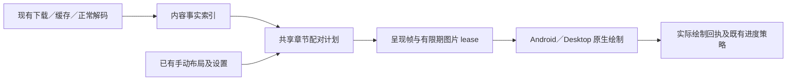

# 双页配对确定性：完整设计与预研门禁

日期：2026-10-12。实验基线：`fe7b2b6fb5`。状态：**继续预研；保留首轮反例，按用户澄清优化事实准备和呈现链路**。

本文规定候选修复的完整边界、失败处理和验收，不表示当前主干已经具备这些行为。预研在独立分支 `codex/reader-pairing-research-20261012` 进行；主干只接收本设计和配套证据，不接收实验性阅读器代码。最终结果见[预研报告](evidence/reader-pairing-research-2026-10-12.md)。

**切换模型后的执行入口：[第 7 节：下一轮预研执行方案](#7-下一轮预研执行方案)。** 本次用户只要求设计交接方案，不启动下一轮实施、构建或设备操作。

## 1. 用户要求及不可降低的验收

用户明确要求以下两项同时成立，不接受取舍：

1. 同一章节内容、设置和手动配对意图下，顺读、倒读、直接跳页、退出重开得到相同配对；不只是“最后收齐相同 facts 时相同”。
2. 按实际体验和耗时对照，正常打开与翻页没有可感知的新增等待；后台识别不能移动已经露出的图片，包括手势中短暂露出的邻屏。

用户在继续预研时明确选择“按实际体验和耗时对照验收”。首轮将此写成“目标图一就绪就绝不能等待任何必要分析”过严，现予以纠正。允许在正常读取、解码和预取期间完成必要分析，必须把全部成本计入对照，不预先要求用户在延迟和配对一致之间取舍。仍不能把已经显示的图片搬到另一槽位来补救。

此外须保留现有双页、真实宽图完整呈现、自动跨页识别、手动调整、逐页加载／重试、缩放以及进度语义。不能通过关闭自动识别、固定页码奇偶、增加永久单页，或把未显示伙伴标成已读来满足前两项。

旧[稳定呈现 v3](2026-10-03-dual-page-stable-presentation-design.md)明确允许冷跳和顺读结果不同。那是当前缺陷相关的历史策略，**不能作为本轮放宽验收的依据**。也不能把“无可感知延迟”偷换成把分析时间藏进 `Ready` 之前而不计时。

验收分三层，分别报告：

| 层次 | 必须证明的内容 | 不能替代 |
|---|---|---|
| 逻辑确定性 | 给定完全相同的内容事实、设置、手动意图，章节唯一分区不依赖导航／绘制历史 | 同内容但事实取得顺序不同的首屏一致性 |
| 呈现与接线 | 真实 adapter／holder／progress 路径不吞页，不错画，不伪造已读，不永久保留临时单页 | 同时满足无感延迟和无后台搬动 |
| 用户完整要求 | 冷缓存、信息迟到、快翻、重开也同时满足上述两项及既有能力 | “最终收敛”、热缓存通过、纯规则测试通过 |

任何一层没有通过，均不得写“完整方案已验证可行”或“bug 已修复”。

## 2. 已证实问题与证据边界

| 场景 | 已证实原因 | 尚不能扩大的结论 |
|---|---|---|
| 第 8 卷阅读器 113～116 | 真实共享实现可在连续阅读中复现邻屏先锁定，产生 `[113] [114,115] [116]`；源图支持 `[113,114] [115,116]` | 没有最初事故的真机逐事件日志，不能声称每个事件都已还原 |
| 第 8 卷 126/176 左页显示、右页黑色 | 126/127 在翻页前约 19 秒已解码；126 的 LEFT 事实到绘制才提交，125 被旧 124/125 的历史占用，126 被拆成 LEFT 单页；正确伙伴为 125 | 不是证明所有历史转圈都由此产生；早先 1～2 秒即重开的报告未独立定因 |
| 第 9 卷两张普通页单独显示 | 邻屏只露出 anchor 后退出，`seal` 按 drawn 裁掉未画伙伴，并永久写回 membership；不需要新的页侧冲突 | 日志捕获阅读器 93/94（纸面 92/93）；用户记忆底部 92/93 但不确定，不能强行宣称编号完全吻合 |

共同问题是**渲染经历反过来决定章节分组**。第 9 卷另证明：仅提前发布 LEFT/RIGHT，不能修复一切；原本正确的双页也能被局部曝光破坏。

原图只用于现场核验，不进入 Git。版本化回归使用与原图一致的数值事实；加强过的合成事实另标压力用例，不能冒充原图识别结果。文件名 `_1/_2` 仅为本漫画取证依据，不成为通用规则。

## 3. 复用边界与职责拆分

复用 `SharedDualPageSession` 的串行 owner、内容身份、手动记录及 CAS；复用 `SharedSpreadMatching`、`ReaderPageSideHints`、现有 materialize／decode／图片 lease、Android ViewPager 和 Desktop runtime。两端不另写配对算法，不添加平台私有修正规则。



单向约束：绘制、释放、滑动取消、预览、读取失败的先后顺序，均不能修改配对计划的输入。图片 lease 不能变成永久章节占用。`drawn` 仍是进度证据，不能成为配对成员集合。

### 3.1 内容事实索引

每页记录内容版本、原始尺寸、方向归一后的尺寸、EXIF／用户旋转、页侧分析结果和分析版本；相邻边记录两端内容版本、分析版本和匹配结果。明确区分：

- 尚未计算；
- 已计算但无法判断页侧，或已计算且不匹配；
- 暂时失败／资源暂停，可重试；
- 已有可用结果。

UNKNOWN 不能兼作“尚未读图”和“读图后无侧向证据”，`null` 分数也不能兼作“不匹配”和“未计算”。资源耗尽、取消、超时不得被写成永久否定事实。

事实提交能力与绘制能力分开：事实按原始内容、generation 和分析版本校验，不以当前左右槽位、位置 sequence 或某个仍有效的显示 ticket 为前提。过时内容拒收；同一内容在离屏完成的结果可以进入索引，但不获得绘制／进度权限。

平台接线不能简化成移动一个回调：目前 Android `ReaderPageImageView.observeDecodedSide` 在 SSIV 的 `onDraw` 经 `ReaderDecodedPageCanvas` 截获完整 bitmap 时才执行，`onImageLoaded` 时不保证已有侧向样本。提前分析需要真实 decode 输出／既有原图采样路径，核对完整图与 tile、方向、硬件 bitmap、回收和内容版本，不能从解码完成事件推定已经识别完毕。

真实本地入口已有可复用的前置工作：`AndroidReaderChapterContentPort.loadChapterContent()` 对 Ready 且有 stream 的页面发布 header，再返回清单。下载目录页通常均为 Ready。但 `ChapterLoader` 在 `PREFETCH` 时显式关闭该步骤，已加载章节复用也不会自动补齐。因此不能假定“本地页永远缺宽高”，也不能假定“任何本地入口都已具备全章宽高”。直接打开、预取后切章、已加载章复用必须共用幂等的事实准备入口；失败 header 单独处理。尺寸已知不代表页侧和竞争边已分析。

Android 的 `ReaderPage.encodedContentIdentity()` 当前包含进程内递增 `contentSourceId`，只适合会话内防迟到，**不能直接作跨重开的持久缓存 key**。持久索引须绑定可验证的编码内容指纹；优先在现有写入／materialize 流中计算，避免为了验证缓存而额外完整读取图片。目录、页码、URL、mtime 单独均不足以证明字节未变化。旧下载没有指纹时须明确 cache miss，不能继承未知版本的结论。

索引是可重建派生缓存，不进入手动布局格式、阅读进度或跨设备同步。不新增用户必须维护的状态。原图、裁边、滤镜和主题区分：分类必须使用方向归一且未裁剪、未加滤镜的样本；裁边开关下若拿不到等价输入，保持未分析，不能用裁后像素假装原图证据。该边界须在双端测试中固定。分析版本还须覆盖采样坐标、方向、颜色归一化与 decoder 的输入差异；在白色／色差阈值附近，需用共享原始样本契约和实际双端解码夹具验证，不能仅凭同字节／同版本声称结果一致。

### 3.2 唯一章节配对计划

计划只接受固定源页序列、内容事实、阅读方向、自动匹配开关、已提交的手动意图（持久保存成功，或现有机制允许的明确会话临时调整），不含待保存建议；拒绝 target、前进／后退、holder、drawn、历史 membership 作为业务输入。保留 `TEMPORARY`／`DEFAULT_UNVERIFIED` 的现有临时调整行为，不强制它们先写数据库。

候选算法按源顺序扫描元数据，建立相邻单页／双页组成的唯一完整分区。原型优先级为：

1. 真实宽图、章节边界、有效手动独占约束；
2. 有效的明确手动相邻配对及现有开篇意图，不能违背真实宽图；
3. 与槽位兼容的页侧证据；
4. 现有相邻边缘评分，使用确定的比较和同分顺序；
5. 从确定边界开始的固定顺序普通配对。

比较当前边与后一条边时，所有重叠候选按同一优先级处理；相同分数以较早源序稳定裁决，不受 Map 遍历顺序影响。未知不等于纵图；失败不等于单页边界。每页出现恰好一次，每个双页相邻，不跨章，不倒置源顺序。RTL／LTR 由共享规则分配物理槽位；实际阅读方向改变是设置输入改变，翻页方向改变不是。

原子预留仅用于“放弃当前本可采用的配对，选择下一对”。若当前边已因可靠页侧、宽图或手动边界禁止，不得借孤页顺手把预留传入右侧。继续预研已发现旧原型违反这一点：虽不能跨边界成对，左侧奇偶仍可经 `reservedStart` 影响右侧选择；必须以回归测试修正后才能把该边界用于局部分析。

第一版原型允许 O(N) 元数据扫描，不进行 I/O。量产要求缓存计划／页到单元索引，对批量事实只失效一次，按受影响边界段重算并在重新进入相同边界摘要时停止。不得在每条事实到达时无条件全章重建，形成 O(N²)；优化必须与全量纯计算 oracle 比较，不能产生第二套规则。

确定性不等于作者版式的绝对真值。页侧留白和连续边缘均为启发式，广告、装订留白异常、扫描裁切可能误判；同一内容应稳定得出同一结论，错误识别仍可由原“调整页面配对”入口修正。本轮不引入 OCR、漫画柜文件命名特判或机器学习分类器。

“确定”须附可检查的依赖闭包：当前分组是否还有未计算的尺寸、页侧或竞争边能改变。没有闭包证明的结果仍是建议，不能靠首次看见、计时器或保存一次猜测升级成最终结果。固定五页窗口不是天然正确的依赖闭包，远处宽图或前缀边界可能改变普通配对相位。

#### 局部事实闭包与工作量

不要求每次打开都先解码全章。保留完整源页序列的轻量元数据，按以下顺序求当前帧与会露出的邻帧所需输入：

1. 优先复用内容版本、算法版本和设置匹配的已认证计划段；缺失不是分析后 UNKNOWN。
2. 在目标附近先分析本来就要加载的图片，向左找可证明的重置边界。真实宽图／有效手动对／强制单页之后可作为候选起点；页侧造成的禁止边须通过上面的预留修正。卷 8 的 113 RIGHT、卷 9 的 93 RIGHT 是候选；126 LEFT 只能封住右边，不能独自证明其左伙伴。
3. 起点必须携带 `openingClosed` 和左邻真实宽图状态（或 `previousIsWide`）等共享扫描状态。是否已经出现首个双页，以及前后是否都是宽图，会影响孤页槽位；不能把局部切片伪装成一个新章节，重新套用封面规则。页侧不得覆盖跨界的有效手动配对；重置条件必须来自完整优先级后的实际禁止边。
4. 没有已认证起点时，枚举左界的有限可能状态（首张尚待配、首张已被左侧配走、左侧传来的原子预留，以及 opening 状态），执行同一个共享扫描步骤。只有各状态产生相同目标成员和物理槽位，才认证该段；否则向左扩展。不得在测试或平台内复制第二套配对算法。
5. 给定起点状态，一个目标候选最多读取到该目标后两页及相邻竞争边；下一屏／预览屏仍按其实际终点继续延伸，不能用固定 `target+2` 冒充整个 pager 的闭包。

最坏情况下，若没有重置边界或有限状态不收敛，仍需分析章首到目标的前缀；当前目标不需要后半章全部像素。这一最坏路径必须计时，不能用典型漫画的局部成功掩盖。新下载、现有章节预取和正常解码应提前建立可重建索引，降低首次阅读所需工作；冷旧下载仍必须独立验收。

### 3.3 呈现帧与释放

帧保护当次已经准备／绘制页面的物理 slots、内容版本、已锁和已绘制集合。一次预览只画右页可以留下“右页确实画过”的事实，不能删掉计划中的左伙伴；释放撤销显示能力、归还资源，不把 `drawn` 回写为章节配对。若尚未准备的伙伴被新事实确定为宽图，可从旧呈现帧移出并作为下一屏完整呈现；已锁页面保持原槽位。不得为了冻结整对，把未锁的宽图困在半槽或跳过去。

旧帧可在当前手势／可见生命周期内保护原有像素，但不能阻止未来合法计划使用其页面。旧 ticket 在释放、内容替换、明确切换上下文后不得画图或提交进度。

若新计划与已经画出的当前帧不一致，简单延迟到 idle 再搬图仍违反本轮要求；继续把旧帧当永久配对也违反确定性。故“保持旧帧、未来重建”只是一项用于验证去历史占用的**实验机制**，不能自动认定满足完整用户要求。最终实现必须证明在首次出图前已有稳定决定，或证明算法对缺失事实具有不变性。

Android 替换 adapter 列表时须保持 `ReaderPageId` 定位，不按变化后的组下标定位；保留正常图片 lease，避免仅因列表发布重复读取／解码。Desktop 使用相同计划与内容令牌，Compose key／原生呈现生命周期不得再隐式决定配对。

逻辑计划和正在呈现的列表必须有独立投影接口，不能把 canonical 列表更新直接交给原生 pager 换 key、回收仍锁定的 holder。例如屏上仍为 `[124,125]`，新逻辑计划变成 `[123,124] [125,126]`，仅保留旧 ticket 并不能保证画面稳定；下一步还可能再次出现 125。必须测试 active frame 边界生成的源页导航意图、计划版本和实际原生提交的一致性。继续预研已实现实验投影并验证部分原生路径，覆盖边界以证据报告为准；不能声称“有限 lease”本身已解决所有冲突。

### 3.4 导航、进度与错误反馈

- 在计划未变化时，翻页按已进入帧对应的单元边界生成源页导航意图，直接跳页保留用户指定源页身份；异步事实不能改写用户定位。计划与 active frame 不一致时须通过上一节的专项门禁，不能混用两个版本的组边界。未画伙伴不能被当作“已读所以略过”。
- 手势取消／邻屏曝光不创造用户导航或已读事件。只有当前有效票据、真实绘制集合和已停稳的用户定位可提交现有进度策略。
- 左右页继续独立显示 Loading／Ready／Error。图片已经解码但因布局拒画，不得默认为仍在读取文件，也不能无限显示无原因转圈。
- 手动调整沿用现有入口，保存成功后应用；失败保留旧值、提供现有重试。自动事实不得覆写手动记录；远端同步仍经同一 CAS／内容保护。
- 真实内容重试、图片替换、章节清单版本变化使相关事实与票据失效；与该内容无关的页不重载。关闭阅读器必须取消剩余工作并释放所有资源。

## 4. 同时满足两项要求的预研重点

优先研究把必要信息提前放到已经存在的工作中，并按实际打开／翻页耗时验收：

| 路径 | 可利用的机会 | 必须测出的成本／缺口 |
|---|---|---|
| 新下载 | 编码写入时取得内容身份；正常完成后有界提取必要元数据与样本 | 不延迟下载完成提示或抢占前台；整个索引尚未完成时打开的行为 |
| 已下载旧章节 | 空闲时建立派生索引；阅读时复用已验证结果 | 没有索引就立即打开／跳中段；不能假设后台总能赶上 |
| 在线与缓存 | 复用正常 current／nearby materialize 和 decode | 冷跳、慢邻图、限速／断网；不能偷偷扩大为全章下载 |
| 普通解码 | 在首次可绘制之前提取本图保守侧向结果 | 不能依赖 `beforeImageDraw` 的旧槽位；本图无法提供尚未取得的邻图事实 |

现有有界资源（事实读取预算、图片 lease、原生 decoder 并发、内存压力暂停）应复用；不以“后台线程”代替 CPU、内存和 I/O 竞争验收。索引只保存标量／有界样本，不持有整章 bitmap。暂停与失败不得改变最终语义。

### 冷缓存信息边界

必须检验以下两个完整章节，而非只测试有索引的成功路径：共同页序为封面 O、A、B、C、D，冷跳 B，B 的实际图片已经准备好，A 尚不可用。

- X：A 是普通纵图，无特殊边证据，应为 `[O] [A,B] [C,D]`，B 在 RTL 左侧。
- Y：A 是真实宽图，其余相同，应为 `[O] [A] [B,C] [D]`，B 在 RTL 右侧。

此时 B 自身和已经观测的信息完全一样，但保留现有自动布局语义需要不同结果。预处理只能减少这个场景出现的机会，不能单凭架构图证明它被消除。研究须给出真实执行证据或明确的必要输入来源。不能以隐藏等待、稳定错误配对、初次猜测持久化、强制单页或放弃自动能力绕过。

比较的是每个相同内容的冷／热两次进入：`Xcold` 与 `Ycold` 在 B ready 前的观测相同，因此只能作相同的即时决定；但 `Xwarm(B)=LEFT`、`Ywarm(B)=RIGHT`。至少有一组同内容的 cold／warm 结果会不同，除非取得缺失信息、搬动已显示页，或改变原有自动语义。这不是用“两个不同章节结果不同”冒充顺序依赖证据。即使所有宽高已知，未知竞争边的像素也可产生同类反例，故只预读 header 不足。

这一反例证明“必要输入缺失时先猜半槽、之后冻结”不足以满足要求，不能据此证明所有可行方案不存在。尤其直接打开健康已下载章节已有 header 前置链，构造中 A 的尺寸完全缺失不能自动等同该实际路径。按用户澄清，下一步应继续实现必要输入前置、局部闭包与成本优化，并测量；门禁失败阻止产品合入，不终止方案研究。

### 耗时对照方法

分别记录用户打开／翻页意图、编码读取完成、解码完成、事实分析完成、首个正确像素、双页完整像素。时间起点不能因把分析塞进 Ready 而后移；同时记录额外 stream 打开次数、解码次数、峰值 bitmap 内存、并发数和取消后的剩余工作。

- 同一产物环境、相同图片与设置，基线／候选交错运行；分别报告冷缓存、热缓存、旧下载无索引、索引损坏、连续翻页与冷跳。
- 先用真实原图和 production 分类器测“已解码 bitmap 上提取样本”的增量成本，并单独测额外解码。主机 Robolectric 的 native Skia 结果仅用于淘汰昂贵策略，不能代表 ART、原生触屏或真机首帧。
- 复用正常解码必须确认采样输入等价：显示用下采样 bitmap、裁边结果或显示色彩转换不能直接当作原图样本。固定原始坐标和分析颜色空间，并测试不同显示分辨率；若现有显示 decoder 不暴露等价输入，应扩展其窄回调或复用原始区域采样接口，不采用反射读取私有 bitmap 或模拟一次绘制冒充正常解码完成。
- 进入产品体验候选前，必须在隔离 Android 运行环境比较首图和翻页分布，保留 p50、p95、最大值及失败样本；最后按用户实际体验复核。性能阈值不能在看到结果后单方面放宽以通过，也不能宣称某个未约定毫秒值天然“不可感知”。
- 三个故障场景、首次无索引和最快正常连续翻页均须通过；只证明热缓存快不够。真实文件／网络不可用须保留明确加载错误与重试，不能静默把失败永久写成无跨页证据。

## 5. 针对性验证矩阵

| 组 | 自动化验收 | 失败含义 |
|---|---|---|
| R1 原故障 | 113～116 原识别值与连续预览时序；126 晚到 LEFT 与旧组；卷 9 单侧预览退出再进入 | 根因修复不完整 |
| R2 确定性 | 每个进入页、往返／跳页／重开、事实到达排列；每一步完整分区无重无漏 | 仍有 target/history 或容器顺序参与决策 |
| R3 真实接线 | Android 原生 holder 的单侧先画、滑出再进、迟到伙伴；Desktop runtime → native paint → SQL progress | 纯共享绿不能代表平台通过 |
| R4 生命周期 | 旧票据／旧内容迟到、退出、内容重绑、重试、手动保存／同步、缩放和手势保护 | 错图、伪进度、数据或资源风险 |
| R5 既有语义 | 首页、单页章、宽图、末页、手动相邻对、强制单页、自动开关、LTR／RTL、裁边／方向 | 修复破坏其他漫画或平台 |
| R6 强双条件 | 冷跳反例、快翻追上预取、缓存淘汰、索引失效／未就绪，记录首图时间与物理位置 | 完整方案不可交付 |
| R7 资源 | 批量事实的重建次数、大章节工作量、有界并发和内存；真实设备首帧／翻页时间与基线对照 | 不能声称无感性能或有界成本 |

TDD 先让旧 production 因正确断言失败，再写最小改动，同范围清理后重跑；测试不复制规则。完整代码与平台接线的变更须有实际行为测试。纯 CPU 操作计数不代替 Android 启动／ART／厂商系统／触屏体验验收。

本轮只做隔离研究和 focused 检查，不全量、不生成 APK、不安装、不操作用户真机。未执行的矩阵逐项标记，不把复用的历史测试或编译成功当作本轮运行通过。

## 6. 实施批次及放行条件

不新增独立 roadmap 状态文件；下列批次是设计内的工作边界，均尚未作为产品完成项勾选。

1. **事实与唯一配对核心**：真实 Session 消费统一计划，移除永久历史占用，补原图事实回归／读序排列／宽图手动契约；先保留实验分支。交付是可复查原型，不能单独放行主干。
2. **完整要求可行性**：确定提前事实来源和内容身份，针对冷跳、缺图、缓存失效执行 R6/R7。此批不通过，停止产品合入，不将余项称为机械接线。
3. **双端呈现与进度**：只在接口成立后处理事实早发布、帧有限期保护、Android／Desktop adapter 原子发布与真实进度；独立审查共享身份与进度边界。复用现有 UI，不新加用户必须操作的修复按钮。
4. **受影响验证与体验交付**：相关回归、原生接线、格式检查；需要 APK 时走正式 candidate 入口并单独安装授权。实机复测三个漫画位置及快速往返，没有复测不得宣称现场 bug 已修复。全量／正式发布矩阵仅在用户选择相应里程碑时执行。

风险与回退：预研不改变主干，失败直接保留实验与证据。未来正式变更若涉及派生缓存，缓存可删除重建，旧版本不读取新缓存；不迁移／清空用户手动布局、已下载原图和阅读进度。不得为回退恢复已知会吞页的旧历史占用逻辑而隐瞒风险。

## 7. 下一轮预研执行方案

状态：**已设计，待用户切换模型后明确开始执行**。本节是下一轮唯一执行计划，复用配套证据报告；不新增 roadmap、逐任务快照或第二份报告。

`active-task: R3-01`

### 7.1 给执行模型的任务与基线

任务是验证一个能够同时满足配对一致、已显示页面不移动、实际打开／翻页无可感知新增等待的原型。继续优化，不能把首轮“绝对零等待”反例当作停止理由；也不能凭少量窗口通过宣称完整修复。先验证最贵、最不确定的原图采样路径，再实现通用闭包，最后接真实阅读器并计时。

| 内容 | 必须沿用的事实 |
|---|---|
| 产品代码工作区 | `D:/Codex/worktrees/reader-pairing-research-20261012` |
| 实验分支／起点 | `codex/reader-pairing-research-20261012`，`4d65d3d67bd98cf8916edcd597976927972f7e0e`；上一父实验为 `5b0514a57e450f1cd0ca6cf55f780aa5547f7fc8` |
| 设计／报告权威位置 | 主工作区 `D:/Shell/Github/mihon/docs/2026-10-12-reader-pairing-determinism-design.md` 与 `docs/evidence/reader-pairing-research-2026-10-12.md`；实验分支不一定含最新文档，按这两个绝对位置读取 |
| 已有证据 | 实验工作区 `.gradle-coordinator/research-evidence/`，同级 `canonical-r2-*.json` 保存实际 argv／退出状态；以报告解释组合证据，不重跑 98 项历史审计 |
| 已过范围 | 31 项核心基线，后续 9 项受影响行为补验、Android 原生 2 项、格式；完整性与时间边界见报告 |
| 保留的失败 | 旧 cold 首槽反例仍红；缩略图采样反例仍红。二者不得删除、跳过或直接改成“期望失败所以产品通过” |
| 并行主干工作 | 主干还有作者等其他功能与用户 `docs/human/`；不合并／rebase 主干，不回滚、暂存或提交其他任务内容 |

开始时只读核对两个工作区 `git status`／HEAD 和协调器状态。实验 HEAD 若已有后续改动，先读取实际 diff，保留它们并记录基线；不 reset 回以上 hash。前一轮代理任务已结束；切换模型后不要因恢复旧代理而偷偷使用上一模型的成本配置。

现场数据仍仅在本机，不进 Git：

- 卷 8 原图：`C:/Users/feeli/AppData/Local/Temp/mihon-slime-diagnosis/111.webp` 至 `128.webp`。
- 卷 9 原图：`D:/Shell/Github/mihon/.gradle-coordinator/reader-vol09-92-93-20261012-114131/images/91.webp` 至 `95.webp`。
- 外部探针：实验工作区 `.gradle-coordinator/pairing-preanalysis-probe/`。其 `ReaderPairingPreanalysisResearchProbe` 有真实原图成本、content port、前缀枚举和下采样反例；机器路径只能留在 ignored 探针，正式回归用合成像素／数值事实。
- 卷 9 日志确切对应阅读器 93/94、纸面 92/93；不得把用户不确定的记忆页码改成已证实事实。

### 7.2 范围、预算与协作

下一轮拟用 **3～5 小时** 完成以下连续预研链；此前 2～3 小时估算未包括后来发现的下采样输入差异及双端协议补验，不能继续把所有工作称为简单移动回调。先用 R3-01 的早期成本门禁淘汰慢路线，降低后续投入。

- 执行模型由用户切换决定；最多 2 名子代理，继承用户当前选择，不自行切回高价模型。实施代理承担 R3-01～04 的主要实现、TDD 与 Gradle 协调；审查代理负责未由自己实现的事实身份、闭包和绘制权限。主代理负责范围、接口、夹具与证据整合。
- 真正可并行的工作限于：实施代理写核心时，主代理准备隔离运行环境的只读清单和夹具；稳定接口出来后审查代理做只读审查。R3-01 → R3-02 → R3-03 的依赖实现串行，重型 Gradle 全程一个协调者，不以多个 worktree 绕过资源约束。
- 独立审查 1 轮，接口定型时开始、真实 wiring 稳定时闭合；阻塞修复复审最多 1 轮。高风险事实身份／闭包接口先过审再供下游接线，不把审查推到所有工作之后。
- focused 红绿按每批风险运行；最终只补受后续修改影响的范围。全量／完整模块／98 项重复审计 **0 次**。不构建 Desktop 正式包，不分配正式 Android 版本，不发布、不合入主干、不安装用户真机。
- Android 研究运行限定一个经核对的专用模拟器。优先复用满足条件的既有隔离 AVD，若要新建，只复用已安装镜像；镜像下载、依赖升级或原生库分叉不在默认预算。最多 3 份宿主 Debug APK（基线、R3-01 原图采样探针、R3-04 完整研究候选）及对应 instrumentation APK；确因已证实相关修复需要时，最多补构建 1 份候选。R3-01 的中间采样产物不能冒充后续 wiring 完成后的 APK，新构建不能覆盖已有产物。
- 交付仅为隔离代码与测试提交、更新本设计／既有报告，以及 ignored 目录下的紧凑 XML、计时 JSON、日志和 APK 过程产物。执行前再次说明此预算；用户只要求方案时不得启动。

### 7.3 固定接口与不能偷换的语义

以下是接口契约，具体类型名可沿用现有命名调整，不另造一套阅读器服务：

| 契约 | 要求 |
|---|---|
| `PageAnalysisEvidence` | 绑定原始编码内容能力、原始尺寸、EXIF／用户旋转的统一解释和分析算法版本；页侧区分 NotAnalyzed、Computed(UNKNOWN/LEFT/RIGHT)、RetryableFailure；不能把资源暂停写成 Computed(UNKNOWN) |
| `EdgeAnalysisEvidence` | 绑定相邻两页上述身份；区分 NotAnalyzed 与 Computed(score=null)，复用 `ReaderSpreadSamplesOwner` 内已有 `scores` 存在性；无需让外部读私有 Map |
| 原图取样 | 固定原始像素坐标、未裁边、未加主题／显示滤镜、固定 sRGB 输入；页侧保持原有 alpha/white 判断，边缘保持现有白底归一化，不借抽取 API 改分类阈值 |
| `CertifiedSegment` | 固定完整页序／清单 revision、内容依赖版本、方向、自动开关、手动 revision；包含实际 unit/slots 及必要依赖集合。无关页面的事实到达不得撤销它或移动当前图片 |
| `NeedFacts` | 明确缺哪页的哪类信息及从哪个状态继续；不能因“已有宽高”“等够时间”“缓存命中页码”就转为 Certified |
| `RetryableBlocked` | 表达真实读取错误／资源暂停和可恢复原因，沿用正常 Loading/Error/Retry 反馈；不得转成永久单页边界，也不得无原因一直转圈 |

现有 `ReaderDualPageUnit.certain` 只表达宽高已知，不能用它代替上述认证。`ReaderPage.encodedContentIdentity()` 仍是会话内能力，不能写盘后当跨重开的内容指纹。优先证明无持久索引的冷路径；本轮不先做数据库／下载格式／同步迁移。

局部扫描必须复用 `canonicalPlan` 的同一生产步骤，完整扫描只作为 oracle。可抽取内部 reducer，但不能在 Android、Desktop 或测试中复制一份决策逻辑。进入窗口的保守状态为：

- U：从窗口首张正常处理；R：带有首张起始的原子预留；P：首张已与左侧配走，从第二张处理。
- 与 opening 状态组合，剔除不可能状态（例如 P 已经历配对，opening 必须关闭）；保留左邻宽图状态和全章原始 ordinal。
- 只有真实优先级结果证明禁止跨界，才可缩小入态集合；页侧不得绕过跨界手动对。所有剩余入态得到相同目标成员和 slots，且读到的必要信息均已分析，才给认证。否则向左扩展；不能固定为五页。
- 当前目标、会露出的前后邻帧分别求必要范围；不是把 `target+2` 当整个 ViewPager 的闭包。批量事实只使相应计划段失效一次，不能每条事实触发全章重建。

### 7.4 顺序任务与逐任务验收

以下 checkbox 只在实现、必要审查、focused 验证及本批提交完成后勾选，不代表正式发布或实机修复完成。

#### R3-01：固定原图样本，先证明能取到且成本可控

- [ ] 完成原始采样契约、双端区域适配和最小原生成本探针。

**入口／范围：** `domain/.../SharedDualPageRules.kt` 中 `ReaderPageSideHints`、`SharedSpreadMatching.kt`，Android `AndroidReaderSpreadSampler.kt`／`ReaderPageRegionDecoder`，Desktop `DesktopReaderSpreadSampler.kt`。复用现有编码 stream、native decoder、region lease、取消与回收，不新增图片下载器、不改 HTTP/源解析。

**先红：** 写通过真实采样 adapter 消费编码图片的测试，证明目前只有边缘、没有独立完整页侧证据；覆盖原图与显示 sampleSize 1/2/4 的不同，尤其卷 9 第 95 页。合成夹具固定薄留白、alpha、旋转／镜像、窄图与长图边界，断言实际点坐标和值；不得把显示图的 RIGHT 反向规定为正确。

**最小实现路线：** 把现有页侧分类抽成共享坐标计划＋对实际样本分类，原 `classify(width,height,argbAt)` 继续委托同一实现。将 288 个页侧点与 100 个边缘点合并成同一原始采样计划；Android 同一原始 decoder 读取左右必要区域、`sampleSize=1`，Desktop 复用原始区域 lease。每页只保留标量／有界样本，不常驻整图；区域边界使用旋转后的点反投影，不能按未旋转的左右条带硬取。

**成本检查：** 先在真实 JNI／ART 读取 23 张现场 WebP，分别记录 decoder 创建、两侧区域 decode、取样、回收和原始 stream 打开次数。主机可先跑行为，但不能用 Windows 替换 JNI 的边界注入宣称 Android 解码性能。已有 0.10 ms 只代表 decoded bitmap 上取样；不得把它当新采样器总耗时。

此处就需要按 R3-04 的身份核对要求准备专用模拟器和基线／采样探针 Debug 产物；只运行本组件 probe，不提前声称实际阅读器性能通过。后续完整候选需要另行构建，已纳入 7.2 的三份预算。

**路线调整条件：** 若区域采样重复解码成为主要增量，检查正常 decode 是否已有等价的原图软件 bitmap，只有原始坐标、分辨率、方向及颜色输入均等价才可复用。当前 SSIV `66e0db195d` 没有公开原 bitmap 回调；不反射私有 bitmap、不通过额外假绘制提取、不自动 fork／升级 SSIV。需要改依赖接口时先记录实测成本及最小替代设计，再申请该具体扩大范围。

**完成条件：** 原图与目标事实吻合，显示缩放不影响固定采样结果；同一边缘计划结果未改变；失败／取消／替换内容关闭 stream 和 decoder，不发布错误事实；得到可复查的 ART 组件成本。未过此项，不投入完整阅读器接线来掩盖昂贵输入路径。

#### R3-02：通用闭包认证与可恢复事实状态

- [ ] 完成共享扫描步骤、证据状态和认证器。

**前置：** R3-01 的样本语义与身份接口固定。**范围：** `SharedDualPageRules`、`ReaderSpreadSamplesOwner`、`SharedDualPageSession` 的事实消费／内部纯规划能力及相关 common tests；暂不改变 native holder 的显示门卫。

**先红：** 至少覆盖“只有 header 不能认证”“分析后 UNKNOWN/null 可以认证”“原图替换／旧请求不得认证”“有前缀竞争边时五页不够”。以同一生产完整扫描为 oracle，在有限入态、不同事实到达顺序和冷／热会话下核对相同成员与 slots。

**必验场景：**

1. 三起原故障的真实数值事实；113/114、115/116、125/126、93/94 的窗口，以及已有 16384 次前缀枚举。
2. 改强 124→125 竞争边后，126 的原五页证书必须失效并请求更多前缀，不能保持“固定五页可用”。
3. 宽图、单页章、封面、末页、连续弱边、左右相反提示、自动关闭、RTL/LTR、有效手动跨界对、强制单页；opening 状态和左邻宽图不能丢。
4. 分别缺尺寸、页侧、竞争边；晚到无关事实不能改变已认证段；相关内容／手动意图／设置改变必须失效。
5. 长无重置前缀、样本淘汰和取消后恢复：不能假装已闭包，不能二次读取已确认标量；用生产查询／重建计数判断工作量，不用只扫描源码或 O(1) 测试 lambda 代替。

**完成条件：** 认证的结果与完整 oracle 一致；必要输入不足时返回明确依赖而非错误最终组。target 只选择需要认证／取证的范围，不改变 canonical 配对；drawn、holder 和历史 membership 不参与配对决策。审查者先核身份／认证不变量，再进入 R3-03。

#### R3-03：把认证接入现有加载与真实呈现链

- [ ] 完成 Android 三入口幂等准备和共享呈现门卫，并补 Desktop 协议接线。

**范围：** Android `AndroidReaderMaterializePorts.kt`、`ChapterLoader.kt`、`ReaderPage.kt`、`DualPageViewerAdapter.kt`／必要的 holder 接口；共享 Session；Desktop `ReaderScreenModel.kt` 与已有 sampler/presentation adapter 的必要调用。不改漫画源、下载协议、数据库 schema、手动布局格式、导航入口或缩放算法。

**先红：** 使用真实 `ChapterLoader`／content port／DownloadPageLoader，以及实际 session→adapter→native holder。断言直接打开、PREFETCH 后进入、同 ReaderChapter 复用都补齐当前必要证据；只测 `publishHeaderFacts=true/false` 两个参数分支不能当三入口接线通过。故意断开 producer→认证→adapter 一条连接时，相应测试必须失败。

**实施约束：**

- 数据 Ready 与版式认证状态分开。normal materialize/decoder 不被另起 loader 替代；必要事实在原图可用后由同一 owner 调度，并在首次准备物理槽位前发布。事实提交不检查旧显示槽位，绘制／进度能力仍检查当前内容和位置。
- 优先复用已有正常／邻页工作；已取得样本的页不再重复开流。逐帧显示左右图的独立加载／错误／重试；认证不足时保持现有加载反馈，不先画一个最终会移动的半槽，不让未画伙伴算已读。
- 保留 `4d65d3d67b` 的投影、真实 `reportDrawn` 和 `hasDrawn` 分离。认证不能恢复永久历史占用；用户明确改配对与后台事实迟到分开处理。
- 同一批证据原子发布，content version／generation 校验后才可用；退出、切章、快翻取消只撤销对应能力。现有持有原图不得因列表刷新重复解码。
- `ReaderDualPageFactBudget` 是一次显式 location 的可选工作预算：2 并发、16 个额外页、32 MiB 新读取、15 秒期限。不能通过伪造跳页／反复新建 budget 偷偷突破。所需前缀超过预算时，区分已在现有缓存中的事实与额外读取，报告真实缺口；这不是允许无限转圈或写永久否定事实。需要改变预算语义／在线全章获取时，先独立论证，不借“本地”一词自动豁免。
- Desktop 使用同一证据与认证语义，复用它自己的原图区域 lease；至少让共享 owner→Desktop runtime→真实呈现／进度链通过，不能新增仅 Android 才确定的规则分支。无需扩做 Desktop 新 UI 或正式打包。

**完成条件：** 真实画布证明首图位置和已露出像素稳定；连续翻页、回翻、冷跳、重开配对相同；未准备宽图仍可完整到达，邻屏单侧曝光不遗失伙伴，prepared-only／旧票据不能结算。针对跨 owner release 合并的既有风险补可达性测试：若实际能漏刷新则局部修复，否则留明确未复现记录，不扩成通用调度重构。

#### R3-04：运行实际 Android 对照，完成研究判定

- [ ] 完成隔离 ART 功能与耗时对照、最小双端回归、审查闭合和证据提交。

**前置：** R3-01～03 接线已过 focused，接口审查无阻塞。使用相同构建类型、同一个专用模拟器、同一尺寸／方向／设置；记录 API/ABI、屏幕刷新率、内存配置、宿主／测试 APK 哈希。基线为 `4d65d3d67b`；旧主干或用户手机上的未知 APK 不能充当精确成本基线。

**夹具与实际路径：** 复用 `HostReaderArtFixture` 的 Activity/native paint／进度观察能力，但它现有原图用例走已安装扩展与普通加载，不能直接证明 DownloadPageLoader。为本轮在专用 `.dev` 实例中通过既有下载目录／归档发现接口准备虚构漫画和章节，让真实 ChapterLoader 选择 DownloadPageLoader；不得直接塞 ReaderPage 列表绕过该选择。23 张现场图只在临时夹具中使用并校验 hash；为完整页数补的合成页须标注，不能声称补齐了整卷原图。普通回归夹具应可独立生成，不依赖用户漫画文件。

**固定采集表：**

| 场景 | 操作／最小采集 | 必须检查 |
|---|---|---|
| 冷旧下载、无分析缓存 | 进程重启并仅清本研究派生缓存，打开中段；20 次基线／候选配对样本 | 包含首次分析，不隐藏在计时前；真实目录路径先测，归档至少一条同链路功能用例 |
| 热缓存、重开 | 同内容退出再进入；20 次配对样本 | 不能靠历史显示冻结结果；使用会话内缓存时如实标明进程重启后会重新分析 |
| 连续与快速翻页 | 正常连续翻 20 屏，再以 300 ms 间隔翻 20 屏，各基线／候选一轮 | 无重页／漏页／右侧永久空黑，读取赶不上时可恢复，不伪造已读 |
| 现场分组 | 连续读过三个位置，再冷跳／回翻／重开 | 113/114、115/116、125/126、93/94 与实际像素一致；不只读 session 的逻辑数组 |
| 失败／失效 | 一次内容替换、一次取消后恢复、一次样本淘汰、一次损坏派生记录（若本轮实际存在持久缓存） | 旧结果拒收，重新取证后恢复，无无限 Loading；未实现缓存则不能把其损坏测试标 PASS |
| 最坏依赖 | 没有已知重置边界的长前缀、有效边竞争迫使扩大窗口 | 记录额外页／字节／解码／耗时；不得只交局部最好情况 |

重启应用不是清 OS 文件缓存，故“冷”准确标为“进程／派生分析缓存冷”，不得冒充物理存储冷启动。新增取样完成之前的等待也计入用户意图→首个正确像素。日志至少同时记录 intent、encodedReady、decodeComplete、analysisComplete、firstCorrectPixel、bothCorrectPixels、page/content identity、所需依赖数、额外 I/O、native work、bitmap 峰值和错误原因。时间使用单调时钟，不能把图片 Ready 当用户计时起点。

**对照判据在运行前冻结：**

- 基线／候选同型 Debug 的测试结果只证明该研究构建的 ART 行为；不外推 Release/R8 或用户真机。正式候选与厂商实机仍需后续验收，不能为了“正式”顺带启动完整发布矩阵。
- 使用 2 次不入统计的预热，之后交错 A/B 与 B/A 采样；报告 p50、p95、最大值、配对差值、所有超时／失败，不删除慢样本。模拟器明显负载干扰时先记录资源事实，只补受干扰场景，不重跑全部矩阵。
- 本轮工程筛选预算提议为：同场景首图 p95 增量不超过 `max(20 ms, 基线 p95 × 5%)`；已有邻页资料的连续翻页，p95 增量不超过一个实测刷新周期，且无由新增分析造成的超过 100 ms 停顿。此为淘汰明显退化方案的研究阈值，**不是用户已经认可的感知阈值，也不是绝对无感保证**。不得看完结果再放宽；客观结果和实际视觉录制分别报告，主观感受仍由后续用户体验复核。
- 在故障样本中，基线可能永远没有正确双页，不能把“无限耗时”用于制造候选速度胜利。时间比较采用两边均能正确显示的匹配控制页；故障样本单列正确性与候选实际耗时。

若冷重新分析已满足以上标准，先不实现持久索引。若冷路径慢、热路径快，报告成本分解与最小持久缓存方案：复用既有 cache、原始字节指纹、算法版本、原子写和损坏失效；目录／mtime／会话 ID 不能单独作为内容身份。不要未经方案确认扩成数据库迁移或下载后台服务。需要此支路时本轮结论为“还需缓存优化”，而不是放弃全部目标或声称已验证。

### 7.5 可执行验证入口与证据保存

以下从实验工作区执行；测试名是现有入口或明确计划新增入口，不能把不存在的新测试当作已经运行。每次仅选择当前任务的类／方法，首轮命令启动后保存 XML，再执行会覆盖同目录结果的下一轮。

```powershell
$ErrorActionPreference = 'Stop'
$env:PYTHONUTF8 = '1'
$env:PYTHONIOENCODING = 'utf-8'
$env:PYTHONDONTWRITEBYTECODE = '1'
$env:JAVA_HOME = 'C:\Program Files\Eclipse Adoptium\jdk-21.0.11.10-hotspot'
$env:ANDROID_HOME = 'D:\Android\Sdk'
$env:ANDROID_SDK_ROOT = 'D:\Android\Sdk'
Set-Location 'D:\Codex\worktrees\reader-pairing-research-20261012'

# 新增测试实现后：只选择本批共享契约，不执行整个 domain 模块。
python scripts/gradle-coordinator.py run --key pairing-r3-closure-red -- gradlew.bat :domain:jvmTest --tests mihon.domain.reader.ReaderPairingClosureResearchTest --offline --console=plain

# 现有 Android 原图采样适配边界，另追加本批实际新增的类／方法。
python scripts/gradle-coordinator.py run --key pairing-r3-sampler -- gradlew.bat :app:testDebugUnitTest --tests eu.kanade.tachiyomi.ui.reader.viewer.AndroidReaderSpreadSamplerTest --offline --console=plain

# 两条现有原生像素保护接线仍须按影响复用或补验。
python scripts/gradle-coordinator.py run --key pairing-r3-paint -- gradlew.bat :app:testDebugUnitTest --tests eu.kanade.tachiyomi.ui.reader.viewer.pager.DualPageViewportZoomTest.partialNeighbourNativePaintReleaseKeepsItsUndrawnPartnerOnEntry --tests eu.kanade.tachiyomi.ui.reader.viewer.pager.DualPageViewportZoomTest.lateWidePartnerKeepsThePaintedNativeImageAndRemainsTheNextPage --offline --console=plain

# 共享协议改变时的最小 Desktop 实际消费链。
python scripts/gradle-coordinator.py run --key pairing-r3-desktop -- gradlew.bat :app-desktop:jvmTest --tests mihon.desktop.ui.reader.SharedDualPageDesktopWiringTest --tests mihon.desktop.reader.SharedDualPageRuntimeProgressProductionTest --offline --console=plain

# Android 研究宿主统一入口已内部使用协调器，不嵌套。
python scripts/build-android.py debug --offline
```

补充执行要求：

- 不因上面列出多个入口就启动全部；按 R3-01～04 的依赖和实际改动选择。需要限制 Android 的 class include 时用 ignored init，避免单方法筛选仍启动大量无关类进程；native Robolectric 单并发、按类隔离、关闭测试自动 retry 后准确统计独立用例。不得为测试方便改产品配置。
- 宿主 Debug 从统一入口取得真实 APK／manifest 路径；测试 APK 通过协调器执行精确 `:app:assembleDebugAndroidTest`。先核验产物 targetPackage、签名、AVD 身份与 `.dev` 实例，再显式 `adb -s <本次serial>` 安装、运行仅本研究类。不要运行会选中所有连接设备的 `connectedAndroidTest`。runner 的完整 `INSTRUMENTATION_CODE`、测试数、失败／崩溃必须核验，`adb` 退出码 0 不足。
- 本计划不固定历史 serial，也不启动任意已连接设备。基线 APK 如尚不存在，可增加一个仅用于 `4d65d3d67b` 的干净 baseline worktree，采用同一薄 instrumentation 夹具和同构建类型；不在工作中的研究目录切换／还原 product 文件。两树 Gradle 仍串行。
- 不直接复用 `scripts/reader-performance.py` 作为 Android 性能工具，它目前明确只面向 Desktop Test Mode；可复用统计方法思想，但 native intent／paint 证据必须来自 Android 实际运行。
- focused 修复后运行受影响模块的定向 Spotless 和 `git diff --check`。每个可独立审阅功能批次带 production、红绿测试与必要记录一起提交；报告引用基线、后续差异、有效补验和最终实际 APK，不写成“最终代码全量绿”。

### 7.6 失败处理与完成回执

| 发现 | 继续做什么 | 不允许的结论／操作 |
|---|---|---|
| 首个采样方案慢或输入不等价 | 保留测量，按 R3-01 分解 decode 与提取；在既有窄 adapter 内尝试有证据的改进 | 把缩略图结果规定为正确；把图已解码后的 0.10 ms 当整个方案成本 |
| 认证器与 oracle 不同 | 保留最小输入、补红、修 reducer／依赖集，再跑同范围 | 修改 oracle／正确期望、固定窗口或回到 drawn 选配对 |
| 原生画布未显示、只逻辑组正确 | 跟踪 producer→证书→票据→holder→paint，修断掉的实际接线 | mock 绘制回执、手工给未画页补进度、把无失败日志当显示正常 |
| 资源／依赖不可用 | 检查本地 SDK/AVD/JNI/协调器，继续纯共享与平台 JVM 的独立工作；记录不可替代的真实阻塞 | 自动下载镜像、全局杀 Java/重启 WSL、借用用户实例 |
| 局部绿而旧失败还在 | 按新行为／旧历史政策／真实回归逐项解释，补本轮受影响项 | 一律称“测试过时”，重跑 98 项或全量来掩盖缺口 |
| 必须增加代理／审查轮次、改依赖或显著超预算 | 先提交可审阅差异、失败证据与最小追加方案，再询问具体扩大项；独立读取和诊断继续 | 仅说“预算用完”或“需求不可能”后停止全部工作 |

下一轮最终回执必须给出：`status`、`diff`、`tests`、`commit`、`process`、`next`；最终面向用户报告按仓库格式，明确哪些现场预期已被真实链覆盖、哪些只是模型／主机／Debug 模拟器证据。研究结论只能选与证据相符的一种：

- **预研通过，可进入产品收口**：本轮采样、认证、双端消费、真实 Android 画面与研究耗时对照全部通过；仍不表示 Release 或用户真机已修复。
- **需要定向优化**：明确是哪条输入／性能／呈现门禁未过，已有可执行的下一项改进，继续在授权范围内做 focused 红绿；不要求用户牺牲三个目标。
- **证据缺口／具体外部阻塞**：如实列出不可运行项和原因，不把缺测试当通过。

禁止只交一句“完整方案 NOT_GO”而不说明已完成内容、具体否决证据、可继续的改进路径和实际成本。下一轮也不得自动把实验分支合到主干，或把测试 APK 当正式修复包安装给用户。
