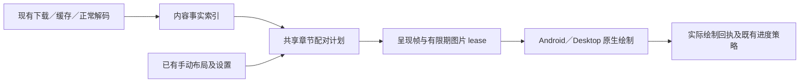

# 双页配对确定性：完整设计与预研门禁

日期：2026-10-12。实验基线：`fe7b2b6fb5`。状态：**继续预研；保留首轮反例，按用户澄清优化事实准备和呈现链路**。

本文规定候选修复的完整边界、失败处理和验收，不表示当前主干已经具备这些行为。预研在独立分支 `codex/reader-pairing-research-20261012` 进行；主干只接收本设计和配套证据，不接收实验性阅读器代码。最终结果见[预研报告](evidence/reader-pairing-research-2026-10-12.md)。

## 1. 用户要求及不可降低的验收

用户明确要求以下两项同时成立，不接受取舍：

1. 同一章节内容、设置和手动配对意图下，顺读、倒读、直接跳页、退出重开得到相同配对；不只是“最后收齐相同 facts 时相同”。
2. 按实际体验和耗时对照，正常打开与翻页没有可感知的新增等待；后台识别不能移动已经露出的图片，包括手势中短暂露出的邻屏。

用户在继续预研时明确选择“按实际体验和耗时对照验收”。首轮将此写成“目标图一就绪就绝不能等待任何必要分析”过严，现予以纠正。允许在正常读取、解码和预取期间完成必要分析，必须把全部成本计入对照，不预先要求用户在延迟和配对一致之间取舍。仍不能把已经显示的图片搬到另一槽位来补救。

此外须保留现有双页、真实宽图完整呈现、自动跨页识别、手动调整、逐页加载／重试、缩放以及进度语义。不能通过关闭自动识别、固定页码奇偶、增加永久单页，或把未显示伙伴标成已读来满足前两项。

旧[稳定呈现 v3](2026-10-03-dual-page-stable-presentation-design.md)明确允许冷跳和顺读结果不同。那是当前缺陷相关的历史策略，**不能作为本轮放宽验收的依据**。也不能把“无可感知延迟”偷换成把分析时间藏进 `Ready` 之前而不计时。

验收分三层，分别报告：

| 层次 | 必须证明的内容 | 不能替代 |
|---|---|---|
| 逻辑确定性 | 给定完全相同的内容事实、设置、手动意图，章节唯一分区不依赖导航／绘制历史 | 同内容但事实取得顺序不同的首屏一致性 |
| 呈现与接线 | 真实 adapter／holder／progress 路径不吞页，不错画，不伪造已读，不永久保留临时单页 | 同时满足无感延迟和无后台搬动 |
| 用户完整要求 | 冷缓存、信息迟到、快翻、重开也同时满足上述两项及既有能力 | “最终收敛”、热缓存通过、纯规则测试通过 |

任何一层没有通过，均不得写“完整方案已验证可行”或“bug 已修复”。

## 2. 已证实问题与证据边界

| 场景 | 已证实原因 | 尚不能扩大的结论 |
|---|---|---|
| 第 8 卷阅读器 113～116 | 真实共享实现可在连续阅读中复现邻屏先锁定，产生 `[113] [114,115] [116]`；源图支持 `[113,114] [115,116]` | 没有最初事故的真机逐事件日志，不能声称每个事件都已还原 |
| 第 8 卷 126/176 左页显示、右页黑色 | 126/127 在翻页前约 19 秒已解码；126 的 LEFT 事实到绘制才提交，125 被旧 124/125 的历史占用，126 被拆成 LEFT 单页；正确伙伴为 125 | 不是证明所有历史转圈都由此产生；早先 1～2 秒即重开的报告未独立定因 |
| 第 9 卷两张普通页单独显示 | 邻屏只露出 anchor 后退出，`seal` 按 drawn 裁掉未画伙伴，并永久写回 membership；不需要新的页侧冲突 | 日志捕获阅读器 93/94（纸面 92/93）；用户记忆底部 92/93 但不确定，不能强行宣称编号完全吻合 |

共同问题是**渲染经历反过来决定章节分组**。第 9 卷另证明：仅提前发布 LEFT/RIGHT，不能修复一切；原本正确的双页也能被局部曝光破坏。

原图只用于现场核验，不进入 Git。版本化回归使用与原图一致的数值事实；加强过的合成事实另标压力用例，不能冒充原图识别结果。文件名 `_1/_2` 仅为本漫画取证依据，不成为通用规则。

## 3. 复用边界与职责拆分

复用 `SharedDualPageSession` 的串行 owner、内容身份、手动记录及 CAS；复用 `SharedSpreadMatching`、`ReaderPageSideHints`、现有 materialize／decode／图片 lease、Android ViewPager 和 Desktop runtime。两端不另写配对算法，不添加平台私有修正规则。

单向约束：绘制、释放、滑动取消、预览、读取失败的先后顺序，均不能修改配对计划的输入。图片 lease 不能变成永久章节占用。`drawn` 仍是进度证据，不能成为配对成员集合。

### 3.1 内容事实索引

每页记录内容版本、原始尺寸、方向归一后的尺寸、EXIF／用户旋转、页侧分析结果和分析版本；相邻边记录两端内容版本、分析版本和匹配结果。明确区分：

- 尚未计算；
- 已计算但无法判断页侧，或已计算且不匹配；
- 暂时失败／资源暂停，可重试；
- 已有可用结果。

UNKNOWN 不能兼作“尚未读图”和“读图后无侧向证据”，`null` 分数也不能兼作“不匹配”和“未计算”。资源耗尽、取消、超时不得被写成永久否定事实。

事实提交能力与绘制能力分开：事实按原始内容、generation 和分析版本校验，不以当前左右槽位、位置 sequence 或某个仍有效的显示 ticket 为前提。过时内容拒收；同一内容在离屏完成的结果可以进入索引，但不获得绘制／进度权限。

平台接线不能简化成移动一个回调：目前 Android `ReaderPageImageView.observeDecodedSide` 在 SSIV 的 `onDraw` 经 `ReaderDecodedPageCanvas` 截获完整 bitmap 时才执行，`onImageLoaded` 时不保证已有侧向样本。提前分析需要真实 decode 输出／既有原图采样路径，核对完整图与 tile、方向、硬件 bitmap、回收和内容版本，不能从解码完成事件推定已经识别完毕。

真实本地入口已有可复用的前置工作：`AndroidReaderChapterContentPort.loadChapterContent()` 对 Ready 且有 stream 的页面发布 header，再返回清单。下载目录页通常均为 Ready。但 `ChapterLoader` 在 `PREFETCH` 时显式关闭该步骤，已加载章节复用也不会自动补齐。因此不能假定“本地页永远缺宽高”，也不能假定“任何本地入口都已具备全章宽高”。直接打开、预取后切章、已加载章复用必须共用幂等的事实准备入口；失败 header 单独处理。尺寸已知不代表页侧和竞争边已分析。

Android 的 `ReaderPage.encodedContentIdentity()` 当前包含进程内递增 `contentSourceId`，只适合会话内防迟到，**不能直接作跨重开的持久缓存 key**。持久索引须绑定可验证的编码内容指纹；优先在现有写入／materialize 流中计算，避免为了验证缓存而额外完整读取图片。目录、页码、URL、mtime 单独均不足以证明字节未变化。旧下载没有指纹时须明确 cache miss，不能继承未知版本的结论。

索引是可重建派生缓存，不进入手动布局格式、阅读进度或跨设备同步。不新增用户必须维护的状态。原图、裁边、滤镜和主题区分：分类必须使用方向归一且未裁剪、未加滤镜的样本；裁边开关下若拿不到等价输入，保持未分析，不能用裁后像素假装原图证据。该边界须在双端测试中固定。分析版本还须覆盖采样坐标、方向、颜色归一化与 decoder 的输入差异；在白色／色差阈值附近，需用共享原始样本契约和实际双端解码夹具验证，不能仅凭同字节／同版本声称结果一致。

### 3.2 唯一章节配对计划

计划只接受固定源页序列、内容事实、阅读方向、自动匹配开关、已提交的手动意图（持久保存成功，或现有机制允许的明确会话临时调整），不含待保存建议；拒绝 target、前进／后退、holder、drawn、历史 membership 作为业务输入。保留 `TEMPORARY`／`DEFAULT_UNVERIFIED` 的现有临时调整行为，不强制它们先写数据库。

候选算法按源顺序扫描元数据，建立相邻单页／双页组成的唯一完整分区。原型优先级为：

1. 真实宽图、章节边界、有效手动独占约束；
2. 有效的明确手动相邻配对及现有开篇意图，不能违背真实宽图；
3. 与槽位兼容的页侧证据；
4. 现有相邻边缘评分，使用确定的比较和同分顺序；
5. 从确定边界开始的固定顺序普通配对。

比较当前边与后一条边时，所有重叠候选按同一优先级处理；相同分数以较早源序稳定裁决，不受 Map 遍历顺序影响。未知不等于纵图；失败不等于单页边界。每页出现恰好一次，每个双页相邻，不跨章，不倒置源顺序。RTL／LTR 由共享规则分配物理槽位；实际阅读方向改变是设置输入改变，翻页方向改变不是。

原子预留仅用于“放弃当前本可采用的配对，选择下一对”。若当前边已因可靠页侧、宽图或手动边界禁止，不得借孤页顺手把预留传入右侧。继续预研已发现旧原型违反这一点：虽不能跨边界成对，左侧奇偶仍可经 `reservedStart` 影响右侧选择；必须以回归测试修正后才能把该边界用于局部分析。

第一版原型允许 O(N) 元数据扫描，不进行 I/O。量产要求缓存计划／页到单元索引，对批量事实只失效一次，按受影响边界段重算并在重新进入相同边界摘要时停止。不得在每条事实到达时无条件全章重建，形成 O(N²)；优化必须与全量纯计算 oracle 比较，不能产生第二套规则。

确定性不等于作者版式的绝对真值。页侧留白和连续边缘均为启发式，广告、装订留白异常、扫描裁切可能误判；同一内容应稳定得出同一结论，错误识别仍可由原“调整页面配对”入口修正。本轮不引入 OCR、漫画柜文件命名特判或机器学习分类器。

“确定”须附可检查的依赖闭包：当前分组是否还有未计算的尺寸、页侧或竞争边能改变。没有闭包证明的结果仍是建议，不能靠首次看见、计时器或保存一次猜测升级成最终结果。固定五页窗口不是天然正确的依赖闭包，远处宽图或前缀边界可能改变普通配对相位。

#### 局部事实闭包与工作量

不要求每次打开都先解码全章。保留完整源页序列的轻量元数据，按以下顺序求当前帧与会露出的邻帧所需输入：

1. 优先复用内容版本、算法版本和设置匹配的已认证计划段；缺失不是分析后 UNKNOWN。
2. 在目标附近先分析本来就要加载的图片，向左找可证明的重置边界。真实宽图／有效手动对／强制单页之后可作为候选起点；页侧造成的禁止边须通过上面的预留修正。卷 8 的 113 RIGHT、卷 9 的 93 RIGHT 是候选；126 LEFT 只能封住右边，不能独自证明其左伙伴。
3. 起点必须携带 `openingClosed` 和左邻真实宽图状态（或 `previousIsWide`）等共享扫描状态。是否已经出现首个双页，以及前后是否都是宽图，会影响孤页槽位；不能把局部切片伪装成一个新章节，重新套用封面规则。页侧不得覆盖跨界的有效手动配对；重置条件必须来自完整优先级后的实际禁止边。
4. 没有已认证起点时，枚举左界的有限可能状态（首张尚待配、首张已被左侧配走、左侧传来的原子预留，以及 opening 状态），执行同一个共享扫描步骤。只有各状态产生相同目标成员和物理槽位，才认证该段；否则向左扩展。不得在测试或平台内复制第二套配对算法。
5. 给定起点状态，一个目标候选最多读取到该目标后两页及相邻竞争边；下一屏／预览屏仍按其实际终点继续延伸，不能用固定 `target+2` 冒充整个 pager 的闭包。

最坏情况下，若没有重置边界或有限状态不收敛，仍需分析章首到目标的前缀；当前目标不需要后半章全部像素。这一最坏路径必须计时，不能用典型漫画的局部成功掩盖。新下载、现有章节预取和正常解码应提前建立可重建索引，降低首次阅读所需工作；冷旧下载仍必须独立验收。

### 3.3 呈现帧与释放

帧保护当次已经准备／绘制页面的物理 slots、内容版本、已锁和已绘制集合。一次预览只画右页可以留下“右页确实画过”的事实，不能删掉计划中的左伙伴；释放撤销显示能力、归还资源，不把 `drawn` 回写为章节配对。若尚未准备的伙伴被新事实确定为宽图，可从旧呈现帧移出并作为下一屏完整呈现；已锁页面保持原槽位。不得为了冻结整对，把未锁的宽图困在半槽或跳过去。

旧帧可在当前手势／可见生命周期内保护原有像素，但不能阻止未来合法计划使用其页面。旧 ticket 在释放、内容替换、明确切换上下文后不得画图或提交进度。

若新计划与已经画出的当前帧不一致，简单延迟到 idle 再搬图仍违反本轮要求；继续把旧帧当永久配对也违反确定性。故“保持旧帧、未来重建”只是一项用于验证去历史占用的**实验机制**，不能自动认定满足完整用户要求。最终实现必须证明在首次出图前已有稳定决定，或证明算法对缺失事实具有不变性。

Android 替换 adapter 列表时须保持 `ReaderPageId` 定位，不按变化后的组下标定位；保留正常图片 lease，避免仅因列表发布重复读取／解码。Desktop 使用相同计划与内容令牌，Compose key／原生呈现生命周期不得再隐式决定配对。

逻辑计划和正在呈现的列表必须有独立投影接口，不能把 canonical 列表更新直接交给原生 pager 换 key、回收仍锁定的 holder。例如屏上仍为 `[124,125]`，新逻辑计划变成 `[123,124] [125,126]`，仅保留旧 ticket 并不能保证画面稳定；下一步还可能再次出现 125。必须测试 active frame 边界生成的源页导航意图、计划版本和实际原生提交的一致性。继续预研已实现实验投影并验证部分原生路径，覆盖边界以证据报告为准；不能声称“有限 lease”本身已解决所有冲突。

### 3.4 导航、进度与错误反馈

- 在计划未变化时，翻页按已进入帧对应的单元边界生成源页导航意图，直接跳页保留用户指定源页身份；异步事实不能改写用户定位。计划与 active frame 不一致时须通过上一节的专项门禁，不能混用两个版本的组边界。未画伙伴不能被当作“已读所以略过”。
- 手势取消／邻屏曝光不创造用户导航或已读事件。只有当前有效票据、真实绘制集合和已停稳的用户定位可提交现有进度策略。
- 左右页继续独立显示 Loading／Ready／Error。图片已经解码但因布局拒画，不得默认为仍在读取文件，也不能无限显示无原因转圈。
- 手动调整沿用现有入口，保存成功后应用；失败保留旧值、提供现有重试。自动事实不得覆写手动记录；远端同步仍经同一 CAS／内容保护。
- 真实内容重试、图片替换、章节清单版本变化使相关事实与票据失效；与该内容无关的页不重载。关闭阅读器必须取消剩余工作并释放所有资源。

## 4. 同时满足两项要求的预研重点

优先研究把必要信息提前放到已经存在的工作中，并按实际打开／翻页耗时验收：

| 路径 | 可利用的机会 | 必须测出的成本／缺口 |
|---|---|---|
| 新下载 | 编码写入时取得内容身份；正常完成后有界提取必要元数据与样本 | 不延迟下载完成提示或抢占前台；整个索引尚未完成时打开的行为 |
| 已下载旧章节 | 空闲时建立派生索引；阅读时复用已验证结果 | 没有索引就立即打开／跳中段；不能假设后台总能赶上 |
| 在线与缓存 | 复用正常 current／nearby materialize 和 decode | 冷跳、慢邻图、限速／断网；不能偷偷扩大为全章下载 |
| 普通解码 | 在首次可绘制之前提取本图保守侧向结果 | 不能依赖 `beforeImageDraw` 的旧槽位；本图无法提供尚未取得的邻图事实 |

现有有界资源（事实读取预算、图片 lease、原生 decoder 并发、内存压力暂停）应复用；不以“后台线程”代替 CPU、内存和 I/O 竞争验收。索引只保存标量／有界样本，不持有整章 bitmap。暂停与失败不得改变最终语义。

### 冷缓存信息边界

必须检验以下两个完整章节，而非只测试有索引的成功路径：共同页序为封面 O、A、B、C、D，冷跳 B，B 的实际图片已经准备好，A 尚不可用。

- X：A 是普通纵图，无特殊边证据，应为 `[O] [A,B] [C,D]`，B 在 RTL 左侧。
- Y：A 是真实宽图，其余相同，应为 `[O] [A] [B,C] [D]`，B 在 RTL 右侧。

此时 B 自身和已经观测的信息完全一样，但保留现有自动布局语义需要不同结果。预处理只能减少这个场景出现的机会，不能单凭架构图证明它被消除。研究须给出真实执行证据或明确的必要输入来源。不能以隐藏等待、稳定错误配对、初次猜测持久化、强制单页或放弃自动能力绕过。

比较的是每个相同内容的冷／热两次进入：`Xcold` 与 `Ycold` 在 B ready 前的观测相同，因此只能作相同的即时决定；但 `Xwarm(B)=LEFT`、`Ywarm(B)=RIGHT`。至少有一组同内容的 cold／warm 结果会不同，除非取得缺失信息、搬动已显示页，或改变原有自动语义。这不是用“两个不同章节结果不同”冒充顺序依赖证据。即使所有宽高已知，未知竞争边的像素也可产生同类反例，故只预读 header 不足。

这一反例证明“必要输入缺失时先猜半槽、之后冻结”不足以满足要求，不能据此证明所有可行方案不存在。尤其直接打开健康已下载章节已有 header 前置链，构造中 A 的尺寸完全缺失不能自动等同该实际路径。按用户澄清，下一步应继续实现必要输入前置、局部闭包与成本优化，并测量；门禁失败阻止产品合入，不终止方案研究。

### 耗时对照方法

分别记录用户打开／翻页意图、编码读取完成、解码完成、事实分析完成、首个正确像素、双页完整像素。时间起点不能因把分析塞进 Ready 而后移；同时记录额外 stream 打开次数、解码次数、峰值 bitmap 内存、并发数和取消后的剩余工作。

- 同一产物环境、相同图片与设置，基线／候选交错运行；分别报告冷缓存、热缓存、旧下载无索引、索引损坏、连续翻页与冷跳。
- 先用真实原图和 production 分类器测“已解码 bitmap 上提取样本”的增量成本，并单独测额外解码。主机 Robolectric 的 native Skia 结果仅用于淘汰昂贵策略，不能代表 ART、原生触屏或真机首帧。
- 复用正常解码必须确认采样输入等价：显示用下采样 bitmap、裁边结果或显示色彩转换不能直接当作原图样本。固定原始坐标和分析颜色空间，并测试不同显示分辨率；若现有显示 decoder 不暴露等价输入，应扩展其窄回调或复用原始区域采样接口，不采用反射读取私有 bitmap 或模拟一次绘制冒充正常解码完成。
- 进入产品体验候选前，必须在隔离 Android 运行环境比较首图和翻页分布，保留 p50、p95、最大值及失败样本；最后按用户实际体验复核。性能阈值不能在看到结果后单方面放宽以通过，也不能宣称某个未约定毫秒值天然“不可感知”。
- 三个故障场景、首次无索引和最快正常连续翻页均须通过；只证明热缓存快不够。真实文件／网络不可用须保留明确加载错误与重试，不能静默把失败永久写成无跨页证据。

## 5. 针对性验证矩阵

| 组 | 自动化验收 | 失败含义 |
|---|---|---|
| R1 原故障 | 113～116 原识别值与连续预览时序；126 晚到 LEFT 与旧组；卷 9 单侧预览退出再进入 | 根因修复不完整 |
| R2 确定性 | 每个进入页、往返／跳页／重开、事实到达排列；每一步完整分区无重无漏 | 仍有 target/history 或容器顺序参与决策 |
| R3 真实接线 | Android 原生 holder 的单侧先画、滑出再进、迟到伙伴；Desktop runtime → native paint → SQL progress | 纯共享绿不能代表平台通过 |
| R4 生命周期 | 旧票据／旧内容迟到、退出、内容重绑、重试、手动保存／同步、缩放和手势保护 | 错图、伪进度、数据或资源风险 |
| R5 既有语义 | 首页、单页章、宽图、末页、手动相邻对、强制单页、自动开关、LTR／RTL、裁边／方向 | 修复破坏其他漫画或平台 |
| R6 强双条件 | 冷跳反例、快翻追上预取、缓存淘汰、索引失效／未就绪，记录首图时间与物理位置 | 完整方案不可交付 |
| R7 资源 | 批量事实的重建次数、大章节工作量、有界并发和内存；真实设备首帧／翻页时间与基线对照 | 不能声称无感性能或有界成本 |

TDD 先让旧 production 因正确断言失败，再写最小改动，同范围清理后重跑；测试不复制规则。完整代码与平台接线的变更须有实际行为测试。纯 CPU 操作计数不代替 Android 启动／ART／厂商系统／触屏体验验收。

本轮只做隔离研究和 focused 检查，不全量、不生成 APK、不安装、不操作用户真机。未执行的矩阵逐项标记，不把复用的历史测试或编译成功当作本轮运行通过。

## 6. 实施批次及放行条件

不新增独立 roadmap 状态文件；下列批次是设计内的工作边界，均尚未作为产品完成项勾选。

1. **事实与唯一配对核心**：真实 Session 消费统一计划，移除永久历史占用，补原图事实回归／读序排列／宽图手动契约；先保留实验分支。交付是可复查原型，不能单独放行主干。
2. **完整要求可行性**：确定提前事实来源和内容身份，针对冷跳、缺图、缓存失效执行 R6/R7。此批不通过，停止产品合入，不将余项称为机械接线。
3. **双端呈现与进度**：只在接口成立后处理事实早发布、帧有限期保护、Android／Desktop adapter 原子发布与真实进度；独立审查共享身份与进度边界。复用现有 UI，不新加用户必须操作的修复按钮。
4. **受影响验证与体验交付**：相关回归、原生接线、格式检查；需要 APK 时走正式 candidate 入口并单独安装授权。实机复测三个漫画位置及快速往返，没有复测不得宣称现场 bug 已修复。全量／正式发布矩阵仅在用户选择相应里程碑时执行。

风险与回退：预研不改变主干，失败直接保留实验与证据。未来正式变更若涉及派生缓存，缓存可删除重建，旧版本不读取新缓存；不迁移／清空用户手动布局、已下载原图和阅读进度。不得为回退恢复已知会吞页的旧历史占用逻辑而隐瞒风险。
