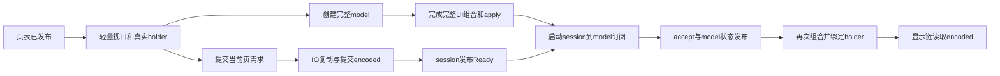

# Windows 阅读器首开调用链与第三方实现调查

日期 2026-11-09。产品源码固定为主干 `1c9e51125787ac1bdf18464ac3f683a1c17faab3`。场景为已下载《史莱姆》第 04 卷、第 5/187 页、静态 WebP、RTL 单页、关闭自动匹配、拆页、裁边及滤镜。沿点击、页面准备、状态交接、取图和绘出追查实际调用，并重新对齐既有原始事件。本轮只读调查，执行了一次离线依赖报告，没有编译或运行性能测试。

后续[优化方案与roadmap](../roadmap/2026-11-09-windows-reader-source-driven-optimization.md)已明确各任务修改边界、最小真实验证、联合采样和采用条件，当前从测量校准P0开始。

## 本轮确认的原因

1. 首屏轻量视口的直接 session 订阅在交接时卸载。完整阅读器改读 model，连接 session 与 model 的 LaunchedEffect 到完整组合 apply 阶段才启动。后台复制完成与 UI 能绑定图片之间存在具体的串行依赖。
2. 未赶上首次／最终两次页表读取时，准入永久回退。此时当前页需求要等完整视口组合提交才产生，准备任务也随之延后。
3. 完整视口无条件创建全屏 controller，其默认 adapter 在 Windows 同步读取 JNA User32.INSTANCE，即使本次没有要求进入全屏。可把原生 adapter 准备移到真正的 placement mutation，需保留进入／退出的一致生命周期。
4. 此前 Windows 记录使用的隔离 PreferencesFactory 每次读取设置都会重新打开并解析整份 properties 文件。普通 Windows 启动采用注册表后端。该差异进入 AWT 线程，也可能改变准入的竞速结果，必须修正对既有绝对延迟的解释。
5. 无裁边／无拆页的静态整页会直接保留原 bitmap，但仍经过 LaunchedEffect → lazy coroutine → transform Ready → 再组合的交接，首轮先返回空 renderedImage。无需改变像素也存在这次异步状态往返。
6. 实际取图后的 Skia 原图 raster、证据采样、缩放与 UI 绘出另占时间。它们已能对应到具体调用，不能继续统称为容器或归档耗时。

上述结论来自生产接线、对应版本库实现和既有事件。原始 fast 样本没有 Ready 发布专用标记，所以复制完成到 Ready 发布的精确时间仍有空缺；本轮没有给该空缺虚构函数自耗时。

## 实际解析的第三方库

版本来自本次 `:app-desktop:dependencies --configuration jvmRuntimeClasspath --offline`，日志为本机 `.gradle-coordinator/reader-dependency-report.log`。该任务仅输出依赖图，6 秒完成。缓存里存在某版本本身不作为选中版本的证明。

| 库／实现 | 实际版本 | 已追到的调用与本场景职责 |
|---|---|---|
| Compose Multiplatform UI / Foundation / Animation | 1.10.2 | 组合、布局、导航动画、普通 Pager 的 LazyLayout。提前挂载成功且首绘前走 StartupSinglePageViewport，HorizontalPager 在后续交接／回退路径使用。 |
| Compose Runtime | wrapper 1.10.2 → **androidx.compose.runtime:runtime-desktop 1.10.4** | collectAsState → produceState → LaunchedEffect；RememberObserver、applyChanges、SideEffect、Recomposer。 |
| Material3 Desktop | 1.9.0-beta03 | 完整阅读器 chrome、加载反馈等 UI 组件。具体是否组合取决于该时刻的可见性分支。 |
| Voyager core / navigator / screenmodel / transitions | 1.1.0-beta03 | Navigator.push → SnapshotStateStack；rememberScreenModel 的 store；SlideTransition → AnimatedContent。缓存的是轻 entry，完整 ReaderScreenModel 在 FullContent 内创建。 |
| kotlinx-coroutines core / swing | 1.11.0 | runtime IO worker、StateFlow、lazy jobs、mutex/semaphore；Swing Main 通过 invokeLater 派发。Reader 没有调用 Voyager 的 screenModelScope。 |
| Skiko AWT 与 Windows x64 native | 0.9.37.4 | Compose UI 的 Swing dispatcher、FrameDispatcher、Skia JNI、位图／Canvas 和窗口渲染。Skiko 版本不等于底层 Skia 的独立版本号。 |
| JNA / JNA-platform | 5.19.1 | Windows fullscreen adapter 的 User32 代理；Native / NativeLibrary 装载与首次 symbol 绑定。 |
| miniz + 项目 JNI | commit 174573d60290f447c13a2b1b3405de2b96e27d6c，ABI 1 / x64 | 目标 CBZ 中央目录、元数据指纹、页 stamp 和流式解压／CRC。源码随仓库固定。 |
| Commons Compress | 1.28.0 | miniz 不可用或归档不满足适用条件时的 ZIP 后端。 |
| SevenZipJBinding / all-platforms | 16.02-2.01 | Commons 打开 ZIP 抛 IOException 后的后备路径及其他归档格式。 |
| SQLDelight JDBC / sqlite driver | 2.2.1 | 原子读取章节打开上下文；transactionWithResult / JdbcDriver 同步调用 JDBC。 |
| Xerial sqlite-jdbc | 3.51.0.0 | JDBC 的 SQLite native 执行。事务／查询保持在调用线程。 |
| Injekt fork / core / api | mihonapp 91edab2317 → 1.16.1 | 按类型查找启动期已注册的 singleton。此次读取不重建完整依赖图。 |
| Coil | 3.4.0 | 在依赖图中；本地漫画显示的实际入口是自有 pipeline / Skia，不能把 Coil AsyncImage 的加载规则套到本链。 |
| JDK | 打包记录 Java 21.0.11 | AWT/EventQueue、Preferences、文件复制／替换、JDBC 接口及 JVM 首次类初始化／链接。 |

Runtime 1.10.4 与 UI 1.10.2 的精确 sources JAR 已从发布仓库取得，位于本机 `.test-tmp/reader-source-analysis-20261109/`。其他库关键入口按本地实际 JAR 的 javap 字节码核对。源文件与字节码能确定派发方式和调用顺序，不包含本次运行的每个方法自耗时。[Runtime 源码包](https://dl.google.com/dl/android/maven2/androidx/compose/runtime/runtime-desktop/1.10.4/runtime-desktop-1.10.4-sources.jar)；[UI 源码包](https://repo.maven.apache.org/maven2/org/jetbrains/compose/ui/ui-desktop/1.10.2/ui-desktop-1.10.2-sources.jar)。

源码包 SHA-256 分别为 `42d7dea9d8684cc8ea5b37c66b24b222ca392873579bb79ef65908dfda4bfa7d` 和 `8434cf3b9e3ef10f0c85f74d5c580ec7e2dafe3c19bf2ff7cf5ced1573d6beb1`。依赖报告还固定了 JAR 实际解析结果；JVM首次类初始化、文件系统、native codec内部和驱动执行的逐函数exclusive时间没有由静态源码得到。

## 生产关键调用逐层追踪

下表应用路径相对于 `app-desktop/src/main/kotlin/mihon/desktop/`，共享核心路径相对于 `domain/src/commonMain/kotlin/mihon/domain/reader/`。行号对应本页固定产品提交。集合／数值运算在所在循环中说明规模，异步、锁、文件和 native 边界单列。

| 调用 | 位置 | 线程、执行内容与依赖 |
|---|---|---|
| openChapter → readerRequest | ui/library/MangaDetailScreen.kt:443；MangaDetailScreenModel.kt:898 | Compose UI scope 启动协程，记录章行点击，读取目标章节，取得原子打开上下文，随后 push Reader。 |
| selectedDesktopReaderOpenContext → RecordReadingProgress.openChapter | reader/DesktopReaderOpenContext.kt:65 | 过滤入口、读取 downloaded-only 设置；调用同步上下文事务，按结果确定恢复页和章节 refs。 |
| database.transactionWithResult | data/src/commonMain/kotlin/tachiyomi/data/reader/SqlDelightReadingProgressRepository.kt:32 | 调用路径没有 withContext。SQLDelight → JdbcDriver → Connection / PreparedStatement → SQLite 在该调用线程同步执行。suspend 声明不等于转 IO。 |
| desktopReaderRuntimeFactory / Injekt.get | reader/DesktopReaderRuntimeFactory.kt:115 | 取启动期已注册 singleton。ReaderPreferences 对象也已构造；其属性 get 仍会逐次读取后端。 |
| rememberScreenModel → createScreenEntry → createRuntime | ui/reader/DesktopReaderScreen.kt:146；reader/DesktopReaderRuntimeFactory.kt:181,362 | AWT 同步建立本次 session、owner、pipeline 与 store wrapper，读取设置。entry 保存 runtime，完整 model 延后创建。 |
| session.start → activate | reader/DesktopReaderSession.kt:234,279 | session monitor 内更新 core，报告 OPEN_READER_INTENT。这个 marker 位于 createRuntime 内部，不能把整个 createRuntime 都放到 marker 之后。 |
| progressPort.open → materializeChapter | reader/DesktopReaderSession.kt:296；DesktopReaderMaterializePorts.kt:67 | runtime Dispatchers.IO。正常详情入口已带 resumeSnapshot，避免再次 beginSyncSession 查询；其他入口依其条件处理。 |
| downloadDescriptors → archiveDescriptors | reader/DesktopReaderMaterializePorts.kt:177；DesktopReaderContentAdapter.kt | 定位实际下载档；miniz Ready 且适用时走 JNI，其他条件回退。目标本地 CBZ 不请求源 HTTP 页面列表。 |
| native open / metadata / page stamps | native/windows-miniz/reader_miniz.cpp | 解析中央目录并用目录元数据生成身份；不解压整卷，不计算整卷图片内容 SHA。完成后回 session 接纳页表。 |
| publishStateLocked | reader/DesktopReaderSession.kt:350,1077 | worker 持 session monitor 更新 StateFlow；更新状态不等于同步运行 UI collector。 |
| initialReaderState / 最终复读 | ui/reader/ReaderFirstComposition.kt:129；ReaderScreenModel.kt:3304 | AWT 读取当前快照、恢复位置和多个偏好；只读两次，未就绪就决定回退。 |
| StartupSinglePageViewport / createHolder | ui/reader/SinglePagePagerViewer.kt:75；ReaderPageImageContent.kt | 直接组合当前页，同一个 Queued holder 可先创建。startup 分支通过 session.state.collectAsState 直接观察 runtime。 |
| SideEffect → scheduleViewportWithoutProgress | ui/reader/ReaderFirstComposition.kt:247；reader/DesktopReaderSession.kt:440 | apply 时提交真实 viewport；不记录阅读进度。 |
| core.settleViewport → scheduler.moveTo / replaceWindow | session/ReaderSessionCore.kt:87；scheduler/ReaderRequestScheduler.kt:361 | 调用者线程，外围 session 锁；生成页 ID／索引集合，主要 O(N)。当前页优先，普通邻页窗口前4后1。 |
| pumpPageRequests → runner.pump / pollNext | reader/DesktopReaderSession.kt:718；scheduler/ReaderPageMaterializeRunner.kt:157 | 同步挑选工作；pending 中线性选优先请求，再 start lazy IO job。选择顺序不保证并行 worker 获得归档互斥锁的顺序。 |
| runWork → prepare | scheduler/ReaderPageMaterializeRunner.kt:265；reader/DesktopReaderSession.kt:779 | IO；物理请求 semaphore、可选 gate、store 初始化 mutex。beginSessionFast 不扫描整个缓存目录。 |
| materializePage → fetchEncodedPage | materialize/ReaderMaterializeExecutor.kt:121；reader/DesktopReaderMaterializePorts.kt:275 | 顺序 resolve/cache 查询、Downloading 事件、fetch、Ready 事件。每次状态发布回 session monitor。 |
| storeWithPolicy → storeAtomically | reader/DesktopReaderEncodedPageStore.kt:144,263 | 同 ref 的写 mutex；创建 partial → writer → 检查实际字节数 → 文件替换 → 内存索引提交 → 清理 partial。copy 返回还不等于 Ready 已发布。 |
| copyArchivePage → JNI extract | reader/DesktopReaderContentAdapter.kt:395；reader_miniz.cpp:306 | runInterruptible；Kotlin archive operation monitor 和 native lease operation mutex 同档串行化解压；miniz extract callback、CRC、fwrite/fclose。 |
| Ready → acceptPageMaterialization → publish | reader/DesktopReaderSession.kt:815；session/ReaderSessionCore.kt:201 | IO worker 持 session monitor 更新页表，包含 O(N) 列表更新，再写 StateFlow。 |
| Host applied → FullContent → entry.model | ui/reader/ReaderFirstComposition.kt:92；DesktopReaderScreen.kt:179；reader/DesktopReaderScreenEntry.kt:17 | startup 分支退出，原直接 collector 被取消。AWT 创建唯一完整 model，重新 initialReaderState，进入共享呈现初始化。 |
| model init / ensureDualSession / publishDualSession | ui/reader/ReaderScreenModel.kt:318,396,506,718 | lifecycle monitor；单页也建立共享页身份、stamp 与 SINGLE 呈现，多个 O(N) 步骤。后台 publisher 也会随相关输入重新 ensure／投影。 |
| 完整 UI composition → LaunchedEffect collector | ui/reader/DesktopReaderScreen.kt:240,289 | UI 此时读 model.state。session→model 桥在 LaunchedEffect 的 remember/apply 阶段才启动，完整 UI 组合必须先完成。 |
| acceptSessionState | ui/reader/ReaderScreenModel.kt:2038 | lifecycle monitor，比较页序、保护可见内容、处理 incoming、ensure/projection、发布 model。随后 UI 再重组。 |
| ReaderPresentationImage → bind / acquire | ui/reader/ReaderPresentationImage.kt:68,104,123；reader/DesktopReaderPresentationImageOwner.kt:244,480,548 | Ready 才有 decode key、绑定 region；DisposableEffect acquire，IO job 等 preview。registry 保持 holder 身份。 |
| region → pipeline → shared content acquire | reader/DesktopReaderRegionPresentationOwner.kt:380；DesktopReaderPageImagePipeline.kt:1256,1312 | pin 内容、按请求去重、lazy async 打开内容。 |
| OPEN_PAGE → encoded store.read | reader/DesktopReaderPageContentOwner.kt:34；DesktopReaderEncodedPageStore.kt | 报显示读取事件，再读取已经提交的 encoded 文件。此处不是 CBZ 解压入口。 |
| withDecodeAdmission → decoder.decode | reader/DesktopReaderPageImagePipeline.kt:999；DesktopPageDecoders.kt:16 | admission 后调用实际 decoder；native 解码期间不持 pipeline monitor。 |
| peekSize → decodeWithOriginal → Codec.readPixels | reader/SkiaImageDecoder.kt:107 | 本场景走原图 raster 路径；分配原图像素、读完整像素、四个旋转方向的证据计划／getColor、分配预览并缩放。 |
| holder Ready → rememberReaderPresentationRenderedImage | ui/reader/ReaderPresentationImage.kt:101；ReaderPresentationTransformOwner.kt:313,335 | 组合看到 asset 后才注册 LaunchedEffect → submit → lazy coroutine。首轮 transform 状态 Empty，返回 null。 |
| createReaderPresentationTransformLease → transform Ready | ui/reader/ReaderPresentationTransformOwner.kt:233 | 无拆页/sourceBounds/裁边时直接保留 base bitmap 与 lease；此分支没有像素变换，也不进入后面的 Default 像素处理。它仍通过 UI scope 的异步任务发布 Ready，再触发一次组合。 |
| renderedImage → onPagePrepared | ui/reader/ZoomablePageBox.kt:371,437；ReaderPagerNativePresentation.kt:280 | 要求有效布局／可见源范围，核 active/slot/内容身份/geometry revision/frame ticket；同步调用 model.prepareDecodedDualViewportPage。 |
| prepareDecodedDualViewportPage → owner.preparePage | ui/reader/ReaderScreenModel.kt:2579 | lifecycle monitor 内接纳 decoded fact，单页不用等待额外配对采样完成。当前票据失效可拒绝本次 draw。 |
| prepareDraw → drawContent → acknowledgeDraw | ui/reader/ReaderIoPresentation.kt:217；ZoomablePageBox.kt:433 | prepare=false 时本次不执行子树 drawContent；成功后先画再确认。FIRST_PAGE_PRESENTED 先于后续 native.drawn 的模型进度确认，Canvas 命令、进度接纳和物理 scanout 是不同端点。 |

章节列表 catalog 补齐与 pairing repository 的读取会以 IO job / async 运行，不能把它们算成构造函数内同步 SQL；它们仍可能通过结果发布或共享锁参与运行。阅读进度写入由实际绘制确认触发。

## 84–87 ms 区间已经可以按真实端点闭合

数据来自归档 `d10-evidence.zip` 的 FC-C-reread1 / FC-C-reread2b。每行是相邻事件之差，单位 ms，所有行相加分别闭合到 87.418 / 84.353 ms。这是阶段墙钟分账，含阶段内执行／派发，不冒充每个方法的 exclusive CPU。

| 相邻端点 | 首次① | 首次② | 对应具体链路 |
|---|---:|---:|---|
| holder apply → model begin |6.949|6.425| applied 状态触发后续组合，切完整 model |
| model begin → end |28.515|27.996| 初始投影、共享身份与呈现初始化、publisher 绑定等 |
| model end → 完整 UI apply |38.281|38.042| 完整阅读器 UI 组合／apply；含同步 fullscreen controller 等调用 |
| 完整 UI apply → accept begin |1.781|1.743| LaunchedEffect 启动 session collector，派发到 UI |
| accept begin → end |1.582|2.235| 含 lifecycle 锁等待0.443/1.073与状态摄入 |
| accept end → holder bind |6.768|5.413| model 状态生效、UI 重组、Ready key 绑定 |
| holder bind → OPEN_PAGE |3.542|2.498| effect acquire、IO 派发、lease/pipeline/内容读取入口 |

原始标记 `ARCHIVE_COPY_*` 有 chapterId=906004 且 detail 是实际 pageIndex，源码 copyArchivePage 将该索引传给 markChapter。因此目标4的复制可以准确对应：58.173–59.237 / 53.448–54.873 ms，相对各自页表就绪。此前因未关联章节和 detail 而称无法识别目标复制，调查不充分，本轮已纠正。

目标复制只用约1.1–1.4 ms，结束后到内容绑定仍有约65–71 ms。store 的替换／索引提交、Ready 发布和 worker 调度尚没有旧样本的独立端点；源码已能确认 UI 订阅必须等完整组合，不能把整段都算成目标解压或锁等待。

## 第三方调度具体做了什么

- Runtime 1.10.4 的 Effects.kt:269–289，LaunchedEffectImpl 在 onRemembered 才 scope.launch，在 onForgotten 取消。SnapshotFlow.kt:48–73 的 collectAsState 通过 produceState 建立 collector；ProduceState.kt 的 producer 又使用 LaunchedEffect。因此写到某一条 Composable 源码行，不等于该 collector 当场已经开始。
- Composition.kt:1103–1134 先应用变化，再 dispatchRememberObservers，随后 dispatchSideEffects。LaunchedEffect 的注册／启动与 SideEffect 标记的顺序不能笼统说成“所有 effect 都在所有 SideEffect 之后”；本次 accept 在完整 UI apply 标记后约1.7 ms 是实际记录。
- UI 1.10.2 的 ComposeSceneRecomposer 用两个 FlushCoroutineDispatcher 管理 effect 与 recomposition；BaseComposeScene.render:174–201 先 flush 已排 effect、再处理 recomposer/frame、measure/layout、snapshot notifications 与 draw。FlushCoroutineDispatcher:52–65 先入队并 launch，flush 会运行可执行队列。effect 可以被同轮事件循环或后续 render flush，不能把每个 effect 固定折算成16.7 ms。
- kotlinx-coroutines-swing 的 Main dispatcher 与 Skiko 的 SwingDispatcher 都经 SwingUtilities.invokeLater，属于两个不同的类。Main.immediate 在已经位于 EDT 时可直接执行。本场景 runtime 工作使用 IO，Composable effect 使用 UI context；Voyager 可用的 screenModelScope 不在 Reader 实际调用链上。
- MutableStateFlow 保留最新值，并合并等价／中间状态。更新值会唤醒订阅者，订阅者仍按自身 dispatcher 执行；当前 UI 不会在 IO 的 publishStateLocked 调用栈中同步消费全部界面。
- Voyager SlideTransition 默认使用 horizontal spring，stiffness=400、默认 dampingRatio=1，结束时间由位移、速度与阈值决定。ScreenTransition 把 navigator.lastItem 交 AnimatedContent，没有“等旧屏退出结束才创建 Reader”的前置 gate。动画会影响画面覆盖和近黑 ROI，不能据默认动画名称推定一个固定加载等待。
- Skiko FrameDispatcher 使用 pending flag 与 conflated channel 合并重复帧请求。多个失效通知不必一一对应多个显示帧，首次位图绘制到物理 scanout 的时间仍需外部观测。

## 测量前提的新发现

四份归档实际启动命令均带 --test-profile。Main.kt:115 在 Preferences 初始化之前调用 platform.DesktopTestProfile.configure；该方法设置 IsolatedDesktopPreferencesFactory，并检查 root 的实际类型，配置失败会终止。

调用链是 ReaderPreferences 委托 → DesktopPreference.get → DesktopPreferenceStore 的 primitive/enum reader → Preferences.get* → IsolatedDesktopPreferences.getSpi:46 → read():77。最后一步每次新建 Properties、检查文件存在、打开 UTF-8 reader、整表 load。没有值缓存；changes().conflate()/stateIn()也不替换直接 .get()。

这四份 profile 的实际文件约2107/2111字节、17个持久键。读取未设置的默认键也会先打开并解析全表。initialReaderState 读取二十多个设置，颜色滤镜本身有九项，startup 投影、model 初始投影和复读 guard 又分别读取。因此隔离模式确有额外的同步文件工作和按节点序列化访问。普通 Windows 默认 Preferences 使用注册表后端，两种后端的值语义可以一致，性能条件仍不相同。

旧 A/B 结果继续描述共同隔离环境中的观测；它们不足以给普通用户启动的绝对差距或提前准入命中率作结论。文件后端改变首轮执行速度还可能改变后台页表与两次读取谁先完成。此项尚无耗时对照，不能声称它恰好解释了28 ms、38 ms或全部黑屏差。

## 其他可定位的同步工作

Windows fullscreen 调用在 ReaderViewport:688 → DesktopReaderFullscreenController 默认参数 → defaultFullscreenAdapter → WindowsBorderlessFullscreenAdapter 默认 User32.INSTANCE。JNA 5.19.1 的 User32 静态初始化调用 Native.load；Native 静态初始化可加载 jnidispatch，Library.Handler 同步取得 NativeLibrary，具体函数首次调用再解析 symbol。普通非全屏首开仍创建这个 adapter。

主窗口的 geometry/transitions 可能已经初始化一部分 JNA/系统 DLL，所以不能把全部 native 首次加载成本都放到这里。startup class warmup 使用 Class.forName(..., false, loader)，也不保证 User32 接口代理已初始化。普通窗口无需原生切换时，controller 只需要轻量状态；adapter 可以在首次真实 placement mutation 前创建一次。进入／退出须使用同一个实例，保留初始已全屏的恢复路径、排队请求取消、dispose和失败fallback。

点击前段的 SQLDelight/JDBC 是另一个明确同步边界。Transacter 管事务但不自动切线程，JdbcDriver 调 JDBC 同步接口并返回 QueryResult.Value；其 await 直接取值。将事务调度到 IO 可研究 UI 响应，但目标打开上下文仍须先确定，不能据“离开 EDT”就宣称整个打开总时间等量减少。

## 解码与绘出阶段

快路径目标 encoded 文件实际读取约0.26/0.31 ms。DECODER_CALL_BEGIN→END 为26.388/25.602 ms，其中 RASTER_PIXELS_BEGIN→END（Codec.readPixels）为16.251/16.225 ms。前段约3.089/2.522 ms包含尺寸／动画元数据探测、Data与codec及内存准备；像素之后约7.047/6.855 ms包含原图证据、输出位图与缩放，不能全称为WebP解压。

decodeDownsampledWithOriginal 会在满足内存上界时先分配全尺寸 RGBA_8888 / UNPREMUL / sRGB raster。PageRotation 四个方向分别生成页侧与边缘证据，调用 Bitmap.getColor；再分配目标位图、应用方向矩阵、通过Skia Canvas缩放。本场景已进入强制 readPixels 路径，不能把后续等待解释成 Image.makeFromEncoded 直到首次绘制才开始全部解码。保留原图证据服务既有共享事实策略，不能仅按单页名称直接删除。

DECODER_CALL_END→holder Ready 约2.65/2.47 ms，holder Ready→应用绘出约37.03/40.94 ms。下面把最后这段进一步对应到现有函数。

| 相对 holder Ready 的事件，ms | 首次① | 首次② |
|---|---:|---:|
| 首次后续组合 BOUND |17.298|24.512|
| 再次 BOUND |33.801|38.205|
| 首次 PAGER_PREPARE |34.678|38.752|
| PAGER_READY_PREPARED |35.163|39.028|
| FIRST_PAGE_PRESENTED |37.029|40.938|

rememberReaderPresentationRenderedImage 的变换 owner 起初为 Empty，组合返回 null。apply 后 LaunchedEffect 才 submit 一个 lazy task；即使 producer 只转移原 bitmap 的 lease，也要经 Ready StateFlow 和另一次组合，才把 Image 交给 ZoomablePageBox。在这个 no-op 分支中，任务使用 Composable 的 UI scope；真正像素变换才在后续分支切到 Default。

两份样本此前都没有 PAGER_REJECT，第一次 prepare 就通过，prepare 开始到 FIRST 仅2.351/2.185 ms。因此37/41 ms主体与 Ready 消费、no-op异步往返和再组合的源码链吻合；没有证据把它判成反复几何拒绝或GPU固定等待。实际 layout/geometry 检查必须满足，源码并不要求单页等另一次异步配对认证后才能绘出。

ReaderIoPresentation 的 prepareDraw 返回 false 会跳过实际 drawContent；drawContent 返回后 acknowledgeDraw 失败则不能倒推“没有画过”。FIRST_PAGE_PRESENTED 由 transform/holder 身份确认后调用 pageIoObserver.pagePresented 产生，后续 currentPixels/native.drawn 才做 viewport/frame 进度接纳。它代表应用 Canvas 绘出路径的确认，不代表GPU已完成或面板已显示。

## 后续研究优先级

1. 先校准普通与隔离 Preferences 后端的性能条件，并保持数据与设置一致。确认测量条件后再解释普通用户绝对延迟，避免为测试后端的文件读取设计错误的优化。后续可研究保留持久化／跨进程可见语义的快照或同后端隔离方案。
2. 稳定下载单页的轻量准入，保留或前移现有 session→首图消费者的桥，解除“完整 model / 完整 UI apply 后才消费 Ready”的串联。身份、代次、设置、早期输入与实际绘制进度继续走现有契约；允许重新评价此前人为选择的交接时点。
3. 给现有 no-op transform 建立保留相同 lease/身份语义的直接呈现路径，避免像素不变时仍等待一次 effect、任务和 Ready 回传。以真实 draw、切页/旧结果、关闭、动态／裁边等原分支回退验证；现有37/41 ms是整体机会区间，不能全部承诺回收。
4. 原生 fullscreen adapter 在首次真实 placement mutation 前惰性初始化。该工作可以按源码确定移出普通非全屏首图链，收益必须另测。
5. 对身份/stamp未变、仅计数或无关字段变化的 publisher 输入研究有界复用，保留D6/D7/D8已有反例和共享状态一致性，先证明冗余再最小实现。
6. 研究 EDT 上的原子打开查询与解码证据／缩放成本。前者以响应和正确原子上下文为验收，后者以图像质量、原图事实与内存上界为验收，优先级低于已经识别的状态交接链。

现有约84–87 ms区间已经闭合到阶段调用。要给38 ms完整UI或37–41 ms绘出段中的每个库方法分别分配exclusive毫秒，还需要方法/CPU/队列/渲染数据。代码负责证明执行内容和依赖关系，现有事件负责计时；本轮没有将代码规模转换成省时承诺。
