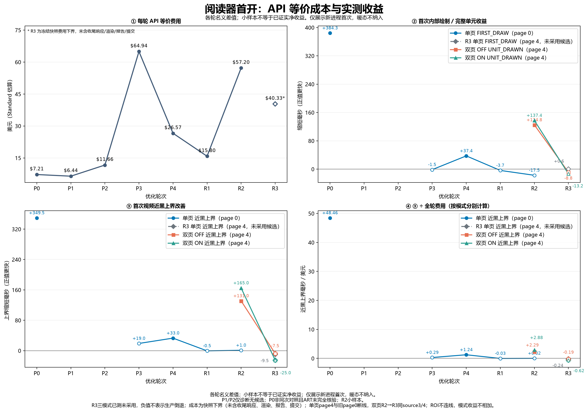

# 下载章节首开自主优化记录

日期：2026-11-04。执行入口为[持续计划](../roadmap/2026-11-04-reader-startup-autonomous-plan.md)。R1已完成真实红绿、独立审查、一次构建及六份真机交替对照：保留局部无效工作削减，但**未证明首开或近黑净改善**。原R1基线为`d4c9862d47ce001e08f567303f7eea198148a966`。R2已完成单/双页12份真机性能对照：双页完整单元内部首绘缩短25.1%–28.1%，单页首次未证明改善；≤60ms及整体目标未达。另发现自动匹配ON正常往返改变单元，优化前A与候选B均复现，尚未修复，不能称双页完整验收通过。

**停止判断更正：** 下文R1当时将未证实收益按0用于整体停止，依据不足。一次候选结果不能证明下一轮收益更小；小样本和帧采样限制下也不能确定真实收益恰为0。保留当时数值与决策记录，但撤回其作为整体优化终止证明的效力。R2不把R1的0作为新的比较分母或继续门槛。

## R1：同值通知重复转换整章状态

观察：代码链显示页表完成后187次初始通知进入`ReaderChapter.dispatch`。reducer已为同值返回原snapshot，adapter仍无条件执行整章legacy映射。它不同于P3首次事实订阅重复重算，也不同于P4重复文件位置查找。

候选：只跳过`next === current`时的投影；保留初始绑定通知及所有真实变化。两条入口使用同一可重入锁；需由真实绑定测试和generation相关focused确认安全性。没有依据将此前页表发布间隙的全部波动都归因于此。

真实红测确认187页初始化时投影188次；同一测试的页面完整性断言先通过，最后计数期望1、实际188而失败。仓库失败重试使同一方法出现3条失败，不能写成3个独立红测。原XML为`.test-tmp/reader-open-goal-20261104/projection-red.xml`，协调器key `reader-open-p5-projection-red-20261104`。

最小修复后3个新增方法、6个`ReaderSessionProductionWiringTest`方法、5个`ChapterLoaderSessionGenerationIntegrationTest`方法，共14个通过；覆盖同值、真实状态/编码身份变化、descriptor建立后绑定前变化、迟到generation与资源退役。加强页序/内容身份断言后新3方法再次通过。原XML为同目录`projection-green.xml`、`session-green.xml`、`generation-green.xml`、`projection-final-green.xml`；GREEN key `reader-open-p5-projection-green-20261104`。首次格式因internal签名超长失败，机械换行后`:app:spotlessKotlinCheck`通过，key `reader-open-p5-projection-format-fix-20261104`。`git diff --check`通过，未执行整模块或全量测试。

主代理独立检查真实dispatch、绑定入口、可重入锁、reducer同值返回和flow顺序，未发现阻塞。production只增加同对象短路及现有函数internal测试可见性，不改变共享reducer、通知或仪器。实际修复的是同值通知重复转换整章页表，**不是已修复首开黑屏**。

### 构建及测量条件

- 控制A：P4隔离APK，SHA256 `2e88eed0532b59c0243a3bf515fb11255859014bb7e0cd57c4bd4596a913991d`。
- 候选B：[诊断APK](../../app/artifacts/android/diagnostics/reader-open-p5-20261104/Mihon-Fork-reader-r1-benchmark-universal.apk)，SHA256 `28d33774d31e4abc4de792e1dd0746d4a1b4335c16f5c419fca23ebc4f71d4aa`。`P5`仅为产物目录命名，本持续计划中为R1。
- `app.mihon.desktop.fork.benchmark`，code134/version `0.19.4-aex.116-benchmark`；原证书SHA256 `fb141e4e749dc634a3d5d79e179a1057ab81fa1fd7cb5077b6dfeccfe11f3079`，R8、资源压缩、non-debuggable。同42点仪器，未改记录器。
- 构建key `reader-open-r1-benchmark-build-20261104`；源码基线加本轮diff，diff SHA256 `a3cb19c9c9baefe0c0954236d7d4fa49ac9f8788dccf627a1b6db03bbec0b924`。同产物目录`artifact.json`保存20个关键输入，主代理复核20项均未变、APK哈希相符。诊断产物不冒充已发布主干包。
- 同一USB平板PCE-W30/API31，serial `5JB0224111000992`，实际OAT各组均`install/verify`。同史莱姆第04卷187页真实CBZ，沿用既有SAF与逻辑章节1/1，从page0开始，未清数据或重跑prep。
- 顺序为A1首次/暖→B1首次/暖→B2首次→A2首次。Main-only前置，不提前进入Reader。单页RTL，横图自动放大OFF，两个阅读提示OFF、原翻页动画ON、黑背景；实际控件截图留存，六份横图控件均独立核看为空框。
- 所有批次前后均USB供电、电量79%、Thermal Status 0；A1电池25℃，其余26℃。这些是计时窗口外读数，不证明CPU/GPU频率恒定。屏幕仅在前台操作时亮起，其余时段熄屏。官方与正式fork APK和数据未改动。

### 六份同次探针与原表指标

以下单位ms，四段起点是ViewModel初始化，**不是触摸送达**；第4段终点是目标图片绘制回调，不是物理屏幕呈现。

| 样本 | 初始化→页表 | 页表→OPEN_PAGE | OPEN_PAGE→解码提交 | 解码提交→首绘 | 合计 | getPages结束→页表 | 视频近黑区间 |
| --- | ---: | ---: | ---: | ---: | ---: | ---: | --- |
| A1 首次 | 110.345 | 70.221 | 12.839 | 85.772 | 279.177 | 10.553 | 66–99 |
| A1 暖态 | 92.739 | 59.976 | 2.011 | 88.092 | 242.817 | 10.274 | 34–68 |
| B1 首次 | 96.925 | 98.810 | 11.245 | 91.446 | 298.426 | 6.331 | 67–101 |
| B1 暖态 | 72.280 | 83.717 | 5.088 | 96.339 | 257.423 | 3.767 | 50–85 |
| B2 首次 | 116.751 | 77.884 | 9.480 | 77.058 | 281.173 | 11.204 | 67–99 |
| A2 首次 | 123.107 | 60.976 | 9.463 | 99.505 | 293.051 | 15.056 | 67–100 |

原表native输入取较早的`deliverInputEvent src=0x1002`；StartActivity取Reader精确异步slice，不使用`startActivityInner`。下面首TX只是Reader关联图层帧完成，不能据此判实际内容响应≤100ms。

| 样本 | 输入→StartActivity | 输入→performCreate | 输入→首Reader TX结束 | 输入→映射FIRST_DRAW |
| --- | ---: | ---: | ---: | ---: |
| A1 首次 | 25.959 | 47.612 | 125.186 | 341.793 |
| A1 暖态 | 21.573 | 41.528 | 94.430 | 294.678 |
| B1 首次 | 31.371 | 53.418 | 140.545 | 367.169 |
| B1 暖态 | 22.284 | 37.934 | 95.617 | 307.118 |
| B2 首次 | 34.205 | 56.233 | 139.997 | 353.017 |
| A2 首次 | 36.922 | 59.815 | 144.344 | 368.757 |

probe MONOTONIC以各trace双clock snapshot映射到BOOTTIME，偏移约234727154338522ns、两快照差不超过521ns；没有用主机发ADB时间或归零视频PTS混算。视频只计算自身四边界的区间，没有补出绝对输入→实际漫画可见。前五份trace各记录1条`trace_sorter_negative_timestamp_dropped`，A2无；相关端点存在且顺序有效，所有样本保留，未将警告归因于产品或删除不利样本。

连续帧由Sol和主代理独立核看，Luna按原生PTS交叉计算；帧组A1首99/100/104/105、A1暖37/38/40/41、B1首95/96/100/101、B1暖36/37/40/41、B2首95/96/100/101、A2首102/103/107/108，依次为最后可辨详情/首近黑/末近黑/首正确漫画。残余可辨详情和输入涟漪不算近黑，正确漫画出现后的所核连续帧无二次闪黑。

全部原件位于`.test-tmp/reader-open-goal-20261104/r1/`，每个`r1-<control或candidate>-<批次>-<次序>`目录保存trace、视频、native PTS与`boundary/selection.json`、`continuous.png`；probe在相应`*-ui`目录。精简整数时间与计算为`analysis/sample-metrics.csv`、`sample-metrics.json`、`summary.txt`及沿用P4的SQL。原视频/图片/完整trace包含私人阅读内容，不提交Git。

### 结果解释、采用与停止决定

首次合计均值A **286.114ms**、B **289.800ms**，候选名义慢3.686ms；第一次配对慢19.249ms，第二次配对快11.878ms。唯一暖态242.817→257.423ms，名义慢14.606ms。两组首次近黑上界均值99.5→100.0ms，下界66.5→67.0ms，差0.5ms远小于视频帧间距，不能解释为真实改善或确定回退；候选两次首次下界均>60ms，目标仍未达。

局部窗口getPages结束→页表首次均值12.804→8.768ms，减少4.036ms；但它还包含其它工作与调度，不能把全部差值视为该函数独占收益。首次四段均值差为−9.888/+22.748/−0.789/−8.387ms，页表→OPEN_PAGE增加22.748ms抵消其它段下降。这说明“少做工作”不自动等于“更早显示”：剩余UI挂载、本页处理与帧机会仍影响终点。当前没有把该22.748ms落实到单一原因，不把线程休眠叫作I/O，也不声称本次guard导致新等待。

保留已用真实生产测试证明的局部冗余削减：不增加读取、调度、缓存或等待，真实变化和generation契约保持，正常翻页通过。没有证据证明整体回退由这处改动引起，同时也**不将它宣传为首开性能改善**。此次只确认重复投影问题已修复。后续若出现可复现回退，应按本报告基线和已冻结APK复查，不能以“逻辑上更少工作”为由否认实测。

按预先固定的主指标，本轮名义收益为−0.5ms，没有可确认正收益；决策用正收益计0，`ROI=0`，低于P4的四分之一门槛0.3104495ms/USD。此次停止依据是**本轮没有测到值得继续投入的净收益**，不是统计证明所有后续算法或平台均无优化空间。没有增加第三轮样本、第二候选或全模块测试去追有利数字。R2/R3未执行，双端总体目标仍未完成。

关闭probe后候选三轮正常1→2→1通过，7张图的页码和相同页内容经主代理复核，未复现P3停稳黑屏；证据`r1-final-normal-flip/contact.png`及相应JSON。最终probe OFF、隔离包无PID、采集进程退出。首次收尾读数为Asleep但changing=true，包装断言失败；只读复核已Asleep且changing=false，属于状态收敛，未重发唤醒。原件`final-device-cleanup.json`与`final-power-settled.json`均保留。成功操作补入既有平板指南，不改屏幕超时或锁屏配置。

## 成本与收益边界

P4首次近黑上界均值改善33ms，内部首绘改善37.358ms。本轮主收益与成本规则见计划。官方价格来源：[API价格](https://developers.openai.com/api/docs/pricing)、[Sol模型](https://developers.openai.com/api/docs/models/gpt-6.1-sol)、[Astra模型](https://developers.openai.com/api/docs/models/gpt-6-astra)，核价日期2026-11-04（本地）。

| 模型 | 普通未缓存输入 / 缓存输入 / 输出，USD每百万token | P4完整批次标准化成本 |
| --- | --- | ---: |
| GPT-6 Astra | 10 / 1 / 50 | $21.296114 |
| GPT-6.1 Sol | 2 / 0.10 / 10 | $5.141644 |
| GPT-6 Luna | 0.10 / 0.01 / 0.50 | $0.136608 |
| 合计 | 每请求输入超过272,000时，整请求输入价格×2、输出×1.5 | **$26.574366** |

P4覆盖UTC 2026-11-03 16:02:00至17:18:34.071，包括两次主代理turn及子代理期间工作，截止任务完成而非Git提交。按thread/turn/response身份核得363个唯一响应，无重复；其中24请求达到长上下文档位。缓存写入字段在每个响应中存在且为0；reasoning属于output，不另收费。服务档位缺失，以上按统一Standard价格估算API等价成本，不是实际账户账单；若整批均为Fast则成本×2，同口径比较的比例不变。

旧footer漏掉Sol中间一次57响应的turn（14,247,617输入token），因为续轮member登记发生在该turn最后响应后约0.764秒。此次按实际目标批次补齐，不把漏计当作成本下降。原件为`.test-tmp/reader-open-goal-20261104/cost/cost-reconciliation.json`及`p4-turn-breakdown.json`；只保存数字元数据，不把会话正文提交仓库。

P4主指标ROI为`33 / 26.574366 = 1.241798 ms/USD`；下一轮严格低于`0.3104495 ms/USD`才触发四分之一停止条件。不能用P4的33ms除本轮成本冒充本轮收益。

本轮收尾快照覆盖UTC **17:34:10至18:05:54.042**，287个唯一响应，按同口径已记录 **$14.882927**（Astra $12.468800、Sol $2.256028、Luna $0.158099）；无长上下文请求，缓存写入字段均为0。包含调查、核账、实施、测试/失败、采集分析、审查及截至该时刻的文档工作。固定数值原件为`cost/final-audit-output.json`，此后的少量提交/最终汇报token尚未进入该快照，因此是本轮总成本下界而非完整结算账单；后续成本只会上升，正收益为0的停止裁决不受影响。若采用未经正收益截断的名义差−0.5ms，当前比值约−0.0336ms/USD，同样没有达到继续条件。

## 当前未完成项

Android首次≤60ms仍未证实；完整输入→首漫画时钟对应、Windows同条件首开及足量样本仍须按基准处理。R2已补真正双图首开的内部／视频边界，但自动匹配ON正常往返存在A/B均复现的未修问题，双页完整验收未通过。已有结果只支持各轮登记场景的改善，不代表整体目标完成。官方APK和数据不得修改。

## R2：单页与真正双页单元的首开评估及优化

起点`b63f8ec44e87abf534f88df36a05c88e1d636b23`，开始时工作区干净。用户明确要求再推进一轮并加入双页性能评估及优化。仍由Sol唯一操作设备/Gradle并实现，Luna读取和离线分析，主代理维护本记录、审查和提交；不另建计划或报告。

正常UI已确认双页RTL、自动跨页匹配OFF；封面page0仍是单张宽图，因此不能代表双图开销。同卷source3/4组成右侧标题页＋左侧World Map，显示锚点4/187，正常退出后详情显示第5页，恢复实际目标index4。两次正常重进初始截图黑；第二次没有输入，约3秒后完整双图自行出现。该时间来自主机观察顺序，**不是设备精确性能值，也未证明持续黑屏或其原因**。图片位于`.test-tmp/reader-open-r2-20261104/next-preview.png`、`resume-preview.png`、`resume2-initial-preview.png`、`delayed-preview.png`和`dual-mode-controls.png`，正式采样前重建进程。

原探针只认page0，双页的FIRST_DRAW只覆盖某个子图，不表示完整单元。R2先补targetPage与当前ticket完整单元的最小仪器，再用同仪器做优化前后对照。待查线索为双页逐页contentFact初始化通知重复执行owner配置/重建；目前只证明代码存在该路径，不提前宣称它是秒级等待的原因。单页现有数据指向holder构造后load进入约31–35ms及UI激活段波动，仍需具体任务证据，不直接更改协程启动方式。

仪器阶段已完成：真实RED `reader-r2-probe-red-20261104`确认配置目标4仍被旧实现当作非目标拒收；实现targetPage冻结与弱实际页绑定后，Probe4方法、真实VM187页接线1方法、真实ChapterLoader2方法通过。真实双PNG/Canvas的当前/非选中holder、首图/完整单元、旧request拒收1方法，以及既有单页bitmap旧请求回归1方法通过，共9个focused；最终key `reader-r2-native-final-20261104`，XML保存在本轮临时目录`probe-green`、`vm-target-green`、`loader-green`、`unit-native-final-green`、`single-native-green.xml`。Kotlin格式及diffcheck通过，主代理核XML和production门禁，允许一次控制仪器构建。

测试过程中区分了真实功能RED和夹具问题：首图子holder一度捕获继承的request0，经真实绘制断言发现并改为外层绑定request；旧request负例不再使用强制prepare成功的helper，而直接真实Canvas重绘后验证拒收；VM夹具在resetMain前等待后台scope取消，防测试结束后异步回调。没有因此更改生产调度或绕过原图prepare门禁。改动跨10个代码/测试文件是同一个目标身份→VM→双页holder→真实绘制的诊断接线，未拆成独立功能或启动全模块测试。

控制A已构建，SHA256 `889bd4a367689affc85fa6e741af5fa14eb7fac837d92b0692614eeb9ea2a527`，构建key `reader-r2-instrument-a-build-20261104`，source diff SHA256 `f33332a4e95f20e17d46b50efe730514e786dc35da8083ff9dce3873ab800fdf`，25项关键输入冻结；同隔离身份/证书/code134，实际install/verify。首份OFF的初始化→首目标绘制497.849ms、UNIT_DRAWN498.043ms；之前约3秒仅为观察间隔，此精确计时不支持把它称为3秒加载。

同次主线程187次dualFact的inclusive与union均128.809386ms，分布在页表之后+34.899740至+194.865365ms；页表→目标header开始199.443229ms，重复处理覆盖64.6%。主线程Running交叠185.681ms（93.1%），holder创建→load进入175.205ms与其重叠，不能相加。数据足以支持对已同步摄入初始事实的重复处理做真实RED，仍不意味着128.8ms全部可回收。原件`analysis/r2-a-off-first.json`、同名CSV及summary；正式结果见下表。

### 双页冗余的真实红绿与改动边界

控制A关闭／开启自动匹配、各首次／暖态的四份样本均有187次初始同步通知，inclusive依次128.809/101.297/137.239/92.149ms。单页同条件首／暖仅1.239/0.450ms；单页P3已跳过已摄入的初值，而双页此前仍逐条重新ensure、配置和重建。这解释的是已观察到的重复主线程工作，不把单页与双页不同源图的整段差值全部归给它。

真实dual viewer连接spy的生产store，187页注册完成后清计数再排空首发通知，RED确认为187次ensure、期望0。首次红测夹具只替换VM内store，未传双页viewer构造参数，未到行为断言；修正实际接线后key `reader-r2-admission-red2-20261104`得到有效RED。`admission-red.xml`有同一方法的三次失败重试，不是三个独立红测。

候选只在`DualPageViewerAdapter`复用单页P3的固定首快照准入；保留初次ensure／配置、末尾rebuild，以及所有后续事实变化。生产store和共享配对算法未修改。测试确认187次重复ensure降为0，同时覆盖metadata、重试、已被另一ensure提前摄入的重试、流／编码身份替换、首回调前变化、章节窗口和同章节页表替换、旧页与销毁后拒收。

候选第一次GREEN已通过去重断言，但后续真实metadata采样遇宿主Windows缺少Android imagedecoder JNI；只将该测试夹具替换为项目既有decodedRegionFactory，保留真实采样／发布和断言。`admission-final-green.xml`的新dual方法最终通过，key `reader-r2-admission-green2-20261104`；`admission-boundaries-intermediate.xml`中既有P3单页方法及真实双Canvas方法通过，该XML整体仍含JNI失败，不能标成整份PASS。KotlinApply／Check和diffcheck通过。主代理读生产准入、初次重建和后续路径，并流式核三份XML后批准B构建；未启动整类、整模块或全量测试。

候选B：[R2诊断APK](../../app/artifacts/android/diagnostics/reader-open-r2-b-20261104/Mihon-Fork-reader-r2-b-benchmark-universal.apk)，SHA256 `259c0d98b00deeca6a1254f753f2ffe0be2e6a7d8f541db74b117de6cfdadfc6`。构建key `reader-r2-candidate-b-build-20261104`，source diff SHA256 `c79bb59b98dfde4e99d72fb3b4ee7fbebf0a33f6aa78d0ff65928aa3282bde3b`。主代理独立核A/B包哈希和B全部25项当前源码输入；清单间仅adapter优化和新增dual测试两个输入变化，仪器输入完全相同。相同隔离包、版本、证书、R8／资源压缩／non-debuggable；安装后实际OAT为install/verify。它是诊断体验包，不是已发布主干包。

### 测量语义与视频复核

本轮四段起点仍是ViewModel初始化位置的`OPEN_READER_INTENT`，不是输入送达或真正发Intent；独立的`INIT_IO_ENTER`不是同一事件。双页FIRST_DRAW仅是配置target4的绘制，UNIT_DRAWN才是当前有效单元的全部required图绘完，两者均不是物理屏幕呈现。视频首部分漫画与完整双图分别分类：A ON首次先出左Map，其余三份双页先出右标题，因此首部分漫画未必对应配置目标的FIRST_DRAW。

主代理逐图复核原PTS缩略图后，A近黑四界依次为OFF首91/92/106/107、OFF暖34/35/46/47、ON首97/98/114/115、ON暖35/36/44/45、单页首101/102/105/106、单页暖35/36/37/38。四双页首完整图为110/49/116/47；A OFF首次109仍只有标题页，已纠正最初误认，单页最初108/44的晚候选也未采用。完整单元比首部分漫画晚49/33/16/34ms，只表示视频帧间距，不是精确的第二图独占耗时；已有一图期间不继续计近黑。

近黑起点沿原表对极淡详情残影的分类，约一帧的视觉敏感性保留；上下界用原始PTS而非假设固定fps。六份所选帧的PTS与best-effort一致。唯一确认清单`analysis/video-selections.json`保留未采用候选；`r2-a-all-samples.csv/json`保存整数纳秒和映射。视频没有绝对输入时钟，仍不能输出绝对输入→漫画可见值。边界分类错误属于分析错误，不能通过重采有利视频掩盖。

### 十二份同条件性能结果

顺序固定A OFF首／暖→A ON首／暖→A单页首／暖→B OFF首／暖→B ON首／暖→B单页首／暖。每组新进程首次加同进程再次；双页目标4、单页目标0，横图自动放大OFF、提示OFF、原动画ON、黑背景。双页录制12秒，单页8秒，同组A/B时长相同。各组采前后实际OAT均install/verify、USB供电、thermal0；A OFF电量80→81%、电池25→26℃，其余81%、26℃，不据此声称CPU/GPU频率恒定。条件原件和路径在`sampling-metadata-summary.json`。

下表单位ms；1为新进程首次，2为同进程再次。四段从VM初始化开始，合计是配置目标页FIRST_DRAW，完整双页另列UNIT_DRAWN。单页／双页源图不同，只在同组A/B比较；单页UNIT不适用。

| 样本 | 初始化→页表 | 页表→OPEN_PAGE | OPEN_PAGE→解码提交 | 解码提交→目标首绘 | 合计 | 完整双页绘完 | 视频近黑 |
| --- | ---: | ---: | ---: | ---: | ---: | ---: | --- |
| A OFF 1 | 105.389 | 227.492 | 34.940 | 130.028 | 497.849 | 498.043 | 233–264 |
| B OFF 1 | 124.537 | 74.310 | 64.802 | 109.391 | 373.040 | 373.224 | 100–133 |
| A OFF 2 | 76.169 | 176.497 | 27.317 | 142.878 | 422.861 | 422.990 | 183–216 |
| B OFF 2 | 86.306 | 46.772 | 37.624 | 133.238 | 303.940 | 304.128 | 84–117 |
| A ON 1 | 110.651 | 223.258 | 18.947 | 133.520 | 486.377 | 502.684 | 265–298 |
| B ON 1 | 96.670 | 78.414 | 29.057 | 160.922 | 365.063 | 365.293 | 100–133 |
| A ON 2 | 73.927 | 164.134 | 36.218 | 107.001 | 381.280 | 381.372 | 132–166 |
| B ON 2 | 82.415 | 36.240 | 34.267 | 121.012 | 273.934 | 274.047 | 16–50 |
| A单页1 | 106.803 | 77.131 | 12.193 | 86.327 | 282.455 | — | 51–86 |
| B单页1 | 129.291 | 67.542 | 8.860 | 94.215 | 299.907 | — | 52–85 |
| A单页2 | 73.742 | 53.886 | 7.878 | 90.626 | 226.132 | — | 17–50 |
| B单页2 | 85.969 | 50.495 | 6.683 | 80.398 | 223.546 | — | 0–33 |

原表系统端点，单位ms；起点为较早的native `deliverInputEvent src=0x1002`。Reader首TX仍不代表正确漫画显示；最后两列是跨钟映射的内部绘制，不是视频绝对可见时间。

| 样本 | 输入→StartActivity | 输入→performCreate | 输入→Reader首TX结束 | 输入→目标FIRST_DRAW | 输入→UNIT_DRAWN |
| --- | ---: | ---: | ---: | ---: | ---: |
| A OFF 1 | 33.461 | 55.038 | 133.766 | 568.553 | 568.747 |
| B OFF 1 | 32.126 | 52.027 | 119.776 | 440.907 | 441.092 |
| A OFF 2 | 21.615 | 37.834 | 85.085 | 467.636 | 467.765 |
| B OFF 2 | 23.399 | 39.138 | 88.590 | 350.530 | 350.718 |
| A ON 1 | 32.507 | 54.786 | 128.109 | 556.473 | 572.781 |
| B ON 1 | 27.386 | 45.738 | 112.409 | 424.991 | 425.222 |
| A ON 2 | 23.950 | 40.199 | 95.832 | 429.979 | 430.070 |
| B ON 2 | 23.358 | 39.074 | 84.372 | 320.293 | 320.406 |
| A单页1 | 30.814 | 56.334 | 126.741 | 353.260 | — |
| B单页1 | 26.509 | 50.962 | 139.284 | 367.586 | — |
| A单页2 | 21.546 | 36.194 | 91.173 | 270.587 | — |
| B单页2 | 26.109 | 40.742 | 93.161 | 271.494 | — |

B近黑四界为OFF首91/92/98/99、OFF暖36/37/42/43、ON首96/97/103/104、ON暖37/38/39/40、单页首97/98/101/102、单页暖38/39/39/40；四双页完整帧为102/44/107/42，首部分→完整的原PTS差为51/16/50/35ms。B单页暖首末近黑同为39帧，下界0不代表真实没有黑屏。正式清单为`analysis/r2-b-video-selections.json`，与A分开。已核初次完整显示后的四份B双页连续范围没有再黑或换图；这不替代后述正常往返检查。

原数据根为`.test-tmp/reader-open-r2-20261104/`；A probe在根下各`r2-a-*-ui`，B probe在`b/r2-b-*-ui`，视频／trace在各同名样本目录。最终`analysis/r2-ab-final-12.json/.csv/-summary.txt`及复算脚本保存精确源路径。主代理独立复算全部12行的阶段加和、native差值、跨钟FIRST_DRAW和Decimal PTS，并直接比对6份B原probe，均一致。中途汇总曾把B已舍入ms还原为ns、漏映射B OFF首告警，已撤回并改用原事件整数；显示表只在最后舍入三位小数。已确认A ON首、B OFF首、B ON暖各有负时间戳丢弃告警；B单页未保留健康字段，标未核而不是无告警，相关计时端点均完整。

### 收益、正常阅读问题与采用决定

四份双页的187次通知仍存在，但同步处理inclusive分别由128.809/101.297/137.239/92.149ms降至0.547/0.356/0.596/0.434ms；真实测试同时证明初始重复ensure为187→0，支持本次削减了首屏关键路径中的重复工作。目标FIRST_DRAW分别缩短124.809/118.921/121.314/107.346ms；完整UNIT分别缩短124.819/118.862/137.391/107.325ms，即25.1%/28.1%/27.3%/28.1%。近黑上界分别降低131/99/165/116ms，明显超过单帧采样间距。

单页首次目标首绘反而名义增加17.453ms，近黑51–86→52–85ms基本相同；暖态首绘减少2.586ms，近黑短一帧，不宣称单页性能改善或确定回退。候选没有修改单页生产策略。双页各组只有一次首次／暖态对照，不作统计显著性或全场景收益保证，不扣固定探针开销换算无探针值。B两份双页首次近黑下界均100ms，单页首次上界85ms，整体≤60ms仍未达。下一步性能定位应关注剩余初始化／页表及解码提交→首绘的具体任务，不能把整个wall区间叫解码CPU或凭本轮结果认定其它优化收益更小。

**正常阅读验收有一项失败。** probe关闭后，单页1→2→1和新进程恢复1/187通过；双页OFF的5→6→5及重启恢复同Map左／标题右通过。ON首次脚本期望回到5却读到4，且先断言后截图导致缺少当时图片；最初仅凭页码推断为合法锚点差异已撤回。新label定向截图实际为初始Map左／标题右，下一单元人物左／Map右，返回标题左／蓝漫画右，详情保存第4页，内容确实不同。

为辨别归因，只增加已冻结A/B各一次probe OFF同场景next→back连续视频及停稳截图，不新增构建／性能样本，也不扩测试矩阵。A与B均复现上述5→6→4和详情第4页；每步至少两张间隔0.7秒的中心区域像素相同，排除仅捕获瞬态动画这一解释。主代理核A拼图与B原停稳图。原件`b/anomaly-a-run/`、`b/anomaly-b-run/`各有`screen.mkv/contact.png/result.json`；前面失败的XML和缺图事实保留。**这是优化前A也能复现的既有双页ON往返问题，具体配对／呈现根因未定位，本轮没有修复，不得标为正常往返PASS或完整双页验收通过。** 首开中同source3/4完整呈现的性能样本仍有效，不能用它覆盖另一条用户路径的失败。

保留本轮有真实红绿和同仪器真机收益支撑的双页初始去重，作为诊断候选本地提交；不发布或推送，不更新公开功能承诺。仪器阶段9项、候选阶段3项focused证据中有1项重叠，共11个不同用例；复用未受影响通过结果，并非最终代码全量重跑。Windows、LTR／条漫／其它存储、3首次+3暖最终基准、probe开关负担校准和ON往返问题仍未完成。

最终保持B包，SHA与上述候选一致；probe OFF、Asleep=true／changing=false，隔离包及设备采集进程无PID，宿主本轮采集已清理，官方与正式fork APK／数据保留。状态原件`b/final-state.json`。操作经验补入[平板指南](../automation/ANDROID_TABLET_ACCEPTANCE.md)，AGENTS.md已有该路径入口。

## R3：自动匹配加速机制核查与跨轮成本收益（候选未采用）

2026-11-04用户授权再推进一轮，并检查ON的独有优化能否用于OFF和单页。基线`ad34d549556ef1d55ad3f06f88fdb0925b8d64da`，起始工作区干净；实施和取样遵循唯一持续计划R3。过程原件限定`.test-tmp/reader-open-r3-20261104/`，不修改已冻结R2记录。

当前任务费用起点为UTC 2026-11-04 01:53:37.937008（当地09:53:37），run `b0594dbaf9ee540b020457b1`；包括主代理、Sol和Luna的调查、实现、失败、分析、绘图与收尾。先核历史任务完整边界，再保存数值元数据，未确认前不把旧footer或累计token当作每轮费用。官方Standard参考单价于2026-11-04重新核对：[价格](https://developers.openai.com/api/docs/pricing)、[Sol长上下文规则](https://developers.openai.com/api/docs/models/gpt-6.1-sol)。结果图将区分API等价估算、实际账单和未覆盖尾部。

### 自动匹配是否具有可共享的独有加速

限定读取当前源码和已有配对研究，机制提取保留`analysis/mechanisms.json`。本轮下载CBZ走`DownloadPageLoader → ArchivePageLoader`；HTTP调度器的优化不能用来解释它。

| 已有机制 | 实际范围 | 对本次本地首开的含义 |
| --- | --- | --- |
| A1评分提前拒绝、B方图免边缘采样 | 已在共享配对核心；仅需要配对判定时有工作 | 减少匹配自身开销，不能当作OFF/单页缺少的图片解码加速 |
| C同绑定普通请求原位提升、双可见请求准入 | HTTP loader；独立于自动匹配开关，双可见另受真实视口约束 | 本次CBZ不经过该路径，无可从ON迁移的本地提速 |
| P3/R2初始事实订阅去重 | 单页与双页ON/OFF均已采用 | 重复ensure问题本轮基线已消除，不能再计算一次收益 |
| ON配对证据采样、有限邻页预取 | 另开archive entry并建立独立region decoder；共享facts和stream factory，未共享显示用encoded buffer/decoder | 可能提前获得配对所需事实，同时增加工作；不能由ON样本快证明净加速 |
| 已有尺寸事实快速返回 | `ReaderPage.publishHeaderFact`对当前encodedVersion已有有效尺寸直接返回；各模式均可命中 | ON若先采到事实，可以让后来的普通holder免去读头，这是条件性的提前准备，基础能力已共享；本轮尚无运行时证据证明它造成R2的ON领先 |
| 双页证据读取使用软件位图 | 双页ON、未裁边且无sourceBounds时，`pageSideHintEnabled → decodedSideEnabled`请求`setHardwareConfig(false)`；OFF/单页可能为true | 这是尚未共享的真实配置差异。当前SSIV依赖在true且API≥26时确有可选`Bitmap.copy(HARDWARE,false)`；ON符合条件时避免该次可选copy，但本轮未量到实际发生/成功次数及耗时，不能称已证实的净加速 |

R2-B首次下载检查OFF/ON/单页分别41.2/34.5/49.1ms、归档打开28.3/21.4/29.6ms、列表30.3/19.9/32.5ms。这些发生在viewer匹配启动前，不能归因自动匹配独有优化。目标header首次OFF约15.97ms、ON约13.30ms，耗时本身不能证明开流次数或缓存命中；保留此因果边界，不宣称模式天然更快。

硬件copy线索在本轮候选冻结后补核：`DualPagerPageHolder`只对双页设置hint，单页不会因为同一个自动匹配偏好而命中；`ReaderPageImageView`的BufferedSource路径将配置传入当前resolved `com.github.tachiyomiorg:subsampling-scale-image-view:66e0db195d`。限定反汇编该AAR确认`TilesInitTask → Decoder`传递字段，`Decoder.decodeRegion`在允许时执行硬件copy；成功才回收软件图并返回硬件图。最初只检查部分字节码未找到copy，现已由完整字段引用链更正，不能将其误记为无效开关。

**这一配置可以作为下一次共享候选，尚不能直接认定共享后更快。** OFF/单页可独立选择是否请求硬件copy，无需启用匹配算法；但必须以相同图片和缩放/翻页行为比较copy与后续绘制总成本，兼顾内存和正确内容，而不是只统计少一次调用。下一次若评估，仅改变这一个配置，先确认实际命中，再用同条件对照决定是否共享；本轮没有把它与同流复用合并，避免无法区分收益归因。

### 本轮候选与固定测量协议

选择共享的重复原图打开：单/双holder首段IO单独开流发布有界header，回Main校验，再在第二IO重新开流读完整编码。候选在首段保留同一流，peek发布header，沿原Main身份/呈现校验后由第二IO读取剩余编码并关闭；不等待完整图片后才发header，不移动prepare、不改全局调度/画质/匹配算法，不声称消除了Main往返。必须保护打开时的流版本、header合法更新、外部内容替换、取消、错误与重试。

正式取样预先固定：控制A为冻结R2-B，候选B为本轮同仪器构建；三模式均以source4地图为观测目标，双页仍核source3/4完整单元。四块ABBA，各块单页、双页OFF、双页ON各一次新进程首次，后两块反向模式顺序；共12份，暂不追加暖态。主收益为各模式近黑上界均值减少，内部目标首绘/完整单元分别旁证；所有样本保留，未知和负名义收益不补零或截断。历史page0单页与本轮source4单页不连成同条件收益线。

### 真实行为红绿、审查与构建

两个真实holder冷绑定测试在原实现分别观察到开流2次而期望1次，`red-confirmed.xml`保留每方法3次仓库自动重试，不当作6个独立红测。第一版实现通过5个新增方法；主代理独立审查发现header失败/取消后的close异常会越过原后备处理，新增失败条件确实产生IOException RED，见`close-red.xml`。修复后普通清理异常记录，有原取消则附加suppressed，取消原因保持；不吞Fatal。正常消费和所有提前退出均只关闭本次持有的源。

最终组合证据覆盖10个不同相关方法：5个单/双holder冷绑定、取消、换流、失败/重试回归；已有双PNG真实Canvas和单Bitmap旧请求拒收；malformed有界header、late header；原EXIF呈现接线。`focused-verification.json`保存准确selector与各XML，主代理核对实际XML和关键生产路径。一条旧`cancelled local header...`测试仍要求ChapterContentPort遍历图片头，P0已移除此行为；本轮误选后失败已保留，没有更改旧测试来造绿。取消实际行为由新holder回归覆盖，不能将含旧失败的整份XML称PASS。

尝试把既有EXIF夹具的预发布header删除后，反射单次绑定遇到正常content observer取消，config为空；恢复原夹具后精确原方法通过，不将其描述为宿主环境已修复。最终`reader-r3-final-exif-20261104`为PASS，Kotlin Apply/Check和diffcheck通过；没有运行整类、完整模块或全仓库。

控制A为R2-B APK，SHA `259c0d98b00deeca6a1254f753f2ffe0be2e6a7d8f541db74b117de6cfdadfc6`。候选[B诊断APK](../../app/artifacts/android/diagnostics/reader-open-r3-b-20261104/Mihon-Fork-reader-r3-b-benchmark-universal.apk)，SHA `ea0a402b764c778c5a03a827948164974baba17a5543a6366b22bfa1961efb69`；基线ad34d549、source diff SHA `aac3cdb8d66d45973643ba3dc11d40dc4410b6ee1bf3e6433b90321c8d16f738`。26项源码输入包含新增受影响ReaderPage与R2既有仪器；相同隔离包/版本134/证书、R8/资源压缩/non-debuggable。构建key `reader-r3-candidate-build-20261104`，UTC02:12:58.792至02:15:30.926成功，仅一次B构建。

第一份探索单页录制与B构建重叠（视频创建02:14:56.596，capture于02:15:13.668收尾）。主代理在看耗时前即要求不计入正式12份，并停止安排新采样；原件`r3-a1-single4-1/`及`r3-a1-single4-ui/`保留，时段和理由在`exploratory-overlap-exclusion.json`。正式组使用构建结束后的新`r3-formal-*`label，不以快慢筛选样本。准备时短暂通知弹窗未进入Reader，不计打开样本，未盲授权限；重启后正常UI将单页定位到source4 World Map（5/187），之后只按协议切模式和重建进程。

### 十二份正式对照与内部结果

正式ABBA全部完成；每模式A/B各两次新进程首次，作品、source4、12秒录制、原动画和其它阅读设置相同。B2也按协议保数据重装B；后两块按ON→OFF→single4反序准备和采集。每份采前/后实际OAT均为`verify/install`、USB供电、thermal status 0；旧dex2oat命令参数中的speed-profile不是实际产物状态，不据这些条件声称CPU/GPU频率恒定。

采集中主代理批量图片显示误报导致一次B1宿主编排暂停，单独重开同一A1 ON原PNG后确认正确并撤回。原B1 single采集和原after条件均已正常exit0，OFF只部分准备；按进程记录恢复未完成步骤，没有重采已完成正式样本。另一次ON准备的Reader菜单未收起，缺少页码控件；读回实际菜单后正常收起、核正确双图，才进行原定正式采集。完整暂停/更正历史保留于`block-b1.json`，不计为设备黑屏，也不删慢样本。

以下单位ms，显示最后才舍入。起点仍为VM初始化位置`OPEN_READER_INTENT`；目标FIRST_DRAW与完整双页UNIT_DRAWN不同。`OPEN_PAGE`在header之后，候选的header可已缓冲部分内容，因此不能用后半读取段单独代替整个I/O成本。

| 样本 | 初始化→页表 | 页表→OPEN_PAGE | OPEN_PAGE→解码提交 | 解码提交→目标首绘 | 目标首绘合计 | 完整双页绘完 |
| --- | ---: | ---: | ---: | ---: | ---: | ---: |
| A1 single4 | 111.358 | 51.564 | 7.050 | 82.050 | 252.022 | — |
| A1 dual-off | 97.274 | 74.609 | 46.870 | 135.404 | 354.157 | 354.488 |
| A1 dual-on | 94.229 | 79.799 | 54.866 | 115.201 | 344.095 | 344.347 |
| B1 single4 | 112.289 | 49.623 | 2.573 | 86.510 | 250.994 | — |
| B1 dual-off | 99.587 | 70.898 | 48.874 | 137.964 | 357.323 | 357.516 |
| B1 dual-on | 105.517 | 83.396 | 60.297 | 124.323 | 373.533 | 373.715 |
| B2 single4 | 105.584 | 53.788 | 2.545 | 86.802 | 248.719 | — |
| B2 dual-off | 100.070 | 78.891 | 47.201 | 149.547 | 375.708 | 376.197 |
| B2 dual-on | 103.832 | 63.834 | 27.206 | 154.955 | 349.827 | 350.047 |
| A2 single4 | 99.394 | 47.905 | 11.088 | 90.516 | 248.903 | — |
| A2 dual-off | 89.165 | 82.891 | 59.621 | 129.714 | 361.392 | 361.605 |
| A2 dual-on | 100.591 | 73.188 | 71.345 | 107.669 | 352.794 | 352.962 |

单页FIRST_DRAW均值250.462500→249.856771ms，仅名义快0.605729ms；OFF完整UNIT为358.046615→366.856771ms，名义慢8.810156ms；ON完整UNIT为348.654948→361.880990ms，名义慢13.226042ms。两个单页配对差约+1.028/+0.183ms，OFF为−3.028/−14.592ms，ON为−29.368/+2.916ms（正数快）。不把这样的小样本称为显著收益或已证实回退。

目标后半完整编码读取均值A→B：单页5.426→0.169ms、OFF 1.972→0.395ms、ON 6.897→0.232ms；header本身分别9.624→10.769、16.503→13.160、16.963→15.950ms。header结束→OPEN_PAGE的Main往返仍分别4.361→7.427、13.965→13.217、13.299→9.746ms。真实测试证明冷路径少开一次流，局部实测与复用已打开源相符，但这些wall区间包括调度和缓冲，不等同纯I/O或CPU，更没有整体净加速证据。

原表系统端点同次取得，起点为较早native `deliverInputEvent src=0x1002`，仍不能把Reader首TX当作漫画可见：

| 样本 | 输入→StartActivity | 输入→performCreate | 输入→Reader首TX结束 | 输入→目标FIRST_DRAW | 输入→UNIT_DRAWN |
| --- | ---: | ---: | ---: | ---: | ---: |
| A1 single4 | 29.925 | 52.702 | 124.399 | 319.271 | — |
| A1 dual-off | 31.137 | 51.041 | 122.270 | 417.504 | 417.835 |
| A1 dual-on | 34.948 | 54.779 | 118.830 | 410.860 | 411.113 |
| B1 single4 | 27.574 | 50.904 | 122.996 | 316.152 | — |
| B1 dual-off | 29.562 | 48.082 | 118.084 | 418.099 | 418.293 |
| B1 dual-on | 32.759 | 52.638 | 124.467 | 439.164 | 439.345 |
| B2 single4 | 39.260 | 59.009 | 124.577 | 319.920 | — |
| B2 dual-off | 27.326 | 46.909 | 108.928 | 434.942 | 435.432 |
| B2 dual-on | 26.837 | 48.032 | 118.632 | 412.419 | 412.639 |
| A2 single4 | 33.557 | 52.324 | 117.617 | 313.226 | — |
| A2 dual-off | 32.701 | 52.599 | 114.922 | 425.391 | 425.604 |
| A2 dual-on | 30.478 | 57.449 | 134.880 | 424.097 | 424.266 |

同trace双clock snapshot把probe MONOTONIC映射到BOOTTIME，单trace两偏移最大差521ns；映射仍是内部绘制，不是视频绝对可见。B1 OFF有2条`trace_sorter_negative_timestamp_dropped`，其余该项0，相关端点均完整，保留告警而不排除样本。主代理独立读取12份原probe及保存的成功原query输出，核唯一目标端点、四段加和、native差值及跨钟映射，均一致；未为此重复执行trace查询。依据为`analysis/root-probe-check.json`、`r3-probe-summary.json`、`first-internal-summary.json`及`native-metrics.json`。

### 视频边界、采用决定与恢复

主代理逐张复核12份连续窗口及最终原PNG，双页均为地图左/标题右；8份双页的首部分都是右标题页，而不是配置target4，因此首部分可见与target FIRST_DRAW不能互换。以下四界为最后可辨详情/首近黑/末近黑/首正确漫画，帧号从原视频取得；首部分出现即结束近黑，未继续等完整双图。

| 样本 | 四界帧号 | 近黑区间ms | 首完整双图帧 | 首部分→完整ms |
| --- | --- | ---: | ---: | ---: |
| A1 single4 | 93/94/96/97 | 33–67 | — | — |
| A1 dual-off | 90/91/98/99 | 134–183 | 101 | 50 |
| A1 dual-on | 99/100/106/107 | 99–132 | 110 | 50 |
| B1 single4 | 95/96/99/100 | 50–86 | — | — |
| B1 dual-off | 93/94/101/102 | 117–149 | 104 | 33 |
| B1 dual-on | 98/99/107/108 | 133–166 | 110 | 33 |
| B2 single4 | 103/104/106/107 | 35–69 | — | — |
| B2 dual-off | 94/95/105/106 | 166–198 | 107 | 19 |
| B2 dual-on | 98/99/105/106 | 100–132 | 108 | 33 |
| A2 single4 | 97/98/99/100 | 34–69 | — | — |
| A2 dual-off | 99/100/107/108 | 117–149 | 110 | 34 |
| A2 dual-on | 90/91/96/97 | 83–116 | 101 | 67 |

阈值沿原表把极淡详情残影归为近黑，主代理和Sol对消失起点存在约一帧的视觉敏感性，首漫画和完整单元端点一致。B1 OFF额外查看同视频93/94原分辨率图，与A1 OFF相同渐暗档位对照后固定；B2 OFF曾被Sol拼图错读早一格，单帧105仍黑、106才有标题，已更正保留候选历史。没有重采择优。

近黑上界均值A→B：单页68→77.5ms、OFF 166→173.5ms、ON 124→149ms，名义收益分别**−9.5/−7.5/−25ms**；下界均值33.5→42.5、125.5→141.5、91→116.5ms。对全部样本统一把判定起点后移一帧，上界变为51.5→60.5、141.5→157.5、107→133ms，也没有净改善。该敏感性不是统计置信区间，不能对每份样本挑有利阈值。

算术只用原生Decimal PTS，所选帧与best-effort一致，不假设固定fps。主代理另从全部12份原PTS独立复算两套边界及首部分→完整差，均匹配`analysis/video-selections.json`。视觉稳定性只覆盖各自连续首开窗口、70/74…142的后续稀疏contact和最终截图，均未观察再黑/换图；没有声称逐帧检查到145或完整翻页验收。视频无绝对输入时钟映射，不输出虚构输入→屏幕漫画可见数值。

**本轮候选不采用。** 它能减少冷路径重复开流，却没有证明整体打开或近黑改善；为几毫秒局部节省新增跨Main/IO持有流、身份判断和取消/清理生命周期，现有证据不足以支持保留这些维护成本。名义负差不等于已证明候选造成回退，但也不能以测试通过或工作量减少替代性能收益。没有追加样本、第二候选或全量测试寻找有利结果。

完整[未采用候选补丁](assets/reader-startup-r3-rejected-candidate.patch)含3个生产文件和对应真实测试，SHA256 `aac3cdb8d66d45973643ba3dc11d40dc4410b6ee1bf3e6433b90321c8d16f738`，与冻结构建的source.diff完全相同。4个文件均已恢复到`ad34d549556ef1d55ad3f06f88fdb0925b8d64da`原字节，原件`restore-evidence.json`；主代理核当前哈希和补丁哈希，候选`git apply --check`通过，当前生产/测试diff为空。候选红绿和APK保留作为研究证据；没有将未采用API写为现行架构，也没有因恢复完全相同的基线再构建/重测。

设备最终保留A，即已采用的R2-B（SHA `259c0d98…fc6`），未装回被否决的R3候选。关闭probe后，单页新进程恢复完整地图5/187、OFF新进程恢复地图左/标题右5/187，正常退出均保存第5页；主代理逐张核最终两张原图。OFF切换准备曾显示正常导航提示层，另一次无性能采样的正常新进程重入确认纯漫画。`final-state.json`记录UTC02:54:19已probe OFF、Asleep且changing=false、隔离包与设备采集PID空；`final-host-processes.json`无本任务残留采集进程，主代理读回导出记录核验。官方/正式fork和数据保留。ON既有往返错单元、Windows同条件基线和双端完整目标仍未完成，不能用本轮首开正确代替。

### 跨轮费用的统计边界

历史费用由各轮实际任务时段和所属会话逐响应重算，按thread/turn/response身份去重；不以子代理登记时间过滤已实际发生的工作。P0–P2包含紧邻的方案制定和实际实施，P3以后包含各轮调查、失败尝试、实施、测试、采集、分析与任务结束。未分配到具体轮次的更早基准调查和讨论不计入各轮，故这不是整个项目自始至今的总账。原件`cost/rounds-usage.json`仅保存哈希身份与数值，`cost/rounds-summary.json`保存时段和模型分项；不提交会话正文或设备私人内容。

计费统一采用上述2026-11-04官方Standard参考价。输入包含缓存命中部分，表中总token为输入加输出；reasoning已包含在输出，不重复相加。超过272,000输入token的请求按整请求输入价格×2、输出×1.5处理。本次已核数值均有缓存写入字段且为0，无未知模型、缺失会话文件或跨轮重复响应。服务档位未知，因此金额是**同价目表的API等价估算，不是实际账户扣费**，不同模型和缓存比例也使总token与金额不能简单按一个单价换算。

P4重算仍为363响应、$26.574366，与此前完整审计一致。R1按任务实际完成截止得到292响应、$15.798945；旧$14.882927仅到收尾快照，差值是之后的工作，不是计费涨价或一次优化收益变化。Luna独立复算了已提取的逐响应数字、长上下文计数和去重交集，没有独立重查用量数据库；此独立核验边界保留。

图统一使用**新进程首次**，分别绘制单页目标FIRST_DRAW、双页完整UNIT_DRAWN，以及视频近黑上界；内部绘制不等于物理屏幕呈现。P0只取两份首次的均值：649.271→264.994ms，差384.278ms；此前包含一次暖态的376.243ms不进入首次曲线。P3首次名义慢1.497ms，不能用暖态快57.409ms替换。P1/P2没有可计收益的采用候选，留空而不是填零。R3单页改用source4，与此前page0断线；双页ON/OFF分别成线，各模式收益不能相加。

图中的每轮差值是该轮自己的A/B结果，不能累加为相对同一主干的累计加速，也不能把P0历史对照和本轮交替对照视为完全相同的实验。P3包含正确性修复，R2包含必要仪器扩展；全轮成本反映实际完成这些工作的投入。单次小样本、接近一帧的差值只画名义值，不以折线形状宣称统计显著或收益必然逐轮递减。

### 成本与收益图

费用快照固定于UTC **2026-11-04 02:52:28.231995**（当地10:52:28），R3最后已记录响应02:52:25.968。包含主体调查、真实失败/修复、构建、12份采集、机制复核、分析、审查及此前文档/绘图准备；不含此后的最终图渲染、最后文档修改、提交和汇报。因此R3金额是任务总费用的下界，而非最终账单；历史P0–R2覆盖各自已识别任务完成时段。

| 轮次 | 输入+输出token（含缓存输入） | Standard API等价USD | 单页首次FIRST_DRAW名义收益ms | 双页OFF首次UNIT收益ms | 双页ON首次UNIT收益ms |
| --- | ---: | ---: | ---: | ---: | ---: |
| P0 | 24,900,665 | 7.212339 | +384.278 | — | — |
| P1 | 31,527,995 | 6.436466 | — | — | — |
| P2 | 51,885,288 | 11.660463 | — | — | — |
| P3 | 171,271,284 | 64.935739 | −1.497 | — | — |
| P4 | 57,459,475 | 26.574366 | +37.358 | — | — |
| R1 | 36,007,498 | 15.798945 | −3.686 | — | — |
| R2 | 140,691,470 | 57.199607 | −17.453 | +124.819 | +137.391 |
| R3（未采用） | 95,388,399 | **40.333617** | +0.606* | −8.810 | −13.226 |

正数表示候选更快，负数更慢；空值没有对应候选或未测。*R3单页source4与历史page0不是同一条件，图中断线。R3负值是**被撤回候选**的名义差，不表示当前生产版本倒退。本轮没有新增可确认的性能收益，没有用0替换真实测量差值。

R3共580个唯一响应，输入95,122,633（其中缓存94,128,640）、输出265,766；42个请求进入长上下文档位。模型分项约Astra $32.1470、Sol $7.9002、Luna $0.2864；分项独立舍入，精确总计以逐响应合计为准。本次统计的P0–R3合计$230.151542，仍不包含早期未归属调查和R3快照尾部，不能称项目总开销。

可导出：[SVG](assets/reader-startup-cost-benefit-2026-11-04.svg)、[CSV数值表](assets/reader-startup-cost-benefit-2026-11-04.csv)、[JSON口径与数值](assets/reader-startup-cost-benefit-2026-11-04.json)。图按轮次对齐费用、内部绘制收益、近黑上界收益、近黑收益/全轮费用；各模式费用分母都是该轮完整投入，不能把几种模式的ROI相加。R3按快照计算的名义比值分别−0.236/−0.186/−0.620ms/USD，后续费用变化不改变其未证实正收益的结论。

**历史结果不支持“每轮收益必然更小”。** P0收益最大；单页后续多轮收益弱或未确认，P4仍有约33ms近黑上界改善；R1没有确认收益之后，R2双页又取得131/165ms的首次近黑上界改善。本轮R3未成功，只说明本次同流复用不值得保留，不能据此排除上述尚未单独测量的硬件copy策略、其它具体瓶颈或Windows的优化空间。下一轮优先有明确调用链和可验证假设的单一候选，不靠无限增加测试数量追求有利均值。

## R4H：分页图片的可选硬件位图复制

用户授权独立评估单页及双页关闭匹配；起点`90c561d484791f74080cdbe34a729018440a2e6d`，生产代码仍为R2，R3未采用改动不参与。执行范围见唯一计划R4H；本节追加新证据，不改写前轮数据。

### 机制与质量判断边界

固定依赖SSIV `66e0db195d`的`Decoder.decodeRegion`先按原rect/sample调用native ImageDecoder，再依据hardwareConfig与API版本选择`Bitmap.copy(HARDWARE, false)`；成功后回收原普通位图，失败返回null则保留原图。后续tile加载也经过此函数，所以它不保证每页仅发生一次。上轮已确认自动匹配ON的适用路径禁用此复制，本轮候选只把相同存储策略用于分页BufferedSource、未裁边且无sourceBounds的图片；不改采样参数、图像方向或配对算法。

这项开关发生在解码之后，不能将关闭复制称为降低解码分辨率；但源码也不能单独证明最终屏幕像素、色彩和流畅度完全不变。Android定义HARDWARE为不可变、仅存于图形内存的位图；普通位图仍可由硬件加速Canvas显示，上传成本可能转移到绘制阶段。参考[Bitmap.Config](https://developer.android.com/reference/android/graphics/Bitmap.Config#HARDWARE)及[GPU渲染阶段](https://developer.android.com/topic/performance/rendering/inspect-gpu-rendering)。减少提前复制与端到端提速必须分别验证。

代码审查原件为`.test-tmp/reader-open-r4h-20261104/analysis/quality-review.json`及`hardware-copy-bytecode.txt`。native ImageDecoder的实际输出格式、色彩空间、alpha等不能从单一ARGB_8888 helper推断到所有格式；本轮需结合运行时配置及同图画面观察。静态截图仅证明被测试画面的最终像素，短时内存/手势记录也不能替代所有图片、设备或长期运行验收。

### 最小实现、仪器与验证

两个真实行为RED分别为分页BufferedSource仍向真实SSIV提交允许copy的配置、真实Canvas绘制尚无位图类型事件；`red-confirmed.xml`每方法含仓库自动重试3次，不当作6个独立测试。宿主不能执行Android native image-decoder JNI，配置测试保留真实setImage/SSIV请求及setter，隔离执行器并控制设备支持判断；它验证接线，实际解码与copy结果由真机验证。

同仪器A/B在目标有效请求第一次成功转发drawBitmap后记录一种实际Bitmap.Config、一种Canvas加速状态和本BufferedSource请求是否允许copy，不读取/保留像素。普通绘制准入不因记录失败而改变；旧请求、错误目标及过期回调不记录。探针OFF不建立转发Canvas。独立审查发现初稿会给ON路径增加捕获变量分配，已恢复该分支原实现，新元数据仅观测非decoded-side路径。控制和候选同时加入仪器，不能把本轮数字直接与旧无该仪器包相减归因。

最终协调器任务`reader-r4h-final-focused-20261104`通过7个方法及Kotlin Apply/Check：3个新增配置边界/真实Canvas记录方法，2个已有EXIF/旧请求绘制方法，2个双图UNIT/双击缩放方法。主代理读取全部原XML核对0失败，并复审实际策略、转发和准入接线。保留原硬件支持查询一次及原顺序，裁边、sourceBounds、长条SSIV、BitmapDrawable和owned InputStream-region的策略边界得到定向覆盖；没有运行完整模块/全仓库。

另两条既有测试分别报child未完成绑定、缩放期望2而实际1；以冻结`90c561d`的原ReaderPageImageView/Probe作一次最小对照仍出现相同失败。依据为`baseline-check.json`及`baseline-two-existing/`，候选文件已按哈希恢复。仅证明失败不依赖本轮修改，未确定旧失败根因、未修复它们；最终7项通过不能描述为所有相关测试全绿，真实设备的翻页/缩放观察另列。

### 固定产物与采集条件

[控制A](../../app/artifacts/android/diagnostics/reader-open-r4h-a-20261104/Mihon-Fork-reader-r4h-a-benchmark-universal.apk) SHA256 `6fd5b0be388d54d72b696d1ccd5f93d165a944755e818d627bd6fb9e9f4ef475`；[候选B](../../app/artifacts/android/diagnostics/reader-open-r4h-b-20261104/Mihon-Fork-reader-r4h-b-benchmark-universal.apk) SHA256 `b56f649f22a7e72177337bd192009256643ba709463f0557114fd483dacd8e0a`。均为`app.mihon.desktop.fork.benchmark`、code134、同隔离调试证书，保留R8/资源压缩/non-debuggable；不是正式发布包。27个冻结输入仅ReaderPageImageView的分页策略条件不同，新仪器及测试相同；完整source.diff包含新增测试。依据为各产物manifest/source-input及`build-pair.json`。

两包各构建一次，A于UTC03:46:59完成，B于03:48:58完成，后续才开始正式采集。仍为USB PCE-W30/API31，史莱姆第04卷同CBZ；单页source4完整地图，双页OFF为左source4地图/右source3标题，正常保存后5/187。四块ABBA、后两块模式反序，每包每模式两次新进程首次，共8份；不预热Reader、不补采择优，不将设置准备或后续手势观察混入首次样本。

八份正式采集均完成，无失败或重采；所有采前/后实际OAT为`verify/install`。四份A目标页首次画出`HARDWARE`、允许copy且Canvas为GPU；四份B均为`ARGB_8888`、禁用copy且Canvas仍为GPU。结合固定解码库的唯一路径，A至少有一次成功硬件copy，B避开该分支，处理差别实际发生。该观测只覆盖首次被接受的source4 bitmap，不是所有tile/source3的copy计数，也未测copy函数自身毫秒。

### 八份实测结果

以下单位ms，四阶段起点为VM初始化处`OPEN_READER_INTENT`，不是用户输入。FIRST_DRAW是目标source4绘制回调，UNIT是双图都绘完；均不等于物理面板显示。

| 样本 | 初始化→页表 | 页表→OPEN_PAGE | OPEN_PAGE→解码提交 | 解码提交→目标首绘 | 目标首绘合计 | 完整双页绘完 |
| --- | ---: | ---: | ---: | ---: | ---: | ---: |
| A1 single4 | 117.928 | 54.164 | 3.132 | 85.899 | 261.122 | — |
| A1 OFF | 93.428 | 61.990 | 60.417 | 143.429 | 359.264 | 359.470 |
| B1 single4 | 108.531 | 51.105 | 10.302 | 97.056 | 266.994 | — |
| B1 OFF | 95.645 | 78.748 | 40.052 | 117.430 | 331.876 | 332.016 |
| B2 single4 | 97.951 | 61.689 | 4.762 | 84.561 | 248.962 | — |
| B2 OFF | 105.451 | 76.630 | 42.148 | 126.916 | 351.145 | 351.297 |
| A2 single4 | 93.555 | 45.311 | 9.364 | 92.606 | 240.836 | — |
| A2 OFF | 103.441 | 65.424 | 43.433 | 138.469 | 350.767 | 350.979 |

单页FIRST_DRAW均值**250.979→257.978ms，名义慢6.999ms**；双页OFF UNIT均值**355.224→341.657ms，名义快13.568ms**。OFF第一对快27.454ms，反序第二对慢0.319ms，不能称稳定提速。删除一次copy没有消除读取、调度、native解码、绘制和上传等其余工作；这些数据没有给出copy自身耗时，也不能将某段wall变化全归为copy CPU成本。

原表系统端点同次采集，起点为最早精确`deliverInputEvent src=0x1002`；Reader首TX是窗口相关帧，不是漫画像素：

| 样本 | 输入→StartActivity | 输入→performCreate | 输入→Reader首TX结束 | 输入→目标FIRST_DRAW | 输入→UNIT |
| --- | ---: | ---: | ---: | ---: | ---: |
| A1 single4 | 27.939 | 48.020 | 121.542 | 324.104 | — |
| A1 OFF | 26.446 | 45.129 | 114.264 | 415.444 | 415.649 |
| B1 single4 | 28.541 | 52.016 | 124.296 | 334.853 | — |
| B1 OFF | 30.322 | 49.811 | 117.772 | 393.989 | 394.129 |
| B2 single4 | 29.243 | 50.450 | 113.092 | 309.928 | — |
| B2 OFF | 33.782 | 56.205 | 129.008 | 421.508 | 421.661 |
| A2 single4 | 25.477 | 42.489 | 108.051 | 293.818 | — |
| A2 OFF | 33.535 | 57.186 | 129.127 | 422.824 | 423.035 |

主代理独立读取全部原probe、两包SHA/27项B源码输入和保存的原SQL输出，核四段相加、唯一目标、实际位图事件及同trace MONOTONIC→BOOTTIME，结果一致，见`analysis/root-probe-check.json`。同trace时钟偏移最大差521ns。B1/B2 OFF各有1条negative timestamp dropped告警，相关端点完整，保留告警、不排除样本；其余该项为0。视频仍无绝对输入映射，不输出伪精确的输入→屏幕漫画毫秒。

### 近黑区间与静态画质

主代理独立查看八份原色连续帧88–119，四界依次为最后可辨详情/首近黑/末近黑/首正确漫画。双页首先出现右标题，近黑到此结束；左地图补齐另计。为统一“极淡残影近黑”的旧口径，使用R3原边界93/94与本轮相邻原色帧并列复核；固定空白封面小块只作渐暗档位旁证：旧首近黑灰值约3.895，本轮所选首近黑3.0–3.85，前帧约8–9.05。不是按结果为每份样本选择有利阈值。

| 样本 | 四界帧号 | 近黑区间ms | 首完整双图帧 | 首部分→完整ms |
| --- | --- | ---: | ---: | ---: |
| A1 single4 | 98/99/102/103 | 49–83 | — | — |
| A1 OFF | 88/89/97/98 | 132–168 | 100 | 32 |
| B1 single4 | 92/93/97/98 | 68–102 | — | — |
| B1 OFF | 95/96/101/102 | 84–116 | 104 | 34 |
| B2 single4 | 97/98/100/101 | 35–66 | — | — |
| B2 OFF | 100/101/107/108 | 99–133 | 110 | 35 |
| A2 single4 | 93/94/96/97 | 33–67 | — | — |
| A2 OFF | 89/90/95/96 | 98–132 | 98 | 34 |

近黑上界均值：单页**75→84ms，名义慢9ms**；OFF **150→124.5ms，名义快25.5ms**。OFF第一对快52ms，第二对慢1ms，改善集中在一次对照。统一将全部起点后移一帧，上界分别58→67.5、132→108ms，方向不变，但这不是统计置信区间；每模式每包仅两次首次，不支持可靠P95或稳定收益承诺，≤60ms也未达标。

原PTS以Decimal解析，不按固定fps换算。初读A1单页首图曾错列为104，单独原frame103已明确完整地图，修正为103；近黑起点的初选和统一对照过程都保留。`analysis/video-selections.json`与主代理独立`root-video-check.json`一致。所看连续首开窗口内首图后维持正确内容，静态截图也正确；不声称逐帧看完12秒或以此代替正常翻页验收。

Luna复用八张正式PNG，单页公共漫画区域`[0,58,1920,2821]`、OFF `[0,749,1920,2130]`，排除页码和系统栏且保留页边抗锯齿。同模式A内/B内及全部4组A×B比较，RGB/alpha逐像素完全相同，最大/平均绝对差均0；两模式截图ICC和尺寸也一致。文字边缘和纹理放大差图保存在`analysis/r4h-pair-visuals/`，全数值见`r4h-png-comparison.json`。这些原截图未重采或转码，只在内存裁取同区域。可确认本次地图/标题静态显示没有画质差异；截图的Display-P3 gamut/sRGB EOTF profile不是源Bitmap色彩空间证明，不能据此覆盖未测的透明、广色域或其它格式。

### 正常阅读操作、彩页、帧与内存

正式首开后关闭probe，A/B各单页/OFF做一次短流程：fit→双击放大→平移→复位→翻页→返回。OFF使用前一组蓝色漫画/标题（source1/2）再回source3/4，替代原拟向后翻页，未增加性能样本。初始A两组串行`input tap`未被识别为双击，只显菜单，原件保留且不计有效缩放对照；一次有界时序校正后实际放大/平移/复位成功，再执行四组有效流程。正常输入的准确方法与证据追加于[平板指南](../automation/ANDROID_TABLET_ACCEPTANCE.md#r4h正常双击输入的成功时序)，AGENTS已有该指南入口。

有效原件为`experience-{a,b}-{single,dual-off}-timed-input/`。两模式对应的fit、zoom、reset、翻页和back共10组A/B全屏PNG逐像素一致，包含蓝色双页；说明这次实际放大及彩页显示也未发生像素质量变化。平移两组画面位置略有差别，直接RGB差不能归为颜色/清晰度损失；只确认实际画面移动、内容正确，不声称两次手势轨迹完全相同。依据为`analysis/experience-ab-comparison.json`；主代理另看放大原图、彩页A/B和双页平移对照，确认实际内容与操作结果。

single A/B返回均显示5/187并保存第5页。OFF A/B返回均显示4/187，但左右仍是地图/标题，退出均保存第5页；这是手动返回后的组锚点，不是跳错单元。原result的`finalPage5=false`保留；曾口头误述OFF“返回5/187”，现以原图/XML与保存进度纠正。不能把固定page5布尔代替内容验证。

以下为一次短流程中gfxinfo报告值，重置统计发生在打开后、手势前；不是首次打开P95，也不是纯CPU自耗时或可靠的长期分位数：

| 模式/包 | 总帧 | Janky帧 | 帧耗时P95/P99 ms | Slow bitmap uploads |
| --- | ---: | ---: | ---: | ---: |
| single A | 154 | 0 | 10 / 10 | 0 |
| single B | 154 | 0 | 10 / 10 | 0 |
| OFF A | 115 | 2 | 10 / 31 | 0 |
| OFF B | 112 | 3 | 11 / 42 | 0 |

四组均为Skia(OpenGL)。单页短流程帧表现相近；OFF名义略差，但每条件仅一次，不能断言稳定卡顿回退。slow-upload计数0不等于没有GPU上传，也没有证明省copy的时间完全转移到了上传。

内存来自各阶段`dumpsys meminfo`，以下均KiB；Native列是App Summary的Native Heap private dirty，包含其它native分配，不能当作位图自身分配精确值：

| 模式/包 | fit总PSS | fit Native / Graphics | 返回总PSS | 返回Native / Graphics |
| --- | ---: | ---: | ---: | ---: |
| single A | 237806 | 30364 / 105860 | 203241 | 28648 / 81596 |
| single B | 226977 | 52596 / 111500 | 190123 | 48116 / 88540 |
| OFF A | 239545 | 32256 / 106400 | 240811 | 32596 / 106444 |
| OFF B | 275006 | 60988 / 117116 | 302114 | 72640 / 127908 |

候选fit阶段Native分别增加约21.7/28.1MiB，返回时增加约19.0/39.1MiB，与保留普通解码位图的机制相符。普通位图仍需被GPU绘制，省掉显式hardware copy并不保证减少稳态内存。OFF总PSS在fit/返回名义高34.6/59.9MiB；single总PSS反而较低，说明其它映射、分配/回收也影响总量，不能将全部差值归因本策略或声称所有模式总内存上升。完整6阶段与原始字段见`analysis/quality-memory-frames.json`；本次不是峰值、长期压力或泄漏测试。

### 采用决定

**本轮候选不推广到单页及双页OFF。** 已证实处理差别真实发生、所测静态/放大/彩页图像没有像素损失，但单页首开无收益，OFF改善只集中于第一对；读图Native内存保持量更高，短流程帧也没有补偿性优势。证据不足以支持改变两模式默认策略，不能把这条ON独有机制直接认作历史模式差异的原因。

这一结论只否决本次“把关闭copy策略直接推广”的候选，不证明copy无成本、所有设备均无收益或以后没有优化空间。仍保留原来的ON策略；本轮不重启配对算法、不修既有ON回翻缺口、不扩Windows或完整矩阵。正式首开8份、有效体验4组、输入无效尝试和真实失败均保留，不追补更多样本寻找有利平均值。

完整[未采用候选补丁](assets/reader-startup-r4h-rejected-candidate.patch)为19175字节，SHA256 `96002e2d4da086afa456cfebf72d0ae7fb386374cf19308bfb976d752691164f`，逐字节等于冻结B的source.diff，包含两个生产文件和新增测试。两个生产文件恢复`90c561d`精确对象字节，新测试在核对冻结哈希后移出当前树；`git apply --check`通过、生产diff为空，依据`analysis/rejection-restoration.json`。新增bitmap诊断也只保留在归档候选中，不是当前主干API；没有因恢复完全相同的基线再构建/重跑测试。

平板最终恢复此前采用的R2 APK，实读SHA `259c0d98b00deeca6a1254f753f2ffe0be2e6a7d8f541db74b117de6cfdadfc6`；UTC04:27:22读回probe OFF、benchmark不运行、Asleep且changing=false，本任务采集进程为空。最初进程检查误匹配自己的shell/grep，包恢复与熄屏已成功；保留失败日志，仅改用raw ps在宿主过滤后只读复核，没有重复安装/采样。官方APK、正式fork及用户数据保留，详见`final-device/result.json`。本批只提交研究结论、完整候选档案及已验证操作方法，不推送、不发布新性能承诺。
