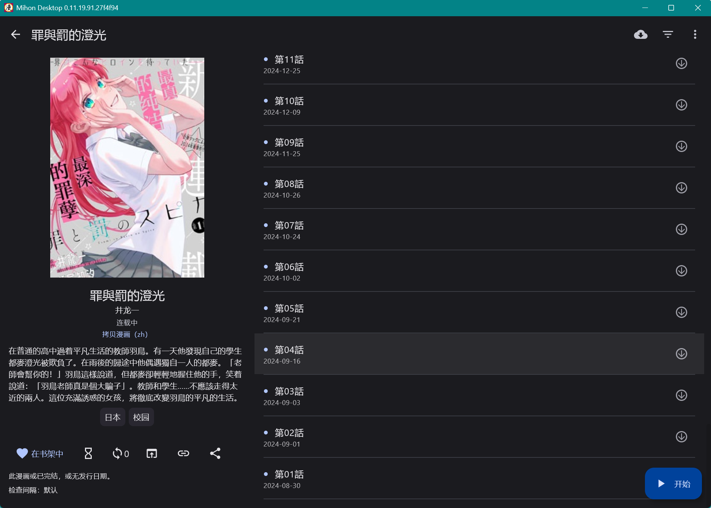

【作者页功能完善】
- 还有各种功能细节要打磨，但优先把它做得能用
- 对于作者显示为上传者、真正作者在标题中的，需要从标题解析作者
- 对于本子，有识别语言/汉化组以筛选的必要————是不是应该考虑对图源插件进行升级

【同步性能优化】
- 同步空间创建时对于密码的提示还是太弱了，应该改为默认不创建密码，需要创建密码则用小字按钮。

【需求池】
- 看完就删除按作品设置
- 汉化组广告页剔除功能
- 桌面端C键修改跨页匹配
- 构建性能最大化，之后要看看成效

【BUG列表】
- 【自动跨页匹配】的开关是默认关，且在【单页式】的分类下
- 章节列表会被开始按钮挡住